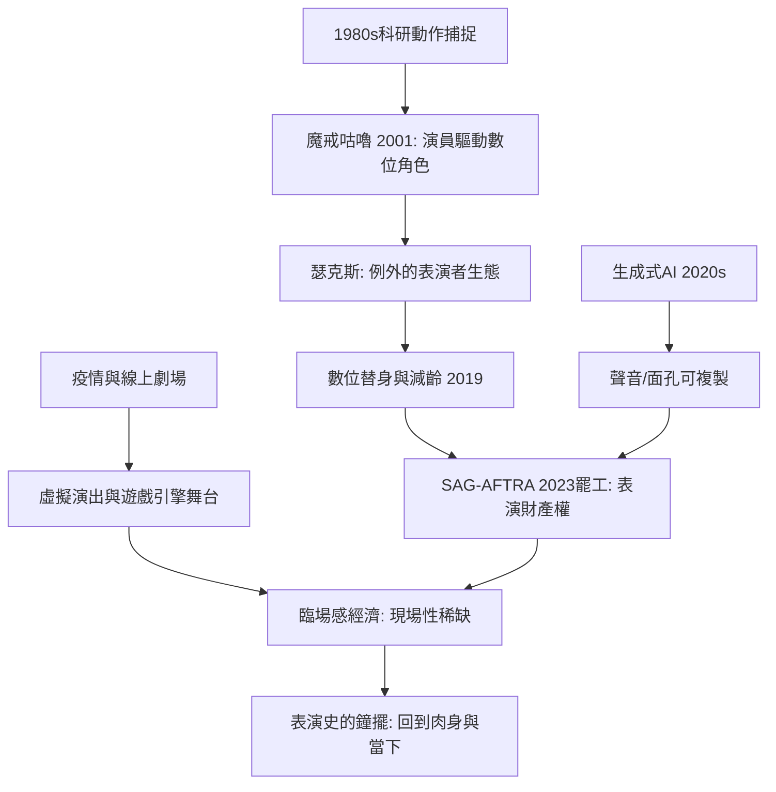

# 10.2 動態捕捉、虛擬演員與AI時代：表演的最後邊界

時間：1980年代至今

## 從光點到安迪·瑟克斯

表演的數位化始於科研而非藝術：1980年代，動態捕捉（mo-cap）技術先在生物力學與運動醫學中出現（測量關節運動的感光追蹤），隨後被遊戲與電影工業吸納。真正的分水嶺是安迪·瑟克斯（Andy Serkis）：他在《魔戒》（2001至2003年）中飾演咕嚕（Gollum）——首次由一位「演員」的完整身體表演驅動的數位角色；他在片場穿著捕捉服、貼滿反光標記，攝影機記錄他的動作與表情數據，再由電腦生成咕嚕的面孔。2014年他在《猩球崛起》系列中飾演的凱撒，把「動作捕捉明星」變成了一種新的演員類型。

瑟克斯的表演引發了一場至今未決的學術與產業爭論：動作捕捉演員是不是演員？奧斯卡是否應頒獎給數位角色？替角色上色的動畫師與提供「靈魂」的演員，哪一個才是表演者？這場爭論與19世紀末「攝影會不會取代繪畫」的爭論結構完全相同——新技術總是先被問「取代」，再被理解為「新藝術門類」。瑟克斯後來成立動作捕捉研究機構（the Imaginarium），試圖證明：數位角色仍是「表演」——只是身體的演出被延後、被放大、被無限編修。

## 表演的存取革命與「數位替身」

21世紀的兩項技術使表演脫離了肉身的時間性。其一，臉部與聲音的數位替身（digital double/de-aging）：演員的年輕面孔由AI從舊片素材重建（《愛爾蘭人》2019年全片「減齡」，老羅勃·狄尼羅與喬·佩西在同一段裡是24歲也是70歲）；已故演員「復活」演出（如《星際大戰》系列中處理的舊素材）。其二，語音合成與類型轉換，逐漸能夠「生成」專業配音。表演數據成為一種資產：演員的身體與聲音可以被掃描、儲存、複用——「版權」與「肖像權」議題由此爆發：2023年美國演員工會（SAG-AFTRA）大罷工，核心訴求之一正是管控生成式AI對演員數位替身的濫用與報酬——這是表演史上第一次，罷工的核心問題不是薪資水平而是「表演的財產形態」。

## 虛擬劇場與線上表演

疫情（2020年起）加速了線上劇場：倫敦國家劇院的 NT Live 高清放映（2009年起攝製，2020年疫情期間全面免費上線 NT at Home）、Zoom 劇場、與遊戲引擎中的虛擬演出紛紛出現。2020年代，虛擬歌姬、虛擬主播（VTuber）與AI生成角色成為新一代「表演者」；他們的「表演」由沒有肉身的程序生成，商業收入與情感影響力卻已與真人明星比肩。這把「臨場感」問題推向極端：當表演沒有身體、也沒有「此刻」，觀眾究竟在共處什麼？

## 「呼吸」的回歸

有意思的是，數位越強大，「現場性」的價值反而越貴。21世紀的劇場經濟數據顯示：沉浸式劇場、音樂會與現場演出的比重增長，票價顯著上漲——因為數位內容可以無限複製，而「同時同地的表演」天然稀缺。表演史的鐘擺在此完成一個大圈：從酒神祭的肉身狂歡出發，經過面具、寫實、方法、鏡頭與數據，最後回到那不可複製的一刻——兩個人在同一個空間裡呼吸同一種空氣。

但這不是結束。AI 語音與動作生成（2020年代 AI 配音、虛擬直播主、生成式短劇）正處於19世紀末攝影剛剛出現的位置：今天所有的驚呼，三十年後都會變成一段歷史注腳。可以確定的是：每一次表演載體的革命（面具→文字→舞台→鏡頭→數據），都沒有取消表演，只是不斷追問同一個問題──「扮演別人」的極限在哪裡？

