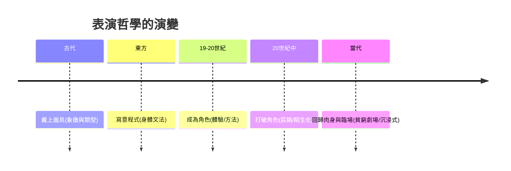

# 戲劇的故事：從神聖祭儀、劇場革命到鏡頭與虛擬舞台的表演史詩

戲劇有兩條並行的血統：一條是劇本文學與劇場制度（誰寫、誰出錢、在什麼空間上演、給誰看），一條是表演體系與演員技藝（身體、面罩、情緒、訓練）。本書將兩線交織，從雅典酒神祭的合唱中走出第一個演員，經過莎士比亞的環球劇場、中國京劇的寫意程式、斯坦尼斯拉夫斯基的心理革命，走到布萊希特的批判、葛羅托斯基的肉身、白蘭度的銀屏、沉浸式劇場與AI時代的數位替身。每篇皆標註關鍵人物、年份與前因後果——政治、經濟、技術、制度與思想如何共同驅動表演的每一次革命。

## 第一篇：戴上面具的神聖狂歡——戲劇與表演的誕生（古代篇）

* 第1章-酒神節、面具與古希臘劇場
    * [1.1-酒神節的歌隊：泰斯庇斯如何從合唱中站出來](01.1-酒神節的歌隊：泰斯庇斯如何從合唱中站出來.md)
    * [1.2-面具、高底靴與聲學奇蹟：古希臘表演的技術體系](01.2-面具、高底靴與聲學奇蹟：古希臘表演的技術體系.md)
* 第2章-東方的寫意神韻：梵劇、儺戲與宋元雜劇
    * [2.1-《舞論》與味：印度梵劇的表演科學](02.1-《舞論》與味：印度梵劇的表演科學.md)
    * [2.2-儺戲、參軍戲與宋元雜劇：中國戲劇從祭壇走向瓦舍](02.2-儺戲、參軍戲與宋元雜劇：中國戲劇從祭壇走向瓦舍.md)

## 第二篇：環球舞台與東方集大成（文藝復興至18世紀）

* 第3章-即興喜劇與莎士比亞的環球劇場
    * [3.1-即興喜劇的面具與Lazzi：專業演員的產業革命](03.1-即興喜劇的面具與Lazzi：專業演員的產業革命.md)
    * [3.2-莎士比亞的環球劇場與莫里哀：兩種觀眾的兩種劇場](03.2-莎士比亞的環球劇場與莫里哀：兩種觀眾的兩種劇場.md)
* 第4章-能樂與京劇：東方表演體系的終極定型
    * [4.1-世阿彌與《風姿花傳》：能樂的幽玄與花](04.1-世阿彌與《風姿花傳》：能樂的幽玄與花.md)
    * [4.2-徽班進京與京劇：程式與虛擬表演的極致](04.2-徽班進京與京劇：程式與虛擬表演的極致.md)

## 第三篇：第四道牆與寫實主義的心理革命（19世紀末至20世紀初）

* 第5章-寫實主義與第四道牆
    * [5.1-第四道牆的誕生：易卜生、契訶夫與安托萬的客廳革命](05.1-第四道牆的誕生：易卜生、契訶夫與安托萬的客廳革命.md)
    * [5.2-小劇場運動：審查制度催生的前衛溫床](05.2-小劇場運動：審查制度催生的前衛溫床.md)
* 第6章-斯坦尼斯拉夫斯基與體驗派
    * [6.1-莫斯科藝術劇院：斯坦尼斯拉夫斯基的體驗派革命](06.1-莫斯科藝術劇院：斯坦尼斯拉夫斯基的體驗派革命.md)
    * [6.2-魔法的「如果」：情感記憶、最高任務與貫穿動作](06.2-魔法的「如果」：情感記憶、最高任務與貫穿動作.md)

## 第四篇：打破第四道牆——前衛革命與方法演技（20世紀中）

* 第7章-生物力學、史詩劇場與殘酷劇場
    * [7.1-梅耶荷德的生物力學：演員作為精密機器](07.1-梅耶荷德的生物力學：演員作為精密機器.md)
    * [7.2-布萊希特的陌生化與阿爾托的殘酷劇場](07.2-布萊希特的陌生化與阿爾托的殘酷劇場.md)
* 第8章-美式方法演技的狂潮
    * [8.1-演員工作室：斯特拉斯堡與方法派的誕生](08.1-演員工作室：斯特拉斯堡與方法派的誕生.md)
    * [8.2-白蘭度與好萊塢：方法演技成為全球標準](08.2-白蘭度與好萊塢：方法演技成為全球標準.md)

## 第五篇：回到肉身——貧窮劇場與當代表演（20世紀末至今）

* 第9章-貧窮劇場、空的空間與肢體劇場
    * [9.1-葛羅托斯基的貧窮劇場：演員與觀眾的肉身對峙](09.1-葛羅托斯基的貧窮劇場：演員與觀眾的肉身對峙.md)
    * [9.2-空的空間與樂寇學派：布魯克與當代肢體劇場](09.2-空的空間與樂寇學派：布魯克與當代肢體劇場.md)
* 第10章-鏡頭、沉浸式與AI時代的臨場藝術
    * [10.1-鏡頭、微表情與沉浸式劇場：觀眾走進戲裡](10.1-鏡頭、微表情與沉浸式劇場：觀眾走進戲裡.md)
    * [10.2-動態捕捉、虛擬演員與AI：表演的最後邊界](10.2-動態捕捉、虛擬演員與AI：表演的最後邊界.md)

## 核心線索

戲劇史的四維度：表演哲學（面具到肉身）、空間邊界（劇場到無邊界）、觀演關係（共祭到共謀）、載體技術（聲量到數據）。讀完全書，你會認得同一個問題如何在三千年裡被反覆追問：扮演別人的極限，究竟在哪裡？
