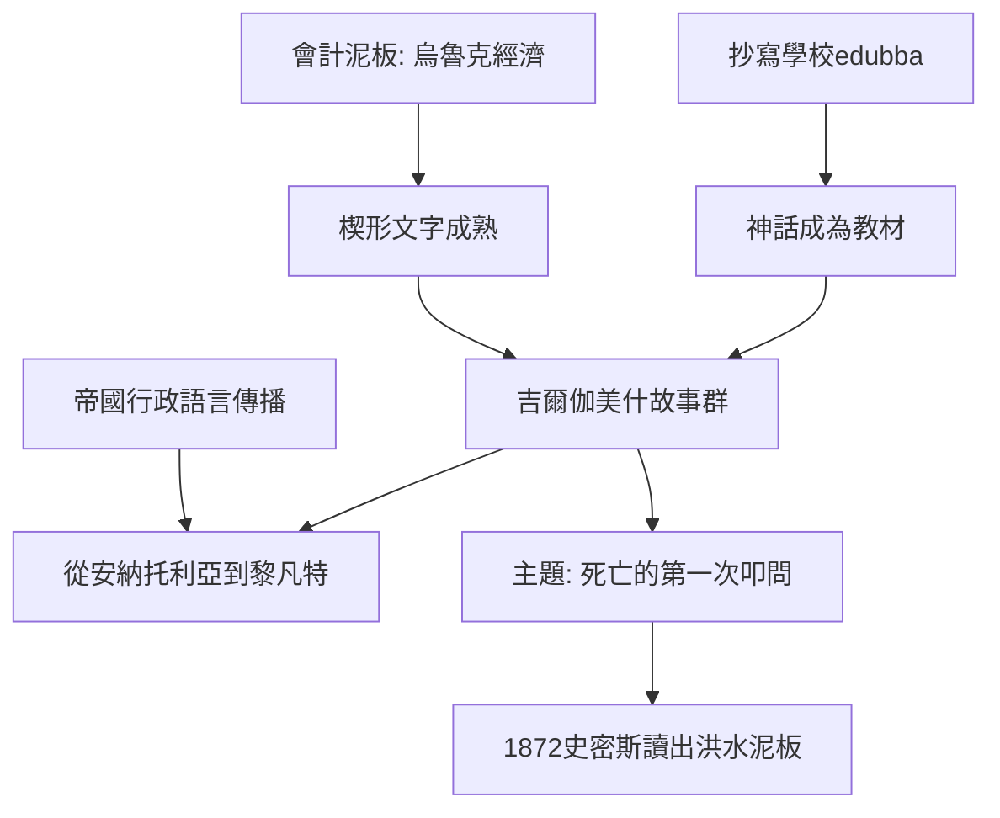

# 1.1 吉爾伽美什：人類最早的文學叩問

時間：約西元前2100年至前1200年

## 泥板上的國王

《吉爾伽美什史詩》（Epic of Gilgamesh）的素材來自一位可能真實的烏魯克國王（蘇美背景的王名見於約西元前2700年前後的王名表）。故事在蘇美語詩歌中被傳誦數百年，約西元前十八至十七世紀在巴比倫被整合成篇，至標準巴比倫版本（以阿卡德語寫就，約前十三至十二世紀，敕定者常歸於抄寫者辛雷奇烏尼）共刻於十二塊泥板。

這部作品史學上的巨星時刻發生在1872年：大英博物館的喬治·史密斯向公眾宣布他在泥板碎片中讀到了一段與《聖經》諾亞洪水幾乎同構的故事（「洪水泥板」的宣布引發倫敦報紙的轟動，報社隨即資助他在庫爾雲吉遺址繼續發掘，並如願找到缺失的殘片）。文學史因此被顛倒了一次順序：不是《聖經》孕育遠古傳說，而是兩河的口頭傳統更早寫下了洪水——這個發現也標示了「楔形文字解讀學」（亞述學）作為一門學科的制度化。

## 首次文學叩問：死亡與友誼

故事的主線是一場對死亡的哲學追究：半神英雄吉爾伽美什在摯友恩奇都死後，第一次被「我也會死」的意識擊穿，徒步去找曾得永生的烏特納皮什提姆；得到的答案是沒有解法，唯有人類的分內事——建城、治理、留下功業。第七塊泥板寫「他躺在地上，七天七夜」與一句刻骨的話：「要我和他一樣躺下，今生不復起來嗎？」這是人類文獻中最早把「對死亡的恐懼」作為結構主題的作品：它不提供宗教安慰，而提供一種存在主義式的誠實。

## 為什麼是兩河

可能性有三重地基。其一，書寫的成熟：楔形文字自前四千紀末的會計用途（烏魯克的泥板經濟）演化約千年，至前三千紀已有足夠容量承載敘事——文學需要先有「可寫的制度」。其二，宮廷與抄寫學校（edubba）：蘇美阿卡德的書吏培養體系把神話、頌詩與對話文學（如《農夫曆書》所以教人的對話體）當作練習題材——「文學」最初是教育制度的旁產品。其三，跨語傳播：蘇美語滅口之後，阿卡德通行千餘年，使烏魯克的王成為從安納托利亞（赫梯譯本）到黎凡特的共同文學財產。文學的全球化，第一波就是靠帝國行政語言完成的。

