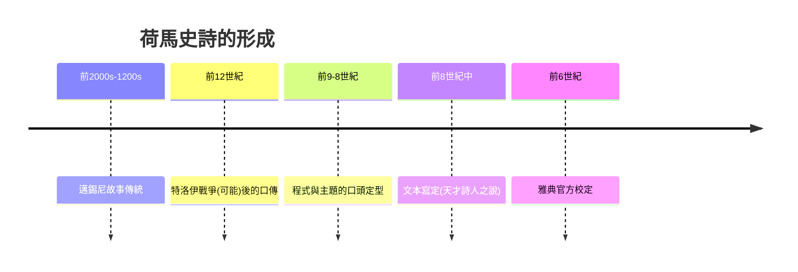

# 1.2 荷馬與口頭詠唱的英雄

時間：約西元前八世紀

## 沒有作者的作品

《伊利亞特》與《奧德賽》的作者「荷馬」，在古代已有七個城市爭奪其出生地，而現代學界的主導假說（米爾曼·佩里的1920至30年代假說，後經阿爾伯特·洛德的田野驗證）是：這兩部史詩是口頭詩歌傳統的結晶——由多代歌者（aoidoi）傳唱、經某位天才詩人於前八世紀中葉定型，並在前六世紀雅典僭主庇西特拉圖時代被官方校定（「庇西特拉圖校訂說」來源於古代傳統記載）。佩里與洛德在1930年代對南斯拉夫史詩歌手的田野錄音顯示：口頭詩人以「程式」（formula，固定的形容語沛——「捷足的阿基里斯」「持盾的赫克托」）與「主題」（theme）即興組裝數千行詩歌——韻律的六步格本身是記憶技術。荷馬史詩因此不是「寫出來的」，而是「被唱出來再被寫下來的」。

## 為什麼是前八世紀

這個年代有制度背景。其一，我們在本文學背後看到的鐵器時代的城邦復興（希臘黑暗時代結束，貿易與殖民起步，與東地中海的文字重新引入——希臘字母改自腓尼基字母，加元音字母，形成「音節可全錄」的文字，這是希臘能記錄長詩的技術前提）。其二，貴族教育需求：好戰的小邦需要一套「貴族倫理」的載體，荷馬史詩提供了Timē（榮譽）、Xenia（客誼）、Kleos（不滅的名聲）的完整課程——柏拉圖後來要驅逐荷馬時，恰恰證明了它已是教育主幹。其三，泛希臘節慶：奧林匹亞與德爾斐的賽會（從前八世紀定期化）以「吟誦荷馬」為儀程，一支詩歌需要能被全希臘人「勾連」，動用了跨邦的身份工程。

## 命運悲劇的結構發明

《伊利亞特》敘事技術上有一個影響後世兩千年的決定：它不講整場特洛伊戰爭（十年），而只講其中五十一天，聚焦阿基里斯的憤怒與平息——「以憤怒開篇」的單一主題結構。這種「從巨大事件中切出一個情感脊柱」的做法，是西方敘事的工程學基礎；《奧德賽》則貢獻了「歸途與身分驗證」的結構套件（化名、回述、認親），成為後世流浪敘事與冒險小說的母版。同時兩部詩把「神」降到背景解釋者的位置，把選擇與責任壓到人身上——文學主角的下降（由神而英雄、而人）自此啟動。

## 口傳的遺產

口傳時代留下的技術我們仍在用：程式語（我們說「睜眼就是清晨」，荷馬說「玫瑰指的黎明」）、反覆段落（宴席、獻祭、葬禮的「積木」）、與「起頭呼叫Muse」的敘事授權儀式。當亞里斯多德在《詩學》以荷馬為「詩的立法者」分析時，口頭的荷馬已被寫定的文本取代——但「唱」的傳統（朗誦、引用、在心中默誦）一直延續到今日的閱讀文化。文學史上第一次「口頭與書面的交接」，就發生在這兩部詩身上。

