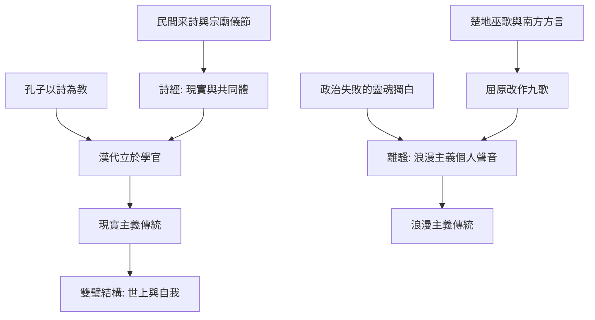

# 2.1 詩經與離騷：現實與浪漫雙璧

時間：約西元前1000年至前3世紀

## 詩經：從田間歌謠到經典

《詩經》收錄約西元前十一至六世紀的詩歌三百零五篇，分風、雅、頌三體。風詩（國風）源自各地民間歌謠的蒐集——先秦文獻載有「采詩」制度之說（此制度的具體運作存疑，但歌謠經官方整理是可確認的事實）；雅頌則出自宗廟與朝會。它成為「經」是一個制度過程：孔子（前551至前479）以《詩》為教（「不學詩，無以言」），戰國儒門傳習，至漢代立於學官（齊詩、魯詩、韓詩三家與毛詩系統並行，後毛詩獨傳）。詩經因此不是「一個作者的書」，而是口頭歌謠 + 禮儀制度 + 教育經典三段工程的產物。

詩經的兩個技術發明影響東亞兩千五百年。其一，賦比興的手法（直陳、比喻、起興——以自然意象開頭轉入人事），成為中國詩學的基礎語法；其二，重章疊句的結構（同一句式反覆易詞），這是歌曲與吟誦的口頭遺產，同時定下了「低導性重複」的中國抒情技術。詩經的另一個貢獻在「現實主義」的傳統——《碩鼠》的刺政、《氓》的棄婦自述、《七月》的農事年曆：社會生活的日常（婚戀、勞役、徭役、饑饉）第一次成為文學主體，開啟了「詩「可以興，可以觀，可以羣，可以怨」的社會功能觀（孔子語）。

## 離騷：一個人的浪漫宇宙

楚辭的路線完全相反。戰國晚期，楚國（南方大國，巫風盛行、方言與音樂自成系統）出現屈原（約前340至前278）：貴族出身的政治家，被讒見疏，最終在秦軍攻破楚都後投汨羅江死（此結局出自《史記》屈原賈生列傳；屈原的生平細節在現代楚辭學有辯論，但其人與《離騷》《九歌》的關聯獲得主流承認）。《離騷》三百七十餘句的自述長詩，以「香草美人」的象徵系統（善香草本喻君子之德、美人喻理想君臣關係）、神遊天界的幻想與上下求索的結構，創造了中國文學的第一個「浪漫主義」個人聲音——它是一首政治失敗者的靈魂獨白，卻以宇宙規模完成。

楚辭的技術根基有兩項。其一，句法的解放：「兮」字的頓挫打破詩經四言的方正，把南方歌謠的節奏層次引進書面詩；其二，巫祭音樂的底層：《九歌》本為楚地祀神的歌舞歌詞（被屈原改作），那種「與神靈對唱」的結構來自儀式而非文本傳統。楚辭的傳播是另一個制度故事：淮南王劉安獻楚辭章句與《離騷傳》，劉向編定《楚辭》集，王逸作注（東漢），使南方的歌詩被整合為國家的文學經典。漢初騷體風行於宮廷（賈誼《弔屈原賦》即騷體系統），浪漫主義自此成為中國文學的固定支線。

## 雙璧的對照

詩經與楚辭合起來，形成中國文學「現實／浪漫」的雙源結構（這是後世文學史的常用框架）。其對照有詩學的意義：風多是集體的、匿名的、歌唱的；騷是個體的、署名的、獨白的。這個「匿名到署名」的轉變，與西方史詩到抒情詩、再到但丁自傳的演變可以對位——主體性的生長，是全球文學的共同方向。東亞的文學教育因此有兩個千年基準：寫社會，學詩經的觀與怨；寫自己，學騷的求索與象徵——兩者到唐代匯成杜甫與李白的雙峰（本書第5章的立場將再回到這條線）。

