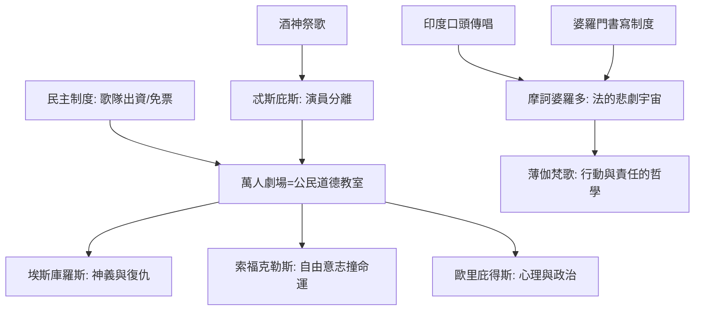

# 2.2 希臘悲劇與摩訶婆羅多

時間：約西元前五世紀至前四世紀

## 劇場的制度基因

希臘悲劇誕生於一種儀式發明：雅典酒神節的山羊之歌祭歌（tragōidia的字面來源），在公元前六世紀被改造為競賽劇——傳統記載將首創人歸於忒斯庇斯（約前534年首個悲劇競賽，演員首次離開歌隊獨言）。而至前五世紀，悲劇已經是雅典公民政治的一部分：每年城市酒神節，三位悲劇家各提交三部悲劇與一部羊人劇競賽；政府資助歌隊（富人的chorēgos義務出資）、發放免票（theorika，讓窮人也能觀劇）、設萬人露天演出場（狄俄尼索斯劇場）。劇場是雅典民主的身體教室：萬人同時面對同一場道德難題——「恐怖的行動在戶外、被全城凝視」的制度，塑造了悲劇「辯論式」的話語結構（悲劇裡的戲往往是公開的辯論）。

## 三大家的道德工程

三位大師劃出悲劇的道德譜系。埃斯庫羅斯（前525至前456，戰過馬拉松）把悲劇從一人之歌推向歌隊與雙演員的結構，其《被縛的普羅米修斯》與《阿伽門農》三部曲（前458年）處理神義與復仇的循環——以「錯誤必須被清算」的世界為底。索福克勒斯（前497至前406）推進到三位演員，其《俄狄浦斯王》（在雅典瘟疫的年代上演，前430年前後——此斷代為主流推測）以「明知會是噩夢，仍要查清真相」的人之自由意志撞上命運：他是「結構主義的悲劇家」（發現真相的過程即敘事本身）。歐里庇得斯（前480至前406）則把神移出劇場（神只在結尾以機械降神收拾攤子），讓心理與政治成為主體：《美狄亞》（前431年）以外邦女人殺子復仇的絕望，直面雅典家庭法與外邦人地位的殘酷——亞里斯多德在《詩學》坦言他不喜歡歐里庇得斯，正反映前者的「新作法」動搖了傳統。

## 印度的巨大平行：《摩訶婆羅多》

同一時代（印度史的斷代有辯論；文本層成於約前四世紀至公元後幾世紀），印度正在凝固《摩訶婆羅多》——約十萬頌的世界最長史詩（約七倍於《伊利亞特》與《奧德賽》之和）。其核心（般度族與俱盧族的家族內戰，以俱盧之戰為高潮）之上，附著一層「以法（dharma）的悲劇」為主題的道德宇宙：俱盧之戰前夕的《薄伽梵歌》（克里希那與阿周那的戰場對談）是對行動與責任、虔信bhakti與知識解脫的一次哲學綜合——印度教的「行動而不執著於果」的倫理就在這裡被書面定型。《摩訶婆羅多》以口頭傳統（早期的口頭傳唱確然）與婆羅門書寫制度的雙軌成長，其「插敘結構」（主線中嵌入百千個故事與法律、地理、宗教的材料）使它成為「文明的全書」——印度文化把法律、政治論與敘事裝在同一件作品裡。

## 共同點：道德在場的制度

希臘與印度兩個平行宇宙都在回答同樣的問題：若人有不必做惡的自由，為何還是會滑向悲劇？兩地答案機制不同——希臘是「悲劇的辯論」（劇場公共化的道德分攤），印度是「法與行動的分身」（責任與解脫的體系），但它們共同完成了一件文學史的大事：把「道德的難題」從神諭的附屬物，升級為文學的核心商業。這個升級的全部效益，要到莎士比亞與曹雪芹的時代才能兌現，但文學自此刻起是「道德的試驗室」。

