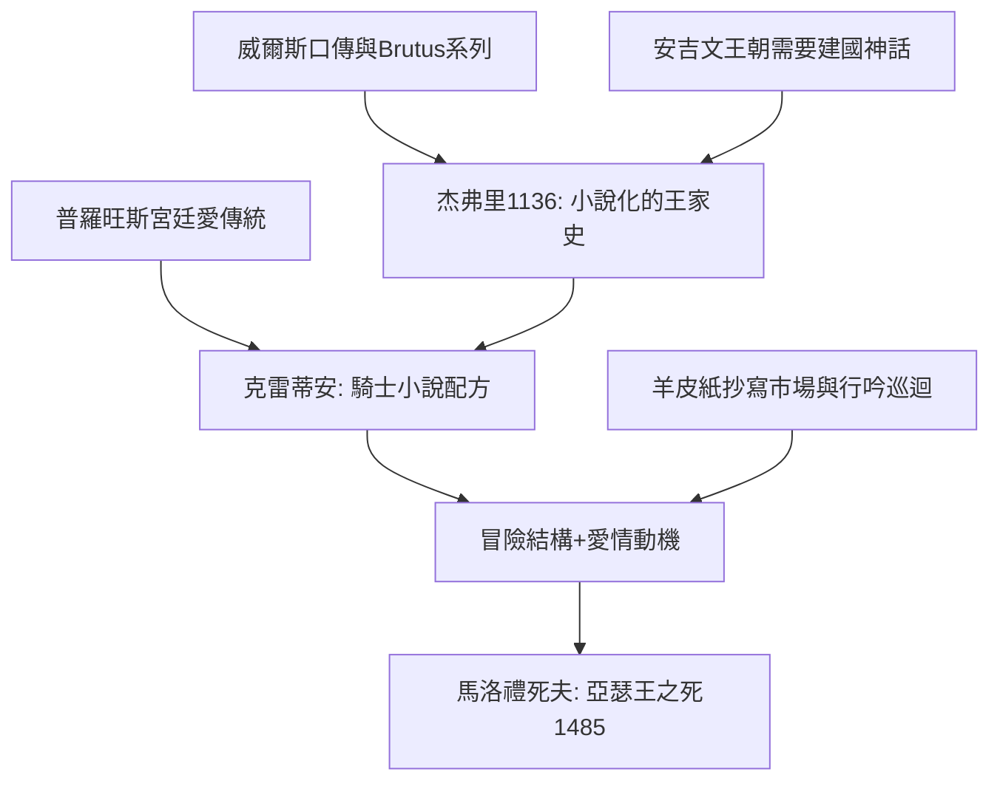

# 3.1 騎士文學與亞瑟王傳說

時間：十二世紀至十五世紀

## 一個傳說的兩次發明

亞瑟王史實的根基極薄：早期記錄（《英吉利史記》可見的Brutus系國王名單，以及威爾斯的《瑪比諾吉》早期材料）只提供一個戰勝撒克遜人的不列顛領袖。真正的文學誕生在兩個動能相加的時刻。其一，1136年前後，牛津的威爾斯教士杰弗里（Geoffrey of Monmouth）的《不列顛諸王史》把亞瑟架構成「征服全歐、擊退羅馬」的世界級帝王——這是一部「小說化的王家史」，其政治目的是安吉文王朝（亨利二世）需要一個不列顛的建國神話。其二，1150至1190年代，法語吟遊詩人克雷蒂安·德·特洛亞（Chrétien de Troyes）以宮廷詩的形式發明「騎士小說」：《蘭斯洛》《艾里克與艾尼德》等五部作品確立了後世騎士敘事的核心配方。

## 騎士精神的雙軌：武勇與愛情

克雷蒂安的貢獻可以拆成兩個系統。其一，「冒險的結構」：騎士離宮（forest of adventure）→試煉（怪物、勇士、迷宮）→歸返（宮廷的承認）——這個「循環結構」承自荷馬與中世紀的英雄傳說，但加上了兩項新要素：其一，愛情作為冒險的動機（騎士為夫人而戰——宮廷愛（fin'amor，源自普羅旺斯行吟詩人的南方傳統）第一次成為敘事的發動機）；其二，「道德的多層自由」：蘭斯洛與桂妮薇兒的私情、加拉哈的貞潔屬靈——愛的世俗與靈性兩個路線都在文本中被嚴肅對待，這是中世紀教會道德框架內的一種結構性張力（騎士小說因此有「表層道德、深層矛盾」的雙重性）。

## 書寫產業：詩人與宮廷的市場

騎士文學的傳播有物質條件。其一，十二世紀的「文學市場」：安吉文與諾曼宮廷的文化舞台（亨利二世的宮廷以威爾斯材質與布列塔尼傳說為素材，文書的翻譯與傳抄成為宮廷文化業的核心）；其二，羊皮紙的抄寫成本仍然高昂（一部騎士羅曼史需要兩百至四百羊皮），故讀者是貴族與富商；其三，行吟詩人與私塾文書的多樣消費（他們在城市與宮廷的巡迴朗誦是口頭吸引力的返回）。1470年前後，英國第一位印刷商卡克斯頓把《亞瑟王之死》（1485年刊行——托馬斯·馬洛禮以散文整理的亞瑟王故事彙編）印出版來，騎士文學第一次進入印刷市場——同時也表示：騎士作為一種政治現實（騎兵與封臣制度）已在火藥崛起的時代失去軍事意義，只有文學讓它永生。

## 騎士文學的歷史後果

騎士文學留下了三個敘事技術遺產：其一，「冒險的敘事節奏」（歸返結構），這是至今奇幻小說與遊戲設計的母板；其二，「愛情作為道德難題」（三角關係的敘事引擎）；其三，「理想化的社群想象」（圓桌≠政治現實，而是「共同體的化身」，由馬洛禮整理成《亞瑟王之死》（1485年卡克斯頓刊印本流傳至今））。十六世紀末，塞萬提斯將以嘲諷的方式關閉這個傳統（見第4章），但關閉的方式是承認：騎士文學確實擁有了一種「可以相信、可以移動世界」的力量——堂吉訶德讀過它就變成騎士，這是文學力量的第一次「社會學證明」。

