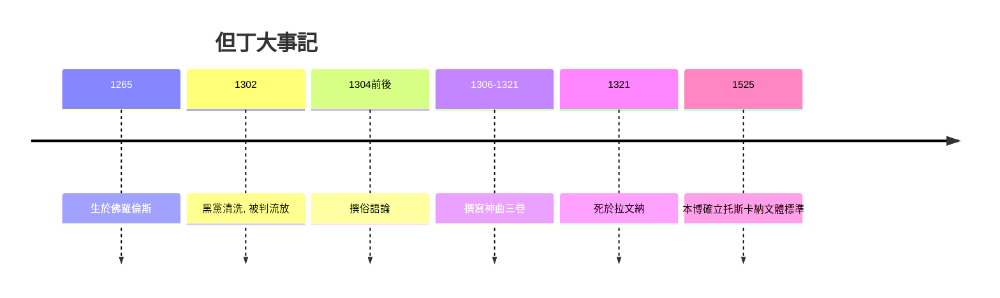

# 3.2 但丁神曲：俗語與新時代的橋樑

時間：1265年至1321年

## 流放者的宇宙工程

但丁·阿利吉耶里（1265至1321）的佛羅倫斯出身與政治身分是《神曲》的起點。他屬於「白黨」（以銀行業貴族為主的教皇派分支），在1302年黑黨奪權的清洗中被判流放（若回城將被處火刑）。此後近二十年他寄居意大利各城邦（維羅納的斯卡拉家族、拉文納的Guido da Polenta等），至逝世都未能回鄉。《神曲》的動機因此首先是政治的：一個被剝奪城市身分的流放者，寫一部宣告「靈魂的世界在宇宙間有序」的史詩，實質是把自己被扭曲的秩序重新安排給所有人——地獄與天堂的每一層，都是一張判決書。

作品的骨架是中世紀的，其意識是新的。敘事框架（地獄九層、煉獄七層、天堂九重天）取自經院哲學的宇宙論（聖托馬斯·阿奎那的綜合神學是背景）；而結構是數字的遊戲：全詩一百歌（地獄三十四、煉獄三十三、天堂三十三），分為三卷，全部以三為倍數——「三」呼應三位一體。技術上更重要的是但丁自創的terza rima（三行交替韻法：aba bcb cdc……），前一節的中行韻成為下一節的首尾韻，像鏈條一樣把全詩拉動不熄——這是一個「自訂結構法寫長詩」的罕見工程，此後意大利長詩的寫作者（從彼特拉克到近代的蒙塔萊）都活在其陰影下。

## 俗語的立法：文學史的語言轉折

更具革命性的是語言選擇。但丁以托斯卡納俗語寫《神曲》——此前高等文化的語言是拉丁文（大學與教會的專屬）。約1304年他撰《俗語論》（De vulgari eloquentia，未完成的拉丁文論文），主張以「俗語的精雅變形」建立全意大利的文學語言；《神曲》就是這個主張的執行。結果是一次制度性的語言事件：至文藝復興，人文學者本博（Pietro Bembo）在1525年的《俗語文體論》中正式把但丁、彼特拉克、薄伽丘的托斯卡納文體核定為意大利語的標準——但丁個人的創作，成為一個現代民族語言的基石（他因此被稱為「意大利語之父」）。歐洲各國的方言文學（英語、法語、德語的世俗經典）在十四至十六世紀相繼興起，但丁是這場「俗語轉向」最早的立法者。

## 神學與政治的雙重秩序

《神曲》同時是一份政治檔案。地獄裡有但丁的政敵與教皇（如把仍在世的教皇卜尼法斯八世預先放進地獄的火坑），天堂裡有他敬愛的先人與朋友——文學第一次成為「對現實權威的最終審判」。而作品對「人的位置」的處理是過渡性的：人不是純粹的罪人（中世紀）也不是純粹的自由人（文藝復興），而是在「自由意志與神恩」之間掙扎的主體——維吉爾（理性的導師）與貝雅特麗齊（啟示的導師）的接力，正是兩個時代的手手相傳。恩格斯後來稱但丁是「中世紀的最後一位詩人，同時又是新時代的最初一位詩人」，這句話精確描述了《神曲》在文學史上的橋樑位置。

