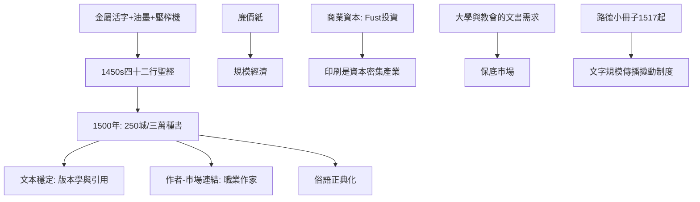

# 4.1 古騰堡印刷術：文學的大眾傳播

時間：1450年代起

## 美因茲的金匠發明

約翰內斯·古騰堡（Johannes Gutenberg，約1400至1468）是美因茲的金匠。他的發明不是單一點子，而是一個系統的整合：可拆鑄的金屬活字（鉛錫銻合金的鑄字模具——手抄本時代的「字」是雕刻的，他用鑄模讓同一字母可無限複製）、油性墨（傳統水性墨在金屬上不附著，他改良亞麻仁油的油墨）、以及改裝的螺旋壓榨機（來自釀酒業的壓酒機）。約1450至1455年間，他在美因茲印出著名的四十二行聖經（約印一百八十部，其中大部分印在紙上、少數印在羊皮紙上）。技術的每一個環節都來自既有的手工業傳統——印刷革命本質上是「手工業系統的重組」。

## 為什麼是此時此地：三重經濟條件

印刷術誕生的土壤與四項條件吻合。其一，紙的廉價化：德意志自十四世紀起有造紙廠（技術經意大利與法國傳入），紙的價格只有羊皮的幾分之一——沒有紙，印刷的規模經濟無從談起。其二，城市商業資本：古騰堡的項目是合資事業（投資人富斯特Johann Fust提供了大筆貸款，後來兩人因債務糾紛對簿公堂，1455年的訴訟紀錄是印刷史的重要檔案——印刷從一開始就是資本密集產業）。其三，識字人口與大學市場：德意志與意大利的大學城（巴黎、波隆那、帕多瓦）對教科書的需求巨大——早期印刷品的最大宗不是文學而是課本、贖罪券與文書範本。其四，教會與帝國的制度空間：聖職的文書需求（佈道書、教令）為第一批印刷品提供了保底市場。

## 傳播的速度與文學的新大陸

印刷的擴散速度驚人：1460年代意大利與法國有了印刷廠（威尼斯的阿爾都斯·曼努提烏斯Aldus Manutius自1494年起成為「口袋書」的發明者——他的八開本古典叢書使書第一次「可攜帶」，並以斜體字體與學者網絡成為歐洲人文主義的出版引擎）；至1500年，歐洲約有二百五十個城市有印刷所，存世書目（所謂incunabula「搖籃本」）約三萬種、估計印行逾千萬冊。對文學的影響是結構性的：其一，「文本的穩定」：手抄本時代的文本在轉抄中漂移（我們見過荷馬與聖經的異文問題），印刷本第一次讓千萬讀者讀「同一個文本」——批評、引用、版本的學問由此誕生；其二，「作者與市場的連結」：作家第一次可以「出版」並獲得名聲與讀者的直接回饋（人文主義者伊拉斯謨是第一批靠印刷市場成名的歐洲作家）；其三，「俗語的正典化」：但丁、彼特拉克、薄伽丘在十六世紀被本博等人核定為意大利語標準，靠的是印刷本的可比對性——語言規範需要穩定的文本，印刷提供了這個前提。

## 一場革命的伏筆

印刷術的直接後果在五十年內爆發：路德的宗教改革（1517年起）以印刷的小冊子傳播（他1517至1520年間的小冊子印行數以十萬計——「沒有印刷就沒有宗教改革」是史學的常用表述），證明了「文字的規模傳播」能撬動制度。文學的相應革命稍晚：十六世紀的意大利與西班牙（阿利奧斯托的《瘋狂的奧蘭多》、塞萬提斯的《堂吉訶德》），十七世紀的英國與法國——印刷市場培養出「職業作家」這個新社會階層，現代小說（下一章的主角）是這個階層與市場共同發明的文學形式。

