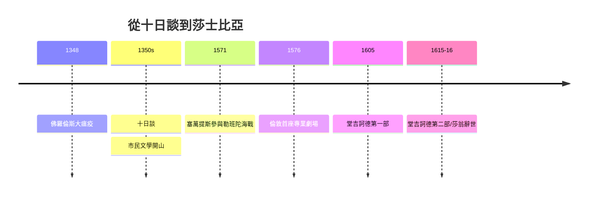

# 4.2 十日談、堂吉訶德與莎士比亞

時間：1349年至1616年

## 十日談：瘟疫後的世俗笑聲

薄伽丘（Giovanni Boccaccio，1313至1375）的《十日談》成書於1350年代：十個青年男女在1348年佛羅倫斯大瘟疫（黑死病奪走城中過半人口）中逃往鄉間別墅，十天每人每天講一個故事，共百篇。這部作品的形式是「故事的框架結構」（承自東方故事集《一千零一夜》的傳統與中世紀寓言集），內容則是徹底的世俗：商人的狡詐、修士的淫佚、妻子的機智、情慾的勝利——教會道德的嚴肅體系被笑聲貫穿。它的社會基礎是新興的城市商業階層：他們的語言（俗語散文）、他們的價值（機智、財富、生存）、他們的禁忌（對教會特權的嘲弄）。《十日談》因此是「市民文學」的開山之作，並確立了俗語散文敘事的可行性——但丁立俗語之詩，薄伽丘立俗語之散文。

## 堂吉訶德：第一部現代小說

米格爾·德·塞萬提斯（1547至1616）的人生是一部低調的冒險史：勒班陀海戰（1571）中左手致殘，回程被巴巴里海盜擄至阿爾及爾為奴五年，贖回後為西班牙王室收稅，因帳目問題入獄（據其自述，《堂吉訶德》的構思誕生於獄中）。《堂吉訶德》第一部1605年出版，立刻風行；第二部1615年出版（其間有人偽造續集，塞萬提斯在真續集中把偽書寫進情節反擊——「後現代」的手法早於後現代三百年）。小說的表面是一個玩笑：拉曼卻的窮鄉紳讀騎士小說讀瘋了，自封遊俠騎士，帶著農夫桑丘出門行俠，把風車當巨人、把旅店當城堡。深層則是對整個騎士文學傳統（第三章的主題）的系統拆解：堂吉訶德的瘋狂使「文學與現實的界線」成為小說的主題——這是現代小說的出發點：自覺地寫「敘事與真實的張力」。

塞萬提斯的技術創新有二。其一，「雙主角的辯證」：堂吉訶德（理想主義）與桑丘（經驗主義）在長途對話中互相滲透（桑丘越來越像騎士，騎士越來越清醒）——人物第一次「成長」，小說有了心理的縱深；其二，「多層敘事」：偽譯自阿拉伯史家熙德·哈邁特的手稿、被摩爾人翻譯——敘述者層層套疊，作者隱身。西班牙的社會背景同樣關鍵：帝國的黃金世紀正在衰退（白銀通膨、貴族氾濫、無地騎士階層的失落）——堂吉訶德正是「舊階級找不到新位置」的喜劇化身。

## 莎士比亞：劇場產業的巔峰

威廉·莎士比亞（1564至1616）是另一種制度的產物：倫敦的商業劇場。1576年起，倫敦有了專業劇場建築（The Theatre等），劇團以售票營利（劇場容納兩至三千人，一便士入場——低價使工匠與學徒成為主力觀眾），而劇作家是「產業的編劇部」：莎士比亞在張伯倫勳爵劇團（後為國王劇團）任股東劇作家，三十九部劇作在二十餘年間寫就，多數為特定劇團與演員（如喜劇演員Kemp與悲劇主角Burbage）量身定做。他的語言資產是英語的劇變期（早期現代英語的詞彙擴張、修辭教育的普及——文法學校的拉丁修辭訓練是他的語言底層）。他的文學成就在於把中世紀的道德劇、羅馬的塞內加悲劇、普魯塔克的傳記與意大利小說情節熔鑄為「人物大於情節」的戲劇：哈姆雷特的延宕、麥克白的野心與愧疚、李爾王的瘋癲——人物內心的矛盾第一次成為戲劇的主體。

1616年塞萬提斯與莎士比亞同年去世（一般紀年如此；兩人實際死亡的曆法差異有十日之別——西班牙用格里曆、英國用儒略曆）。這兩人標示了同一件事的完成：文學的主角從神明與騎士，徹底移交給「有矛盾的人」。下一章的啟蒙與小說革命，將在這個地基上建樓。

