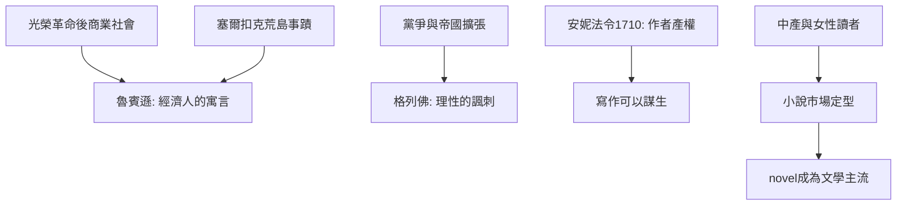

# 5.1 魯賓遜與格列佛：小說的崛起

時間：1719年至1726年

## 新中產的鏡子：魯賓遜

丹尼爾·笛福（Daniel Defoe，1660至1731）是倫敦的小商人、記者與政治小冊子作者（多次因文字獲罪上枷示眾）。1719年他出版《魯賓遜漂流記》，署名方式狡猾地假裝是魯賓遜本人的回憶錄——「以為是真的」是早期小說的核心行銷策略。故事的素材有真實原型：蘇格蘭水手塞爾扣克（Alexander Selkirk）獨自在南太平洋荒島生活四年多（1704至1709），其事蹟在笛福時代廣為流傳。但小說不是航海記事：魯賓遜在島上以帳簿式的理性清點資產（「善與惡對照表」）、馴化自然、重建英國式的小農經濟——他是「經濟人」（homo economicus）的第一個小說化身。時代的背景：英國光榮革命後（1688年起）的商業擴張、保險與股票市場的誕生（南海泡沫在1720年）、以及新教倫理把「勤勉與積累」定為德性。魯賓遜的孤島是資本主義的寓言舞臺：一個人 + 勞動 + 記帳 = 文明。書也毫不掩飾其殖民視角（星期五的馴服結構）——這正是它作為「時代鏡子」的誠實。

## 格列佛：理性的諷刺

喬納森·斯威夫特（Jonathan Swift，1667至1745）是愛爾蘭的教士與政治小冊子大師（他都柏林三一學院出身，後任聖派翠克大教堂教長），《格列佛遊記》（1726）表面是兒童冒險（小人國、大人國、飛島、慧駰國），實際是四枚政治炸彈：小人國的繩技與鞋跟黨諷刺英國宮廷與黨爭（高跟與低跟是輝格與托利的化身）；大人國的巨人之眼看穿歐洲「文明」的渺小與戰爭的荒謬；飛島（Laputa）諷刺脫離現實的皇家學院式科學；慧駰國（理性的馬）則把人類（Yahoos）貶為貪婪的獸類。斯威夫特的背景是啟蒙時代的內部批判：他不反理性，而反「以理性之名行傲慢之實」——這本書是英國諷刺文學的巔峰，也是文學對科學革命與帝國擴張的第一份系統性帳單。

## 為什麼小說在此定型

笛福與斯威夫特代表小說的兩翼（寫實的個人史／諷刺的虛構旅行），而他們的成功依賴四個社會條件。其一，讀者群：英國的都市中產與女性讀者（閒暇與教育使中產女性成為小說的第一主力市場——接下來的理查森《帕梅拉》1740年與菲爾丁正是為這個市場寫作）。其二，報刊與連載文化：笛福本人辦過《評論週刊》（1704至1713），新聞寫作與小說敘事共享「真實性修辭」。其三，版權制度：1710年英國的安妮法令（Statute of Anne）確立作者對作品的有限產權——「寫作可以謀生」首次有法律地基。其四，印刷與流通的規模化：倫敦的書商（當時的出版商兼零售商）網絡與流通圖書館，使一本小說可以賣到數千冊。小說（novel）作為一種「散文、寫實、關注個人命運」的形式，在此刻正式註冊為文學的主流——而東方在同一世紀也到達了古典長篇的頂點，下一節我們轉向曹雪芹。

