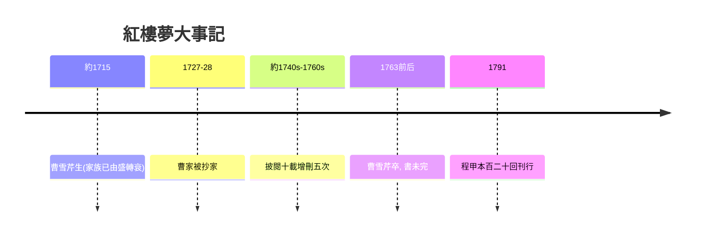

# 5.2 紅樓夢：東方古典小說的絕響

時間：約1750年至1791年

## 一個家族的百科全書

曹雪芹（約1715至1763，生卒年有異說）的家族史本身就是小說的素材庫：曹家是內務府包衣（皇家家奴編制），其曾祖曹璽之妻孫氏是康熙幼年保母，曹寅任江寧織造近二十年，兼皇帝在南方的耳目與詩文應酬中心——曹家的江寧織造府是康熙南巡的駐蹕之所（四次接駕的榮寵與虧空並存）。雍正即位後政治清算（1727至1728年曹家被抄家革職），家產蕩盡，曹雪芹晚年居北京西郊貧困著書，「舉家食粥酒常賒」是友人敦誠詩中留下的記錄。他批閱十載、增刪五次（小說開卷自述），未竟全書而逝；今傳百二十回本的後四十回，通行說法為高鶚與程偉元整理補續（1791年程甲本刊行——後四十回的作者歸屬至今是紅學的核心爭論）。

《紅樓夢》的規模在中國小說史上是斷代性的：賈府的興衰作為敘事骨架，但真正的內容是一個文明的全景——建築與園林（大觀園）、服飾與飲食、戲曲與詩社、醫藥與禮儀、宗教與管理（探春理家的經濟改革）、愛情與家族政治（寶釵與黛玉的選擇即家族的路線選擇）。魯迅的評價精準：「自有紅樓夢出來以後，傳統的思想和寫法都打破了。」打破了什麼？其一，人物：數百個人物皆有性格，主角賈寶玉是一個「拒絕仕途經濟」的異端少年——中國小說第一次以「不合時宜者」為價值中心；其二，敘事：線性的善惡報應結構被「盛極而衰、繁華即幻滅」的生命結構取代（「好了歌」的哲學框架貫穿全書）；其三，性別：女性第一次成為小說的價值高地（「女兒是水作的骨肉」——作者借寶玉之口把傳統性別秩序倒置）。

## 為什麼是十八世紀中葉

《紅樓夢》的誕生有制度土壤。其一，清代旗人體制的雙面性：包衣貴族的富貴與人身依附的脆弱，正好提供「鐘鳴鼎食之家一夕傾覆」的觀察位置——曹家的自傳性素材與此不可分。其二，小說傳統的累積：明代四大奇書（《三國》《水滸》《西遊》《金瓶梅》）已把章回體、世情寫實（金瓶梅尤為直接的先聲——魯迅稱紅樓夢「深得金瓶壺奧」）與人物群像的技術準備齊全。其三，印刷出版業：清代江浙與北京的書坊業發達，抄本與刻本的流通使「小說閱讀」成為士人與市民的消費（《紅樓夢》早期以抄本流傳，「開談不說紅樓夢，讀盡詩書是枉然」是嘉慶年間竹枝詞的記錄）。其四，思想氣氛：清代考據學與陽明心學的餘緒、以及明末以來「情」的哲學（湯顯祖《牡丹亭》「情不知所起，一往而深」的傳統），為寶黛愛情的形而上化提供了思想資源。

## 絕響的意義

《紅樓夢》是中國古典小說的頂點，也是終點：它把章回體的技術用到極限，其後的中國長篇要等白話文運動（1917年起，見第七章的平行時間）才重新出發。「紅學」作為一門顯學（評點、索隱、考證三大派的百年研究）本身也是文學現象：一部未完成的小說，靠其結構的未完成性，把讀者永久地拉進補全的衝動——這與西方的《神曲》註疏傳統、《聖經》訓詁傳統同構：偉大的文本製造自己的學術產業。下一節我們回到西方，看浪漫主義如何把「個人情感」推上文學的王座。

