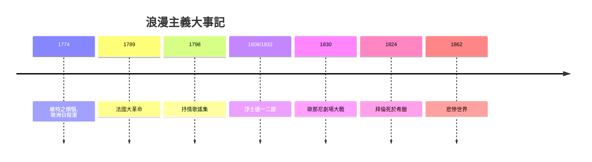

# 6.1 浪漫主義：雨果、拜倫與浮士德

時間：1790年代至1880年代

## 革命與情感的聯盟

浪漫主義不是一個流派，而是一次情緒的政權更替。它的政治起點是法國大革命（1789）：「人可以重新開始」的信念，把個人意志推上價值的頂點；它的哲學起點是盧梭（《懺悔錄》1782年出版——一個普通人以「我感受故我在」的姿態寫自傳，是浪漫主義的宣言前身）；它的美學宣言則是德國的狂飆突進運動（Sturm und Drang，1770年代：赫爾德論民族民歌、歌德《少年維特之煩惱》1774年——維特的自殺在歐洲引發穿維特裝的自殺潮，是文學力量的著名社會案例）與後來華茲華斯與柯勒律治的《抒情歌謠集》（1798年，英國浪漫主義的開山，其序言把詩定義為「強烈情感的自然流露」）。

## 三個國家的浪漫面孔

歌德的《浮士德》是浪漫主義的哲學之塔：第一部（1808年出版）寫浮士德與魔鬼賭約、葛麗卿的悲劇；第二部（1832年，歌德去世前數月完成，他寫了六十年）擴張到帝國政治、紙幣發明、希臘神話的復活與靈魂升天——「凡是自強不息者，終能得到拯救」的結尾，把「無限追求」本身定為人的救贖。拜倫勳爵（1788至1824）則是浪漫主義的明星現象：其「拜倫式英雄」（孤傲、憤世、有罪的貴族浪子——恰爾德·哈羅德與《唐璜》的主人公）成為全歐青年的模仿對象；他1823年赴希臘支持獨立戰爭、1824年病逝於米索朗基，使「為理想而死」的詩人形象與希臘獨立的民族主義敘事合流——文學家第一次成為國際政治的符號。雨果（1802至1885）是法國浪漫主義的制度化者：1830年《歐那尼》首演的劇場大戰（古典派與浪漫派觀眾在巴黎劇院喝倒彩與鼓掌對峙數週——法國文學史的著名戰役）確立浪漫派對古典規則（三一律）的勝利；《悲慘世界》（1862）與《巴黎聖母院》（1831）把「底層的苦難」與「情感的崇高」寫成史詩規模，其背景是十九世紀法國的都市化與社會矛盾。

## 浪漫主義的生產條件

浪漫主義的流行有具體的經濟與技術基礎。其一，印刷的廉價化與期刊：月刊、年鑑與旅行書的市場使詩與小說可以規模流通（司各特的歷史小說是1810年代歐洲的暢銷奇觀，其版稅模式也開創了作家的高收入時代）；其二，鋼琴與家庭音樂：浪漫抒情詩與藝術歌曲（舒伯特以歌德與繆勒的詩譜曲六百餘首）共享同一個「家庭客廳」的消費場；其三，民族主義的政治需求：赫爾德的民歌理論啟發各民族搜集自己的口頭傳統（格林兄弟的《兒童與家庭童話集》1812年起、芬蘭《卡勒瓦拉》1835年編成——民族文學是民族國家的文化基建）；其四，旅行的平民化：浪漫主義者把阿爾卑斯與萊茵從「險地」改寫為「崇高」的景觀，旅遊業與文學互相成就。浪漫主義的遺產是雙重的：它把「內心」與「民族」同時放上祭壇——而下一章的寫實主義，將對這兩個祭壇各澆一盆冷水。

