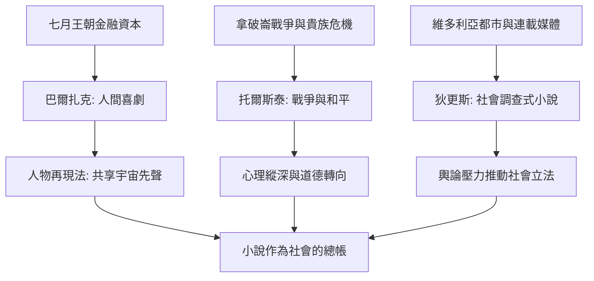

# 6.2 寫實主義：巴爾扎克、托爾斯泰與狄更斯

時間：1830年代至1880年代

## 社會學的文學形式

寫實主義（Realism）的宣言是法國的：畫家庫爾貝（1855年自辦「寫實主義」展館）與批評家尚弗勒里把「畫所見之人」的綱領移植到文學。但工程最早、規模最大的是巴爾扎克（1799至1850）：其《人間喜劇》（La Comédie humaine）計畫為法國社會寫一部「風俗史」，最終完成約九十部小說、兩千多個人物（他為人物建立重複出場的「人物再現法」——同一角色跨書出現，構成小說的連續宇宙，這是「共享宇宙」敘事的十九世紀先聲）。他的方法近乎社會學：分類研究（風俗研究、哲學研究、分析研究）、對巴黎的街道與行業做普查式描寫、以金錢為社會的血液（《歐也妮·葛朗台》《高老頭》的核心都是資產與親情的交易）。巴爾扎克的時代動力是七月王朝（1830至1848）的金融資本主義勃興：投機、遺產訴訟、新舊貴族與暴發戶的雜居——「高老頭的兩個女兒」是資本社會親情通脹的精確報表。

## 俄國的靈魂深度

托爾斯泰（1828至1910）把寫實主義推向兩個新維度。其一，規模與心理：《戰爭與和平》（1869）以五百餘人物與拿破崙戰爭（1805至1812）為骨架，但真正的技術是「歷史與家庭互為表裡」——戰場的宏觀與莫斯科客廳的微觀切換，安德烈與皮埃爾的內心演化成為另一條戰線；其《安娜·卡列尼娜》（1877）則以一句「幸福的家庭都是相似的」開篇，把婚姻、鐵路（安娜在鐵路邊的死亡意象——十九世紀的技術新物成為命運的象徵）與貴族社會的偽善寫成心理解剖。托爾斯泰的方法論見於其日記與創作筆記：不斷重寫開頭（安娜的開頭據研究改寫十餘次）、追求「每個人物的內在邏輯」。其二，道德的轉向：晚年托爾斯泰轉向宗教與倫理寫作（《復活》1899年），批判私有制與教會——文學家再次成為社會運動的中心（他1908年八十壽辰成為俄國反對派的精神事件，1910年出走途中病逝）。

## 英國的都市眼睛

狄更斯（1812至1870）是寫實主義的媒體形態：他十二歲進鞋油作坊做童工（父親因債入獄馬夏爾西監獄——這段經歷成為《大衛·科波菲爾》與《小杜麗》的債務監獄素材），後做記者與議會速記員，再以連載小說成為維多利亞時代的第一個「暢銷作家帝國」（《匹克威克外傳》1836年起以月刊分冊發行，每期數萬冊）。連載的形式塑造了他的技術：每章結尾必須「吊住讀者」，人物須在一章內立起來（誇張的外號與口癖正是連載的敘事經濟學）。他的社會功能是「調查報告式的小說」：《霧都孤兒》對童工與濟貧院、《荒涼山莊》（1853）對大法官法庭的訴訟拖延、《艱難時世》（1854）對功利主義教育與工廠制度的抨擊——維多利亞英國的社會立法背後常有狄更斯的輿論壓力。寫實主義三巨頭的共通點由此清晰：他們都以「小說作為社會的總帳」為己任，把文學從浪漫的內心拉回外部的世界——而下一章，二十世紀將把這個外部世界炸碎。

