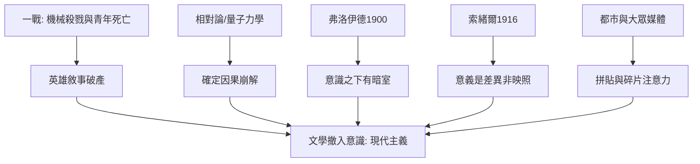

# 7.1 一戰後的精神危機

時間：1910年代至1930年代

## 被炸碎的敘事

第一次世界大戰（1914至1918）對文學的殺傷是雙重的。其一，物理與人口：歐洲一代的青年知識分子戰死（英國的「戰爭詩人」歐文與薩松的直接戰壕經驗、法國的阿波利奈爾傷亡、德國青年作家的成批陣亡），凡爾登與索姆河的絞肉機（各傷亡逾七十萬）把「英雄敘事」的原料徹底毀滅。其二，認識論：戰壕裡的經驗無法用十九世紀的敘事容器承載——大兵團的機械殺戮、毒氣、炮火數月不斷的拉鋸，任何「情節—高潮—意義」的結構都顯得虛偽。雷馬克《西線無戰事》（1929）以碎片化的日常記錄取代英雄故事；喬伊斯的《尤利西斯》（1922）則把「一天」寫成宇宙——這不是巧合：傳統的線性敘事（起因、過程、結果、意義）正是十九世紀寫實主義與進步史觀的敘事版本，一戰把這個史觀炸掉了。

## 理論的平行崩解

文學之外，知識的各領域同步崩解。物理：愛因斯坦的相對論（1905、1915）與量子力學（1920年代）推翻了絕對時空與確定因果；心理：弗洛伊德《夢的解析》（1900）把「我」分割為意識、前意識與潛意識——人的內心不是透明的理性房間，而是有暗室的迷宮；哲學：尼采「上帝死了」（十九世紀末）的餘波在戰後被兌現，維也納學派的邏輯實證主義（1920年代）則對形而上學宣戰；語言：索緒爾的語言學講義（1916年整理出版）指出意義是符號間的差異而非對實在的映照——「語言不反映世界」的種子在此埋下（後現代的理論基礎）。文學的意識流與荒謬，與這些理論是同一場危機的不同部門。

## 都市、報紙與新的時間感

現代主義還有一個日常地基：大都會與大眾媒體。倫敦、巴黎、柏林與紐約在1900至1930年間完成電燈、地鐵、電話與報紙的普及——喬治·西美爾1903年的《大都會與精神生活》精確描述了都市經驗：刺激的連續轟炸迫使人心「戴上防衛的面罩」、以計算與疏離應對。報紙的版面（廣告、標題、剪輯、跳讀）訓練了新的注意力結構——喬伊斯與艾略特的蒙太奇手法（艾略特《荒原》1922年由碎片與引用拼貼而成，註腳密如學術論文）正是報紙拼貼技術的文學化。時間感的改變同樣深刻：鐘錶時間、火車時刻表與生產線的泰勒制（1911年泰勒《科學管理原理》）把時間切割為標準單位——普魯斯特與喬伊斯以「心理時間」對抗「鐘錶時間」，是文學對工業時間體制的正面反擊。

## 一個綜合診斷

一戰後的文學危機可以壓縮為一句話：外部世界不再可信，內部世界尚未可測——文學從「描寫社會」撤入「描寫意識」。這次撤離不是逃避，而是遷移：既然十九世紀的「社會鏡子」無法解釋戰壕與毒氣，就必須發明新的儀器。下一節的三件儀器——意識流、心理時間與異化寓言——就是這次遷移的成果。

