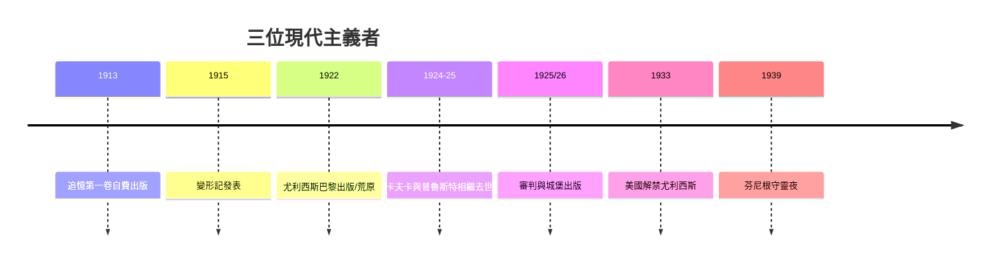

# 7.2 喬伊斯、普魯斯特與卡夫卡

時間：1913年至1930年代

## 普魯斯特：記憶的工程

馬塞爾·普魯斯特（1871至1922）出身巴黎富裕資產階級（父親是著名醫生），因哮喘半隱居於軟木貼面的臥室，以十四年寫成《追憶似水年華》（共七卷，1913年自費出版第一卷《在斯萬家那邊》，其後由新資本主義出版社NRF接手；最後三卷在他死後出版）。全書兩百餘萬字、兩千餘人物，情節卻極簡：一個敏感的敘述者如何從社交、愛情與藝術中，逐步發現「失去的時間可以被藝術找回」。其技術核心是「非自主記憶」：一塊瑪德萊娜蛋糕的滋味瞬間打開整個貢布雷的童年——感官觸發的記憶比理性回憶更真實（這與柏格森的「綿延」時間哲學同構，普魯斯特讀過柏格森——兩人是姻親）。《追憶》的文學史意義：把「時間」而非「事件」定為小說的主題，把敘事的第一人稱推到哲學分析的深度。

## 喬伊斯：一天之內的宇宙

詹姆斯·喬伊斯（1882至1941）是都柏林人，自稱「為了一種藝術的道德、智力與精神解放」而自我流放（1904年起定居歐陸的里雅斯特、蘇黎世與巴黎）。《尤利西斯》（1922年在巴黎出版，英美曾因「淫穢」查禁數年——美國1933年聯邦法院判決解除禁令，成為審查制度的里程碑判例）寫1904年6月16日一天之內，三個都柏林人（廣告推銷員布盧姆、教師斯蒂芬、布盧姆之妻莫莉）的漫遊。它把荷馬《奧德賽》的十八個篇章做為隱性骨架（每章對應一個史詩場景與一種寫作技術——報紙頭條體、問答體、戲劇體、獨白體），而巔峰是結尾莫莉的四十頁無標點內心獨白——意識流的技術極限。喬伊斯的貢獻是「方法的百科全書」：一日、一城、兩條意識的平行線，證明敘事可以承載幾乎無限的形式實驗（其後的《芬尼根守靈夜》1939年更把語言本身推向多語混融的極端）。

## 卡夫卡：異化的寓言

弗蘭茲·卡夫卡（1883至1924）是布拉格的猶太人、保險公司的法務職員（白天上班、夜裡寫作，與父親的權威鬥爭是其終身主題——《致父親的信》是著名的精神檔案）。《變形記》（1915年發表）的開頭是文學史上最著名的一次暴力：推銷員格里高爾一覺醒來變成甲蟲——而全書的敘事重點不是「為什麼」，而是「之後」：家人如何從照顧到嫌惡，異化如何完成。卡夫卡的三部長篇（《審判》《城堡》《美國》，均在其死後出版，他遺囑要求焚毀，遺囑執行人布羅德違命保存）建立了「卡夫卡式」的語法：無名的官僚系統、無法抵達的目標、罪名的不可知——一個個體被制度與語言圍困的存在處境。其時代注腳：布拉格德語猶太少數族裔的身分懸置、奧匈帝國官僚體制的龐大、以及他1917年確診肺結核後的死亡預感。

## 三人的共同發明

三人各佔一個位置：普魯斯特發明「時間的心理結構」，喬伊斯發明「意識的敘事技術」，卡夫卡發明「異化的存在語法」。他們的共同點是放棄「全知敘述者」——十九世紀的上帝之眼被撤走，敘事的位置移到人物的顱骨之內或系統的迷宮之中。這是文學主角下降的終點站：不是英雄，不是市民，而是「一種意識」與「一種處境」。二十世紀下半葉的文學（貝克特、羅伯-格里耶、乃至拉美的魔幻寫實）都在這個地基上施工。

