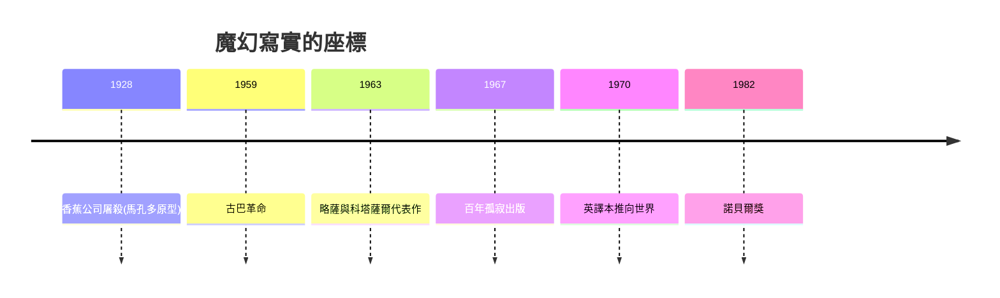

# 8.1 百年孤寂：魔幻寫實主義

時間：1967年前後

## 馬孔多的誕生

加夫列爾·加西亞·馬爾克斯（Gabriel García Márquez，1927至2014）生於哥倫比亞的阿拉卡塔卡，由外祖父母撫養：外祖母以「面無表情地講最不可思議的事」的方式講鬼故事與家族傳說，退役上校的外祖父則講千日戰爭（1899至1902年哥倫比亞內戰）的親歷記憶——「魔幻」與「寫實」兩種敘事聲部，在他童年就已合流。他做過記者（卡塔赫納與波哥大的報社），以記者的精確加上外祖母的語調寫小說；1965年駕車赴阿卡普爾科度假途中靈感降臨，返程閉門十八個月寫出《百年孤寂》，1967年布宜諾斯艾利斯出版（南美出版社Sudamericana初版八千冊，數月內售罄，至1970年代已譯成數十種語言），1982年獲諾貝爾文學獎。

## 技術：把神話裝進報紙語法

《百年孤寂》寫布恩迪亞家族七代人與馬孔多小鎮的百年興亡。其魔幻寫實（magic realism）的操作有明確技術：敘事者的語調自始至終是「報導式的鎮定」——美麗的蕾梅黛絲抓著床單升天、小鎮集體失眠與失憶瘟疫、一場下了四年十一個月零兩天的雨——神奇事件以精確數字與平靜語氣呈現，反而「真實事件」（香蕉公司屠殺三千工人、屍體由火車運走投入大海——原型是1928年聯合果品公司大罷工屠殺事件，哥倫比亞官方長期淡化其死亡人數）被寫成「官方否認其發生過」的荒誕。這是全書的政治核心：在一個記憶被官方話語篡改的國度，「魔幻」反而是保存真實的容器。家族的最後一人被螞蟻吃掉、馬孔多在颶風中消失——「遭受百年孤寂的家族，不會有第二次機會在大地上出現」，結尾把循環時間（名字重複、命運重演）與線性毀滅合而為一。

## 為什麼是1967年的拉丁美洲

魔幻寫實的爆發有結構條件。其一，歐洲現代主義的輸入與消化：博爾赫斯（見下一節）與福克納（約克納帕塔法縣的「縮小的宇宙」方法）是拉美作家的技術教科書；其二，古巴革命（1959）的催化：革命政權資助文學（美洲之家Casa de las Américas的出版與獎項），使拉美文學獲得大陸級的讀者網絡與意識形態自信——「文學爆炸」（Boom）是六七〇年代拉美出版產業與革命政治的共同產物（同時代的重量級作品：略薩《城市與狗》1963、科塔薩爾《跳房子》1963、富恩特斯《阿爾特米奧·克羅斯之死》1962）；其三，翻譯與世界市場：加西亞·馬爾克斯的英文版（1970年，格雷戈里·拉巴萨譯）把爆炸推向英語世界，法國與德國隨後——《百年孤寂》成為第三世界文學第一次以「美學主體」姿態進入全球正典的標本。

## 遺產與後果

魔幻寫實此後成為「邊緣敘事」的通用技術：魯西迪《午夜之子》（1981，印度獨立與魔幻寫實的合體）、莫言的紅高粱系列（諾獎2012）、乃至非洲與東歐的後殖民寫作。它證明了一件文學史的大事：現代主義的技術（時空循環、敘述者自覺）不必屬於巴黎——它可以承載地方的神話與創傷。但加西亞·馬爾克斯本人對濫用者並不客氣（他批評後繼者把魔幻寫實當成廉價香料）。真正的配方是記者的眼睛與神話的耳朵同時在線——這份配方無法複製，只能重新長出。

