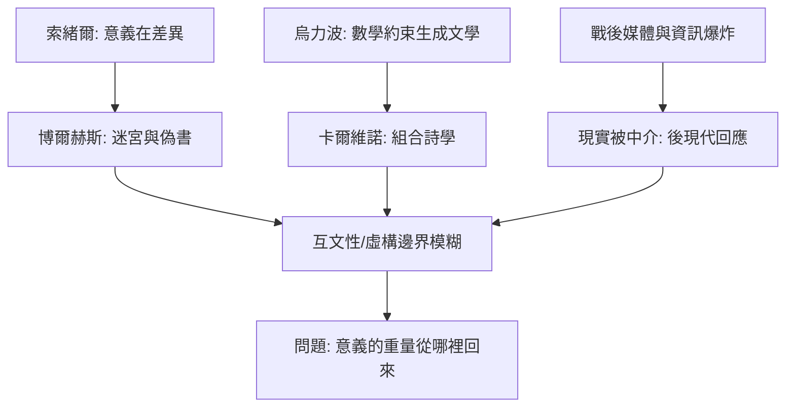

# 8.2 後現代實驗：博爾赫斯與卡爾維諾

時間：1940年代至1980年代

## 博爾赫斯：圖書館的迷宮

豪爾赫·路易斯·博爾赫斯（Jorge Luis Borges，1899至1986）是布宜諾斯艾利斯的圖書館員（他長期任國立圖書館館長——晚年失明，「上帝賜給我八十萬冊書，同時賜給我黑暗」是他的著名自嘲）。他的小說極短（多數不足二十頁），卻是二十世紀後半葉文學的思想引擎。《小徑分岔的花園》（1941年集，同名小說1944年發表於南方雜誌Sur）提出「時間的分岔」：所有選擇同時發生的網狀時間——這在數十年後被計算機科學界反覆引用（平行宇宙與圖論敘事的思想原型）；《通天塔圖書館》（1941）設想一個包含所有可能書籍的無限圖書館（其中絕大多數是噪聲——這是關於資訊過載與搜索的寓言，比網路早了半世紀）；《博聞強記的富內斯》寫一個記不住「遺忘」的人（記憶的完美即思考的癱瘓）。博爾赫斯的策略是「以論文的偽裝寫小說」：假書目、假注釋、假哲學體系——虛構與知識的邊界被他有意識地拆除。他自認的最大發明是「把卡夫卡的氣氛變成一種可以被引用的傳統」（他1930年代的卡夫卡論文實際上「發明」了卡夫卡的世界譜系——批評作為創作的範例）。

## 卡爾維諾：輕、快、精確

伊塔洛·卡爾維諾（Italo Calvino，1923至1985）的路線從新寫實轉向寓言：1950年代的《我們的祖先》三部曲（分成兩半的子爵、樹上的男爵、不存在的騎士）以童話結構處理現代人的完整性問題；1967年他移居巴黎，接觸烏力波（Oulipo——「潛在文學工坊」，以數學約束生成文學的同人實驗團體，創始人之一是數學家雷蒙·格諾與後來的佩雷克）——《看不見的城市》（1972）以馬可波羅向忽必烈描述五十五座虛構城市，實為對「城市與欲望、記憶與符號」的組合詩學；《如果在冬夜，一個旅人》（1979）是小說形式的巔峰實驗：全書由「你」讀一本剛開頭就中斷的小說開始，追逐十個只存在開頭的小說——讀者的購買與閱讀行為本身被寫進情節。卡爾維諾1985年去世前留下《新世紀文學備忘錄》（哈佛諾頓講稿，1993年出版），提出文學的五種價值：輕、快、精確、繁複（第三講未及完成「連貫」與「多樣」）——這是後現代之後最有力的文學綱領之一。

## 後現代的共同語法

兩人代表的後現代實驗共享幾條語法。其一，互文性（intertextuality）：作品以「與其他作品的關係」為結構（博爾赫斯引偽書、卡爾維諾引未完成之書——文本的宇宙代替單一文本）；其二，作者與讀者位置的翻轉：敘事者承認自己在編造、並把讀者寫進情節——「虛構的邊界」成為主題而非禁忌；其三，形式的數學化：組合、迷宮、循環、分岔——文學向數學與邏輯借引擎（烏力波的正式綱領）。這條路線的思想源頭可上溯至索緒爾語言學（意義在差異中）與博爾赫斯的圖書館隱喻，其社會背景是戰後大眾媒體與資訊爆炸——當「現實」本身被媒體中介，文學只能以「中介的中介」回應。後現代實驗的極限也在此：當一切只是符號的遊戲，意義的重量從哪裡回來？這個問題把二十一世紀的文學（網路連載與AI生成）推上了舞臺。

