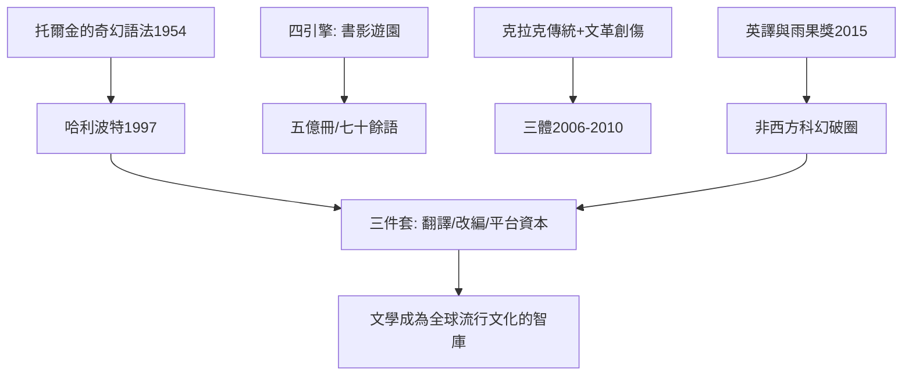

# 9.1 類型文學與全球化：哈利波特與三體

時間：1990年代至今

## 哈利波特：印刷帝國的最後一個神話

J.K.羅琳（1965年生）的《哈利波特與魔法石》（1997，布魯姆斯伯里出版）的誕生故事是出版業的經典檔案：單親母親在愛丁堡咖啡館寫作，十二家出版社拒稿，Bloomsbury以一千五百英鎊預付款簽下（其文學代理克里斯多福·立特建議她用姓名縮寫以吸引男童讀者）。真正的引爆是媒介工程：1998年美學樂Scholastic以十萬美元競得美國版權（當時的童書罕見的價碼），1999年起每冊首印量以百萬級增長，第七冊《死神的聖物》（2007）首日銷量逾八百萬冊——出版史上最快的銷售紀錄之一。哈利波特的產業結構是「印刷、電影、遊戲、主題樂園」的四引擎體系（華納電影八部曲自2001年起），它證明了：在網路時代，實體書仍能製造「全球同時等待」的儀式感（首發夜的排隊文化）——兒童與成人共讀的跨界（cross-over）出版是書業的關鍵創新（紐約時報暢銷榜2000年為此增設童書榜）。

其文本的成功配方同樣值得拆解：寄宿學校的成長敘事（英國公學文學傳統——伊妮德·布萊頓與《湯姆布朗的求學時代》的譜系）、善惡大戰的奇幻架構（托爾金《魔戒》1954至55年開創的現代奇幻語法）、加上九十年代特有的多元價值（階級的榮恩、麻瓜出身的妙麗——體制的批判內建於體制的敘事）。全球化的結果：七十餘種語言、逾五億冊——文學史上印刷時代的最大銷量級作品之一。

## 三體：非西方科幻的破圈

劉慈欣（1963年生）的《三體》三部曲（《三體》2006年連載於《科幻世界》、2008年成書；《黑暗森林》2008；《死神永生》2010）的全球化是另一條路線：2014年英文版《The Three-Body Problem》（劉宇昆Ken Liu譯）出版，2015年獲雨果獎最佳長篇（亞洲作家首次）——科幻界的最高榮譽之一。其技術配方是「硬科幻的宇宙社會學」：黑暗森林法則（宇宙文明的生存猜疑鏈）以公理化的方式推演文明間的博弈，物理學的設定（三體運動的不可預測性、智子鎖死基礎科學）承自阿瑟·克拉克的宏大傳統（劉慈欣自述克拉克是其启蒙），而其歷史底層是文革創傷（葉文潔的人生起點）與中國現代化的百年焦慮——「給歲月以文明，而不是給文明以歲月」的命題把宇宙尺度的冷酷與文明的價值選擇對撞。其流行同樣依賴產業與外交的共振：中國官方的文化輸出政策、科技精英的背書（歐巴馬與扎克伯格的公開書單）、以及Netflix改編（2024年上線，規模化的全球發行）。

## 類型文學為何成為全球智庫

哈利波特與三體代表兩個結論。其一，類型文學（fantasy、SF）在二十世紀末完成了正典化：從 pulp（廉價雜誌）的邊緣，到雨果、星雲獎與學院研究的正席——「類型」不再是「不夠文學」的標籤，而是承載思想實驗的容器（科幻是「以敘事做思想實驗」的文學）。其二，全球化的文學傳播依賴三件套：翻譯產業（專業譯者的明星化——劉宇昆本人的作家身分）、影視改編（IP的跨媒體宇宙）、與平台資本（出版集團與串流的全球發行）。文學第一次以「全球流行文化的智庫」身份運轉：它提供世界觀、設定與倫理難題，影視與遊戲消費其敘事資產。下一節我們看另一條更草根的路：網路連載如何重寫「出版」這件事本身。

