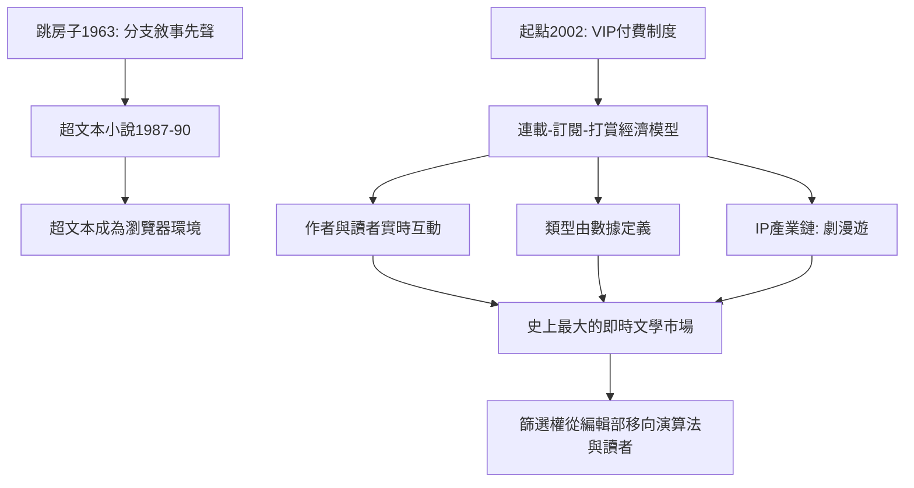

# 9.2 網路文學與超文本

時間：1990年代至今

## 超文本的先聲

「讀者可以選擇走向」的文學實驗早於網路：阿根廷的《跳房子》（Hopscotch，1963）以章節的組合順序邀請讀者自選路徑；印刷時代的「選擇你自己的冒險」系列童書（1979年起）把分支敘事量產化。數位的轉折在1990年代：麥可·喬伊斯的《下午，一個故事》（afternoon, a story，1987，1990年公開發行）被公認為首部重要的超文本小說（Eastgate系統發行，以連結link組織的碎片文本）；羅伯特·庫弗的《加州公司的作曲者》（1990）以賭局與隨機結構實驗。這些作品的共同命運：學院讚譽、市場極小——因為早期的超文本需要專用軟體與昂貴硬體，讀者始終沒來。真正的超文本革命，發生在它變成「基礎設施」之後：當連結成為每個人手裡的瀏覽器功能，超文本不再是「作品」，而是「環境」。

## 網路連載：中文世界的規模革命

中文網路文學的量級是全球獨有的。起點可推至1998年痞子蔡《第一次的親密接觸》在BBS的連載（台灣，網路小說的大眾化起點）；中國大陸的產業化在2002年前後：起點中文網（2002年成立，後屬閱文集團）建立VIP章節付費制度（讀者按千字付費訂閱），把「連載—訂閱—打賞—月票」做成完整的經濟模型。這個模型重寫了出版的三個關係：其一，作者與讀者的實時互動（作者依讀者反饋調整情節，甚至被「逼更」——創作節奏由讀者市場錨定，百萬字的體量與日更數千字成為職業標配）；其二，類型的工業化分化：玄幻、仙俠、都市、穿越、無限流等品類由讀者數據直接定義（起點的分類本身就是讀者投票的結果）；其三，IP的產業鏈：熱門網文改編為電視劇、動漫與遊戲（《琅琊榜》《慶餘年》《贅婿》等），網文成為中國影視業最大的內容庫之一。閱文集團2020年在港上市時已是中文數字閱讀的巨頭，其平台上的職業作者以數十萬計、讀者以億計——這是人類史上最大規模的「文學生產即時市場」。

## 閱讀習慣的碎片化與長篇化悖論

網路文學的深層影響是「注意力的重組」，而且呈現雙向悖論。一方面，碎片化：章節變短、鉤子變密（每章末尾的懸念設計是付費轉化的工程學）、跳讀與聽書（有聲書與AI配音）成為主流——「讀完一本書」的古典經驗被「追更一本書」取代。另一方面，超長篇化：百萬字甚至千萬字的作品成為常態（唐家三少等頭部作者以億字計的累計更新）——網路同時製造了史上最碎與最長的閱讀。西方的平行現象是連載平台的興起（Wattpad的社區寫作、Substack的付費通訊、以及Kindle Unlimited的訂閱閱讀），日本則有「成為小說家吧」與web小說改編動漫的產業鏈（《轉生史萊姆》等）。全球共同的結論：出版的權力（篩選誰能被讀到）從編輯部移到演算法與讀者數據——文學的「市場調研」第一次與創作同步發生。

