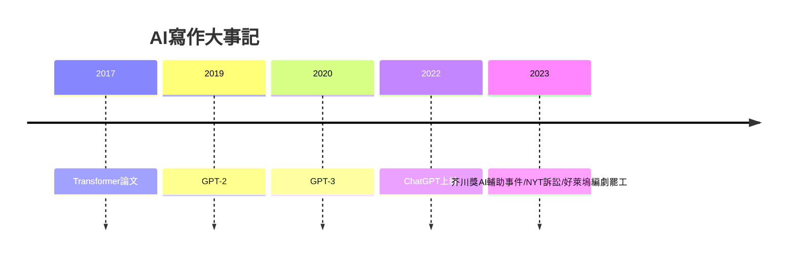

# 10.1 AI寫作與大型語言模型

時間：2010年代至今

## 從統計到湧現

機器寫作不是新議題（1950年代圖靈測試的原始版本——模仿遊戲——就以「能否寫出像樣的詩」為判準之一），但能力的天花板在2017年前後被掀開：谷歌的Transformer架構論文（Attention Is All You Need，2017）確立了大型語言模型（LLM）的技術基礎——以「注意力機制」在海量文本上預測下一個詞。GPT-2（2019）已能寫連貫段落，OpenAI以「發布太危險」的分段策略成為新聞；GPT-3（2020，1750億參數）展示了「少樣本學習」；2022年11月ChatGPT上線，兩個月破億用戶——人類歷史上最快的消費級應用增長之一。文學的邊界問題就此落地：模型讀過的語料（數十億頁，含大量小說與詩）使其能模仿幾乎任何作家的風格表面——莎士比亞的抑揚格、村上春樹的疏離語感、納博科夫的華麗比喻，都能以假亂真地生成。

## 創作實踐與爭議現場

AI寫作的現場爭議已有多起實錄。其一，獎項事件：2023年日本芥川獎入围作品《東京都同情塔》（九段理江著）作者公開承認約百分之五的文本由ChatGPT生成（她自述讓AI寫「我寫不出的東西」——最終該作品獲獎，引發日本文學界的大辯論）；同年中國的《機憶之地》（江蘇青年作家以AI輔助）入圍文學獎；其二，版權訴訟：作家與新聞機構對模型公司提起的訓練數據訴訟（紐約時報訴OpenAI與微軟，2023年12月起——「未經許可使用數百萬篇文章訓練」是核心指控；科幻與奇幻作家協會的集體訴訟同構），與音樂業的RIAA訴訟平行；其三，平台治理：2023年美國科幻雜誌Clarkesworld因AI投稿激增而暫停收稿——「生成洪水」成為編輯部的日常難題。這些爭議的結構與攝影術誕生時的繪畫爭論（十九世紀：攝影是「抄襲自然」還是新藝術）同構，但規模更大、速度更快。

## 作者性的重新定義

AI對「作者」概念的挑戰有三層。其一，原創性的語言學基礎：若風格只是詞彙與句式的統計分佈，則「模仿某作家」在技術上是可行的——但文學史的經驗（從莎士比亞的借用、到後現代的互文）早已表明：文學本來就是對既有文本的重組；AI把這個重組的效率提升了數個數量級，於是「什麼屬於作者」的界線必須重新談（訓練數據的授權、生成的標註、輔助與代寫的區分）。其二，寫作的分工：生成、編輯、策展的分工在寫作中出現（人機協作已成為類型小說與劇本業的現實——好萊塢2023年編劇罷工的核心條款之一正是AI使用的邊界：WGA協議規定AI不能被視為作者、AI生成的材料不能削減編劇署名與報酬——這是AI時代第一份重要的勞資契約範本）。其三，人類的不可替代處：語言模型的弱點與其強點同源——它沒有身體、沒有死亡、沒有必須說話的理由。文學的動機（為什麼非說不可）來自有限的生命，這是下一節的主題。

