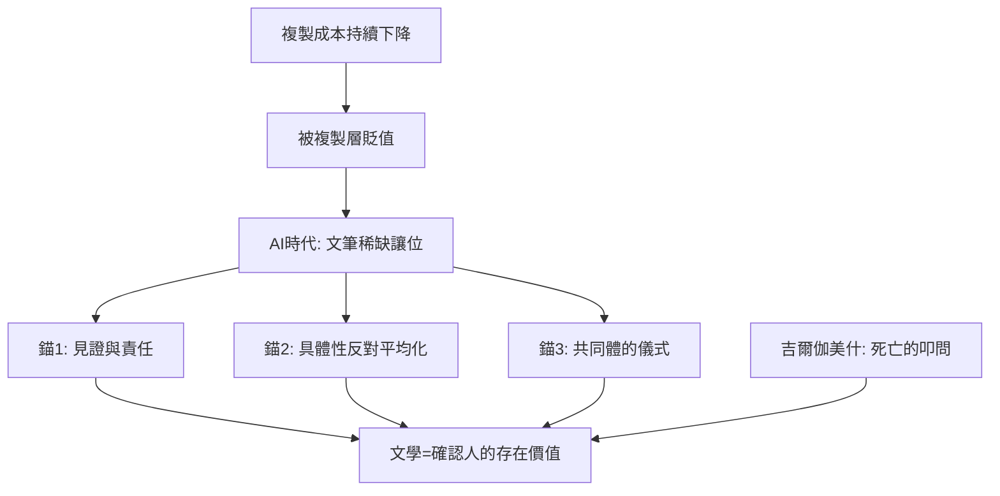

# 10.2 數據時代的文學避風港

時間：21世紀至今

## 算力過剩與意義稀缺

本書的主線到此刻收攏。載體演變的邏輯一直是「複製成本的下降」：口頭（一次一人）→泥板竹簡（昂貴手抄）→印刷（規模複製）→網路（近零成本複製）→AI（近零成本生成）。每次複製成本下降，都發生同一件事：被複製的那一層貶值，稀缺性移往不可複製的層。印刷時代，抄寫的稀缺（書法與手抄本的權威）讓位給「文本的正確與思想的新穎」；網路時代，印刷的稀缺讓位給「策展、社群與即時性」；AI時代，文筆的稀缺（流暢、華麗、風格表面）正在貶值——因為機器以近零成本供應它。稀缺性移往何處？移往無法從語料中統計出來的東西：親身經歷的重量、寫作的理由、以及「這段文字背後有一個會死的人」這件事實本身。

## 避風港的三個錨點

數據時代的文學價值至少有三個不可壓縮的錨。其一，見證：文學保存「不可被數據化」的經驗——戰爭與流亡的文學傳統（從一戰詩歌到亞歷塞維奇以訪談寫成的《戰爭的非女性面孔》——她2015年諾貝爾獎的授獎詞稱其「以多重聲音寫我們時代的苦難與勇氣」）的價值恰恰在「我當時在場」。AI可以生成無限的「像見證的文本」，卻無法承擔見證的責任——責任（誰為這些話負責）是文學的倫理地基。其二，具體性：偉大文學的細節（曹雪芹的一道茄鯗、普魯斯特的一塊瑪德萊娜）不是資訊，而是「具體對抽象的反抗」——演算法的世界以聚合與平均運作，文學以單一生命的不可交換抵抗平均化。其三，共同體的儀式：閱讀從來不只是接收資訊，而是人類的聚集儀式（本書第一章的篝火：口傳的核心是「一起聽」）——讀書會、文學獎、書店與網文社群的「追更」都是這個儀式的現代形態。生成式內容可以填充注意力，卻難以製造「共同等待第七冊」的儀式感。

## 文學的下一個使命

文學的功能史（本書開頭列的四條線索）在此刻的答案已經浮現：當記憶與傳播的技術被機器接管，文學的使命收縮並加深為「確認人的存在價值」。這不是安慰劑式的結論，而是有歷史依據的判斷：攝影沒有殺死繪畫（繪畫轉向印象派與抽象——把攝影做不到的「看的方式」變成主體），錄音沒有殺死現場音樂（現場成為稀缺的儀式），機器寫作也不會殺死文學——它會把文學推向機器做不到的位置：有限的人，在必死的時間裡，為另一個有限的人，說出不可替代的話。本書從吉爾伽美什對死亡的第一次叩問開始——五千年後，這仍是文學唯一的母題。演算法可以模仿一切風格，但它沒有可失去的東西；而文學的全部重量，來自可失去的東西。

