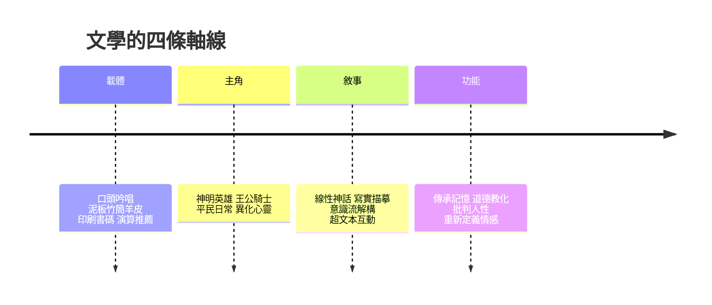

# 文學的故事：從史詩歌唱、文字載體革命到虛擬時代的靈魂敘事

文學是人類用語言記住自己的方式。本書從美索不達米亞泥板上最早的史詩寫起，經過東方的詩歌雙璧、希臘劇場、騎士傳說、但丁的俗語革命、印刷術的爆發、小說的定型、浪漫與寫實的對峙、意識流的迷宮、魔幻寫實與後現代的實驗，一路走到網路連載與生成式AI的邊界。四條主線貫穿全書：載體與傳播的演變、主角的下降（從神明英雄到異化心靈）、敘事方式的實驗、以及文學核心功能的每次重定義。

## 第一篇：口傳吟唱與文明的曙光

* 第1章-篝火旁的歌者與最早的英雄史詩
    * [1.1-吉爾伽美什：人類最早的文學叩問](01.1-吉爾伽美什：人類最早的文學叩問.md)
    * [1.2-荷馬與口頭詠唱的英雄](01.2-荷馬與口頭詠唱的英雄.md)
* 第2章-東方的抒情傳統與哲學寓言
    * [2.1-詩經與離騷：現實與浪漫雙璧](02.1-詩經與離騷：現實與浪漫雙璧.md)
    * [2.2-希臘悲劇與摩訶婆羅多](02.2-希臘悲劇與摩訶婆羅多.md)

## 第二篇：信仰、宮廷與印版革命

* 第3章-神聖的旅程與騎士的冒險
    * [3.1-騎士文學與亞瑟王傳說](03.1-騎士文學與亞瑟王傳說.md)
    * [3.2-但丁神曲：俗語與新時代的橋樑](03.2-但丁神曲：俗語與新時代的橋樑.md)
* 第4章-印刷術、狂歡與人性的爆發
    * [4.1-古騰堡印刷術：文學的大眾傳播](04.1-古騰堡印刷術：文學的大眾傳播.md)
    * [4.2-十日談、堂吉訶德與莎士比亞](04.2-十日談、堂吉訶德與莎士比亞.md)

## 第三篇：啟蒙理性、浪漫狂潮與寫實巨鏡

* 第5章-理性光芒與小說形態的定型
    * [5.1-魯賓遜與格列佛：小說的崛起](05.1-魯賓遜與格列佛：小說的崛起.md)
    * [5.2-紅樓夢：東方古典小說的絕響](05.2-紅樓夢：東方古典小說的絕響.md)
* 第6章-浪漫主義的咆哮與寫實主義的巨鏡
    * [6.1-浪漫主義：雨果、拜倫與浮士德](06.1-浪漫主義：雨果、拜倫與浮士德.md)
    * [6.2-寫實主義：巴爾扎克、托爾斯泰與狄更斯](06.2-寫實主義：巴爾扎克、托爾斯泰與狄更斯.md)

## 第四篇：意識流、荒謬與解構傳統

* 第7章-崩解的世界與內心的迷宮
    * [7.1-一戰後的精神危機](07.1-一戰後的精神危機.md)
    * [7.2-喬伊斯、普魯斯特與卡夫卡](07.2-喬伊斯、普魯斯特與卡夫卡.md)
* 第8章-魔幻寫實、後殖民與後現代實驗
    * [8.1-百年孤寂：魔幻寫實主義](08.1-百年孤寂：魔幻寫實主義.md)
    * [8.2-後現代實驗：博爾赫斯與卡爾維諾](08.2-後現代實驗：博爾赫斯與卡爾維諾.md)

## 第五篇：跨國網絡、數位文本與未來的敘事

* 第9章-大眾類型文學、影視改編與全球化
    * [9.1-類型文學與全球化：哈利波特與三體](09.1-類型文學與全球化：哈利波特與三體.md)
    * [9.2-網路文學與超文本](09.2-網路文學與超文本.md)
* 第10章-生成式AI、演算法與未來的文學邊界
    * [10.1-AI寫作與大型語言模型](10.1-AI寫作與大型語言模型.md)
    * [10.2-數據時代的文學避風港](10.2-數據時代的文學避風港.md)

## 核心線索

