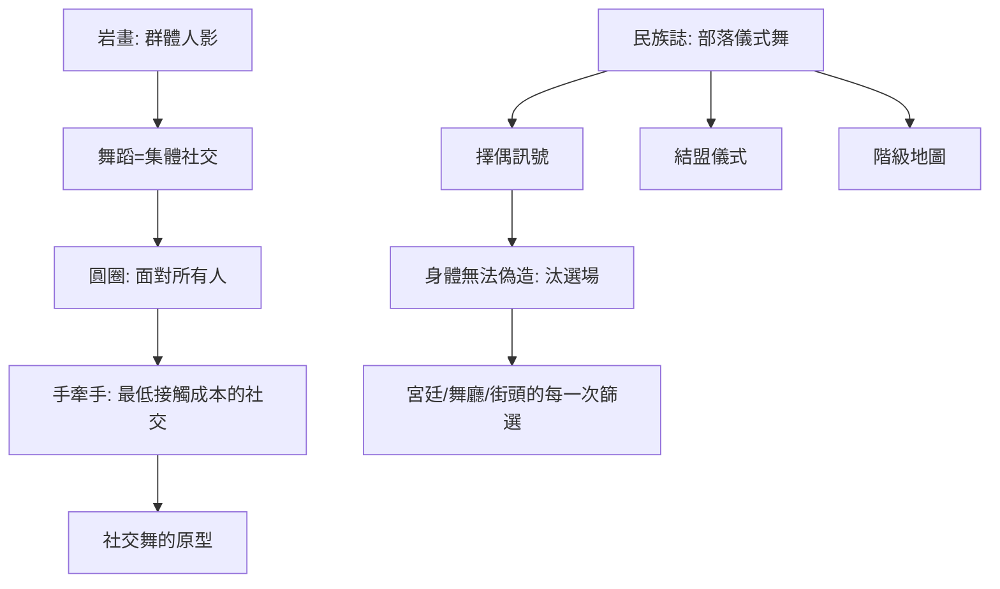

# 1.1 從祭祀巫術到擇偶與結盟

時間：約西元前一萬年至前三千年

## 篝火旁的第一種「社交」

舞蹈的考古證據很早：印度中部賓巴特卡的岩畫中，一排手拉手、身體前傾的人影約屬西元前八千至前三千年之間（前一章《舞蹈的故事》已提過這一證據）；南歐與北非的岩畫（如義大利摩爾比亞的岩窟壁畫、阿爾及利亞塔西利納傑爾的「跳舞的小人」群像）也以群體隊形為主題。這些圖像透露一件關鍵的事：人類最早有記錄的舞蹈不是一個人的獨舞，而是一群人——舞蹈從一開始就是「集體的身體社交」。

人類學對無文字社會的長期田野研究（20世紀的非洲、大洋洲、美洲原住民民族誌）給了我們一個可靠的推論框架：狩獵採集部落的大型儀式舞（成年禮、季節慶典、獵前動員）幾乎都同時執行多個「社交功能」——其一，擇偶（青年男女在慶典上有機會被看見，舞蹈能力常是擇偶的訊號）；其二，結盟（兩個部落共舞，是和平締約的儀式語言）；其三，確立階級（誰能站在隊伍前端、誰在圓心，是地位的地圖）；其四，祭祀巫術（舞蹈作為與神靈或祖先溝通的方式）。舞蹈在儀式與社交之間沒有一條明確的界線：宗教與交友，是在同一次身體活動中完成的。

## 為什麼是「圍圈」

遠古舞蹈的典型隊形是圓圈與半圓，這個幾何不是偶然。以火堆或祭壇為圓心的圓圈，讓每個人都「面對著所有人」——在沒有座椅、沒有宴會桌的時代，圓圈是人類發明的第一種「社交空間技術」：城市群還未出現、村落的公共建築還未定性之前，圍圈舞就是部落共享的引擎（按：這個「圓圈的社交技術」將延續五百年：中世紀的卡羅爾舞、文藝復興的圓舞、乃至當代薩爾薩的rueda一輪圓圈，都是它的後裔）。圓圈的另一個功能是「親密而不費力」：手牽手（或勾手腕）讓陌生人以最低的接觸成本進入社交——這幾乎就是「社交舞」的定義原型。

## 擇偶的身體訊號

在擇偶功能上，遠古與部落舞蹈玩的是「訊號遊戲」。民族誌紀錄中的幾種機制：其一，耐力競賽式的舞（跳到最後的人勝出——某些非洲與大洋洲社會），展示健康與耐力；其二，節奏協調（男女分列、互相回應舞步——「對歌對舞」的求愛形式在全球多地出現）；其三，面具與服色（身分與可用性的視覺訊號）。這些機制的共通點可以用一句話說：舞蹈是「低成本、高資訊量」的擇偶汰選場——你無法偽造節奏感與耐力，身體會說真話。這個「身體的汰選場」邏輯，將在往後每一章重演：宮廷的小步舞篩選教養、維也納的華爾茲篩選勇氣、哈林區林迪舞的表演賽篩選創造力、今日酒吧的即興篩選默契。

