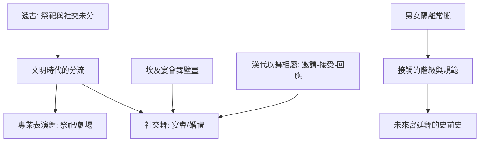

# 1.2 手牽手：人類最早的集體接觸

時間：約西元前三千年至前八世紀

## 從圓圈到「隊形」

進入文明時代（河谷農業、城市出現之後），舞蹈的社交技術開始分化。美索不達米亞的浮雕與印章（烏爾王陵時期前後）顯示隊形舞的存在；古埃及是保存最完整的病例：墓室壁畫與浮雕（新王國時期尤明顯）記錄了宴會舞、祭祀舞，男女分列、對稱佈置、以擊掌與女舞者的造型動作為核心——埃及的宴會樂舞在《死者之書》與墓室文本中被描述為「宴客的必要項目」（官員宴會中有職業女舞者表演，而主客與賓客之間的社交交談才是主體：職業表演與私人社交在此分道）。這個分工（表演的舞 vs. 大家一起跳的舞）是人類舞蹈史的第一個大分流：前者走向祭祀與劇場，後者就是本書的主題——社交舞。

## 古代中國：飛燕與「以舞相屬」

古代中國的宴會舞蹈是一個漂亮的獨立案例。漢代文獻（《史記》《漢書》與樂府記載）記錄了「以舞相屬」的宴會風俗：主人先舞一段，然後「以舞屬客」——用手勢或舞姿邀請指定客人續舞，客人必須起身回舞，否則被視為失禮。這是有明文的「點舞」制度：舞蹈成為宴會的邀請語言，拒跳即拒情。這個制度顯示：社交舞的「邀請—接受—回應」三段結構，在沒有西方影響的東亞也自發地形成了——因為它本來就是社交結構的身體化。「以舞相屬」在魏晉之後漸衰（文人宴集轉為詩酒），但它證明了一件重要的事：社交舞的邀請制度不是歐洲的專利，而是社交的身體必然。

## 手與距離：接觸的階級學

古代社交舞的接觸程度是分級的。團體舞（大家一起跳）的接觸是「工具性」的——手牽手的功能是連成一體，不是親密；男女之間名節的規範（在多數古代社會）使女性與男性不共舞或分列而舞（埃及壁畫、希臘前古典的公眾場合都如此）。而「男女共舞」作為社交常態，在古代是少數場景的特權（私宴、慶典中的特定環節）——這個「男女隔離」的常態，正是往後歐洲宮廷舞「以禮儀管理男女接觸」的史前史：中世紀與文藝復興的宮廷舞，本質上是把「如何讓男女在公共空間共舞而不越軌」制度化的千年工程。

## 祭祀與社交的分裂

到古代晚期，舞蹈的兩大類型已經分家清晰。祭祀與劇場的舞（希臘悲劇歌隊、印度神廟舞、埃及祭祀舞）走向專業化與神聖化；而宴會與婚禮的舞（埃及宴會舞、羅馬即興、漢代相屬舞）走向世俗與社交。這個分家的經濟基礎是：城市與宮廷的「娛樂勞動分工」——有人以表演為業，其他人才能以跳舞為社交。本章結束於一個問題：既然專業表演已經分家，那麼「大家一起跳的舞」如何在體制化的社會裡維持規範？中世紀的回答是鏈舞與教會的緊張（下一章），而更早的答案來自希臘與羅馬——他們的公民教育與宴會文化，是社交舞制度化的第一批試驗。

