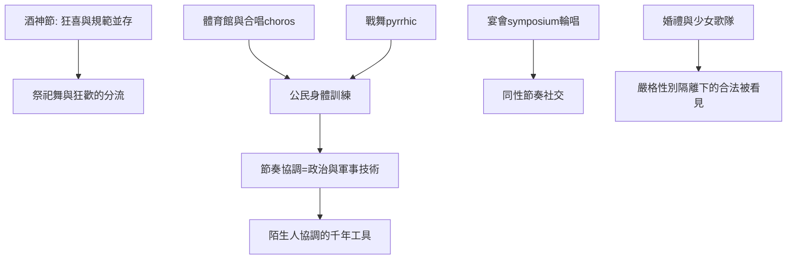

# 2.1 酒神節與雅典公民的社交舞禮儀

時間：約西元前八〇〇年至前一四六年

## 酒神的解放LinkedIn

古希臘的酒神節（Dionysia，紀念酒神狄奧尼索斯的節慶，雅典的戲劇競賽即附屬於此）是集體身體狂歡的制度化案例。酒神的崇拜（公元前七世紀起流入希臘本土）的核心是歌與舞：崇拜者（尤其女性，文獻中稱為maenads「酒神的侍女」）在山林間以音樂、旋轉與群體舞進入狂喜。雅典的酒神慶典在城市層級被規範化（公元前六世紀庇西特拉圖確立都會酒神節，包括歌隊競賽）；但鄉間與私人的酒神舞則更狂放。這個「城市的規範版」與「鄉野的狂喜版」並存，正是我們在遠古看到的「祭祀與社交分家」的希臘版本：祭祀舞裹上政治與戲劇的外衣，而狂歡的身體記憶持續流入日常的宴會與婚禮。

## 公民教育中的舞蹈

雅典沒有職業舞蹈教師為全體公民開課的制度（那是後來法國的路），但舞蹈是公民身體文化的核心組成。首先，「合唱」（choros）：無論悲劇歌隊或公民的節慶合舞（或所謂祖傳合唱patrioi choroi），雅典男性都從少年期開始在合唱中受訓（體育館制度中，合唱與體操並列）。其次，軍事舞（pyrrhic「戰舞」，持盾矛的快舞）是青年的身體訓練。第三，宴會（symposium）的抒情部分：富裕男性在宴後共飲，唱skolia（輪唱的短詩歌）、以krótēsis（拍手）同步——身體的節奏協調，是公民的社交儀式。雅典的「公民社交舞」因此不是雙人舞（男女共舞在雅典多數公共場合是禁忌），而是男群體的節奏協調與女性宗教舞的分離世界。這種「同性群體的節奏社交」與我們今日理解的「社交舞」（男女雙人）不同——這提醒我們：歷史上的社交舞有過多種社會學形態，雙人僅是後來的勝出者。

## 節奏與政治：合唱的民主技術

雅典合唱有一個制度細節值得強調：歌隊由公民（或公民出資者chorēgos出錢組隊）組成，訓練數月、全城公演、評比競賽。節奏協調是字面上的「政治訓練」：一群公民以同一節拍移動（亞里士多德在《政治學》第八卷論及音樂與節奏教育的公民功能），這個「以節奏集合身體」的技術，後來在羅馬軍事、在近世歐洲宮廷、以及今日的廣播體操中被不斷重複使用。換言之：集體舞蹈專治「陌生人的協調」問題——政治、軍事與社交，都在分享同一個節奏技術。

## 婚禮與少女歌隊

男女之間的社交，在希臘有幾個合法場景，婚禮舞蹈最為重要。雅典婚禮的儀式含新娘的馬車行進、婚宴與婚後的拉歌隊（新娘家的少女合唱、围绕新婚房的調侃歌，一種調侃式合唱，與羅馬及後世歐洲婚俗接軌）。少女歌隊（如斯巴達的阿爾克曼紀錄的少女合唱）常在神聖節慶中表演，也成為「被看見」的合法機會——在性別隔離嚴苛的希臘，舞蹈是少女唯一能被城市公共空間「看見並議論」的場合之一。社交舞的「相親」功能（遠古的智慧）在嚴格規範的社會裡被壓縮，但從未被消滅。

