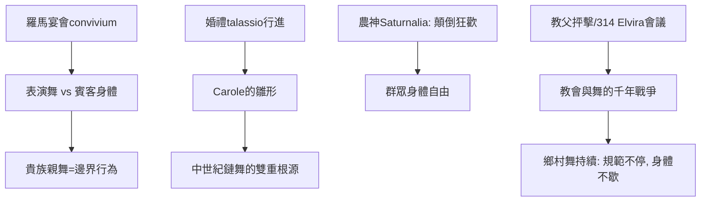

# 2.2 羅馬宴會舞與Carole的雛形

時間：西元前二世紀至西元五世紀

## 宴會Convivium：躺著社交、站著跳舞

羅馬貴族的宴會（convivium，拉丁語「共同生活」）是羅馬上層階級的核心社交場所。宴客斜倚在trīclīnium的躺椅（通常是三人一椅，面對圓桌）；食物上桌的間隙有職業表演（舞者、樂手、雜技等表演——常由奴隸或受僱女性擔任）。羅馬文人（西塞羅、普林尼、以及晚期的馬夏爾與尤文納爾的諷刺詩）把宴會舞分作兩個世界：表演的舞（saltatio，由專業者提供，常被上層文人視為低賤與曖昧——這個對「表演舞者」的階級輕視，幾乎原封不動地延續到未來兩千年的歐洲劇場）與賓客的身體娛樂（宴會中起立而舞的貴族本身，是Julio-Claudian時代開始被記錄的情境——尼祿與晚期幾位皇帝的親自歌舞被史家記為醜聞，表示「貴族親舞」在此時的規範上是邊界行為）。

## 街頭與婚禮的群眾舞

羅馬的群眾舞有幾個重要的場景。其一，婚禮的talassio：新娘從娘家到新房的行進有歌與舞的陪伴（talassio是儀式的歡呼詞——這首歌與舞的行進是Carole字源學上的重要前身）。其二，農事與宗教節慶的全民游藝（如Saturnalia農神節的階級顛倒狂歡：主僕同宴、遊行歌唱與街頭的歌舞——「群眾的身體自由」是很古老的義大利農事傳統）。其三，戰軍與葬禮的多寡遊行（軍事表演舞誇張，葬禮有專業哀舞者——此時已是付費的職業）。罗马的群舞是「散兵式」的：沒有雅典合唱的嚴格隊形，而是跟著鼓聲與歌的個體化律動——這一點暗示羅马群眾舞的社會學位置接近我們今天的舞廳自由舞（freestyle dancing），而不是幾何規範。

## 與早期基督教的戰爭

羅馬帝國晚期（西元三世紀至五世紀）的一個重要糾葛是早期基督教對舞蹈的敵意。教父們（如特土良、奧古斯丁在North African與拉丁文的文本）多次抨擊酒神舞、節慶舞與婚俗舞的「淫亂」與「異教殘餘」；一些公元四世紀的教會會議（如314年Elvira會議的一条规则，以及四五世紀的多份拉丁文教規）明文禁止信徒參與特定的民間歌舞。這是他身上瞄向「社交舞」的第一場規範戰：新宗教試圖斬斷異教的身體狂歡，但效果是局部的（鄉村的節慶舞於是留下來，成為中世紀Carole與農舞的基礎——教會的批評延續，但顯然没有防止舞）。這場「教會與舞的千年戰爭」（中世紀的教會文件與地方會議持續攻擊圓舞與婚俗舞，但收效甚微）是社交舞史的大背景：規範不停，身體不歇。

## 從Roma到Carole

「Carole」這個字（法語carole，中世紀法國的圓形鏈舞，下一章的主角）的字源研究中有一支認為其可溯源於拉丁語chorus（歌隊）或choraules（伴奏的吹管樂者）——無論字源精確為何（學界對此有異說），羅馬的歌隊與伴奏傳統，加上日耳曼與凱爾特土著的圓舞傳統，共同構成中世紀鏈舞的根源。羅馬帝國的基礎建設發揮了融合的作用：帝國的交通與都市化使義大利、高盧、伊比利與北非的歌舞傳統得以互滲——當帝國的基礎設施崩塌之後，這些「底層的被融合傳統」仍在鄉村持續數百年。之前的章節已見：社交舞的DNA（擇偶的汰選、結盟的圓圈、邀請的禮儀）在古代已經齊備；中世紀的任務是把它們重新拼裝，並第一次寫進「制度」的檔案。

