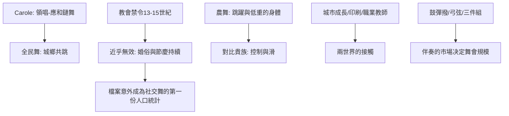

# 3.1 卡羅爾舞與布雷舞：圍圈與跳躍

時間：十二世紀至十五世紀

## Carole：鏈舞的社會技術

中世紀歐洲最普遍的社交舞是carole（法語，亦作carolle）：舞者手牽手（或勾小指）成半圓或封閉圓圈，由領唱者唱一段、眾人應和（一個「領唱—應和」call and response 結構），同時沿著或多或少的弧線移動。這個舞的資料遍布12至14世紀的法語與條頓文學（《羅蘭之歌》的時代已見carole；法國的chansons de geste與羅曼史、以及德國的記載中皆常見）——carole是當時的「全民舞」：鄉村與城市、貴族與平民都跳。它的功能可對照第一章的遠古架構：節慶的社交、婚禮的相親、結盟的儀式，全部被裝進同一個圓圈。

carole和遠古圓圈的一個重要差異是文獻化：中世紀的教會、文學與地方規範第一次以「社會問題」的方式記錄了圓舞。教會對carole的反覆攻擊（在法國、英國與德意志的教區檔案中，13至15世紀有大量禁止「在教堂前與墓園跳舞」的條款——最著名的例子之一是英國與法國多地對聖母升天節等慶典舞的禁令，背後常與巡迴傳道者的批評有關，如聖弗朗西斯派與多米尼克的修道者對墓園舞的抨擊）——但舞者的持續存在證明這些禁令幾乎無效。教會檔案因此意外地成為社交舞史的第一份「人口統計」：批評中透露的細節（誰在跳、在哪跳、跳什麼、伴奏是誰——常有「跟著歌謠」與「少女與青年混合」的記載）告訴我們，中世紀的圓舞場景常常就是男女社交相親的實質場合。

## 布雷與奧維尼的農舞

法國農村與各地的「跳躍舞」（如bren、bourrée——奧維尼與中法國的三拍跳步舞，17世紀文獻豐富，其根源可上推至中世紀）是身體美學的另一端：跳躍、膝蓋的彈性、上身前傾——身體「低而重」。這種農舞的身體（自然、跳、快）與貴族舞的身體（控制、滑、慢）在14世紀有清晰的對比——文藝復興的舞蹈理論家（如第一章已提過的Caroso與Negri，與稍後法國的Arbeau）將這種對比寫成系統。但本章的關鍵點是：兩個世界（農舞與貴族舞）的接觸從14世紀開始變得頻繁——原因包括：其一，城市的成長（市民階層需要「有點優雅但不必像貴族」的舞）；其二，貴族與農民的人口接觸（戰爭與莊園經濟的流動）；其三，印刷術（1470年代起，舞蹈書在義大利先出現，法國與德意志隨後）與職業舞蹈教師的出現使舞步可以跨階級傳播。

## 鼓、號角與提琴：伴奏的演變

中世紀跳舞的伴奏由三種樂器主導：人聲（carole的領唱）、鼓與彈撥（tabor與pipe的組合、以及簧管）；14世紀起，弓弦樂器（vielle、rebec）在城市宮廷流行，15世紀中葉起則是三件組合的basse danse樂隊（鼓、管樂與後來的提琴）。音樂的供給是社交舞背後看不見的市場：城市節慶雇請樂師（多有行會）、貴族家庭有宮廷樂師、鄉村則以流動藝人為主——伴奏的可及性，决定了一場舞會可能有多大。這個「音樂的市場」在18世紀（鋼琴與鍵盤樂的擴散）與20世紀（廣播與唱片）將數次被大幅擴容，每次擴容都觸發一次「社交舞的流行」——這是我們書中重複出現的因果鏈。

