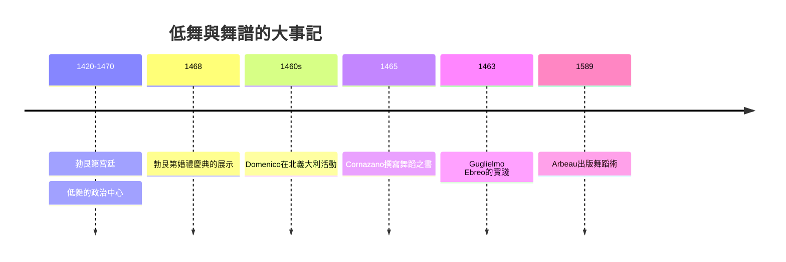

# 3.2 低舞Basse Dance：貴族的優雅滑步

時間：十五世紀至十六世紀初

## 「腳不離地」的政治

低舞（basse danse，低語義即「低舞」——相對於跳躍的高舞haute danse）是15世紀勃艮第與法蘭西宮廷的核心舞。舞者的雙腳幾乎不離地，以滑步、踏步與旋步在緩慢莊嚴的節奏中行進——身體的重心被刻意壓低，動作的目的是「穩定」與「莊重」。勃艮第公爵宮廷（好公爵菲利普與大膽查理的時代，1420至1470年代）是低舞的政治中心：婚禮（如1468年大膽查理與約克郡的瑪格麗特的婚禮慶典，有詳細的帳目與編年記載）是低舞的展示場。勃艮第宮廷是15世紀歐洲「最豐富的宮廷文化」樣本（排場、音樂、禮儀的創新都在這裡制度化——舞蹈自然是禮儀的一部分），而低舞傳播至法蘭西、伊比利與義大利的宮廷。

低舞的政治功能一目了然：其一，「不跳躍」使衣著（長裙、拖尾）與陣形不被破壞——宮廷的低舞是「在身體最佳狀態下被看見」的設計；其二，滑步的速度使兩位舞者可以長時間並肩、以緩慢的位移交錯——「被看見的時間」被最大限度延長，階級的展示效率因此最高；其三，幾乎不接觸（至多指尖相觸或牽手）——「保持距離的優雅」是比華爾茲早四百年的貴族社交技術。

## 舞譜與教師：責任與規範的第一家工廠

低舞是第一種留下了豐富文字記錄的歐洲宮廷舞。15世紀留存數種basse danse舞譜（勃艮第與法國的抄本，如布魯塞爾的抄本與Nancy抄本，附舞名與步法）。15世紀末與16世紀初，兩位義大利舞術大師把「舞蹈教學」變成印刷文獻：多米尼科·達·皮亞琴察（Domenico da Piacenza，1450至1470年代在北義大利宮廷活動的編舞大師）與其弟子安東尼奧·科納薩諾（Antonio Cornazano，1455年前後撰《舞蹈之書》）；稍後有Guglielmo Ebreo（其《舞蹈的實踐》約1463年成書）。義大利的低舞（ballo與bassa danza）融入了「memoria」（舞步的記憶分類：single, double, reprise, branle等步型的分類系統）——這是歐洲舞蹈史上第一次有「步型的語法學」。

而制度化的「舞蹈教師職業」在此時成形：1460至1500年代，義大利與法國的宮廷舞蹈教師成為正式職位（工資記於帳目）、以專業身分受僱、可以流動於宮廷之間（阿爾博1589年於朗格勒出版的《舞術》Orchesographie，以對話體寫給學舞的青年，把低舞與當時的法國舞步整合印刷）。舞蹈教師的專業化是社交舞「可傳授」的關鍵：一旦有職業教師、印刷教材與考試傳授的機制，「內化一種舞」的成本急速下降——這是後來華爾茲能爆發式傳播的百年前置條件。

## 與義大利的競逐：文藝復興宮廷舞的兩個傳統

義大利的宮廷舞（ballo/bassa danza，講究節奏分類與即興）與勃艮第—法國的低舞（講究莊嚴併列與幾何）在15世紀互相影響。這個交互的經濟背景是：義大利城邦的宮廷（費拉拉的Este、米蘭的Sforza、曼圖亞的Gonzaga）與北方宮廷（勃艮第）是當時歐洲最富的兩個文化區——宮廷婚姻的交換（1470至1520年代婚姻與聯姻織成的網）把兩種舞傳統帶向同一個國際場。下一章的主角，凱瑟琳·德·美第奇（義大利嫁入法國王室，1533年）正是這個「義大利傳統輸入法國」的案例——法國宮廷芭蕾（ballet de cour）的根基。低舞在16世紀中葉後漸為較活潑的舞（pavane節奏莊嚴但路線更靈活、branle系列與後來的courante）所接替，但「莊重、滑步、保持距離」的身體語法未被取代——它將直接塑造16至17世紀法國宮廷舞（包括小步舞）的身體。

