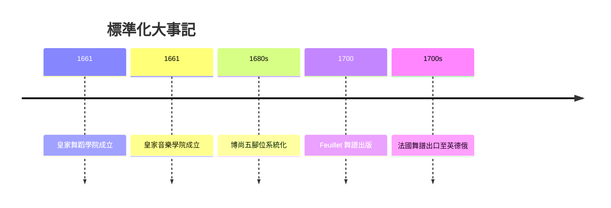

# 4.1 1661皇家舞蹈學院：社交舞的標準化

時間：1661年起

## 國王的私人舞蹈教師立法

1661年，路易十四頒布敕令，成立皇家舞蹈學院（Académie Royale de Danse），以宮廷首席舞蹈教師皮埃爾·博尚（Pierre Beauchamp）為首的十三位舞蹈教師組成。其官方任務是：「回復舞蹈藝術的本真與完美」。翻譯成治理語言：統一宮廷舞的規範、定義正確的舞步、制定教育與審定的機制。

這個機構的深層功能有兩層。其一，技術標準化：博尚在此時期系統化了五個基本腳位（positions），並配合舞步術語（plié、cou-de-pied、arabesque等法語術語體系）——五個腳位成為社交舞與日後芭蕾共同的「公理系統」。這不是小細節：五腳位意味著「任何兩個受過標準訓練的法國貴族，不需要事先商量就能共舞」——舞蹈的可互操作性（今天工程師說的標準化問題），在1661年被解決了。

其二，政治去個性化：這個時期是投石黨之亂（1648–1653，貴族叛亂幾乎推翻王權）結束的初期。宮廷舞蹈的中央化管理，正是使貴族「在身體上服從」的制度工程：舞蹈的幾何（位次、旋轉方向、下一步去哪裡）由編舞者決定，貴族只是執行者——身體的服從是政治服從的排練。

## 樂譜、舞譜與「勤王的標準」

1661年同年，法國還成立了皇家音樂學院（Académie Royale de Musique）；兩個學院共同組成了「音樂與舞蹈的治理」。這個治理還有一個看不見的環節：印刷。與女王伊麗莎白時代靠手抄的舞譜不同的是，法國宮廷的標準化舞譜在1688年以Feuillet的記譜法出版（Raoul-Auger Feuillet《舞蹈術》Chorégraphie 1700年正式出版），使舞步可以被「寄到」歐洲其他宮廷。1700年代初期，英國（John Weaver 翻譯 Feuillet）、德意志與俄羅斯的宮廷都開始按法國舞譜排練——法國的舞蹈標準由此「出口」到全歐洲。這是可傳播標準的關鍵：有舞譜印刷，才有「國際通用」的社交舞。

## 從宮廷到城市的下放

1660至1700年代，法國城市（巴黎）的市民舞蹈文化也在發展：公共舞會在某些行會節日與嘉年華出現，部分的舞蹈教師在城市開課（「青年男女的舞蹈教育」成為城市中產的消費品）。但城市舞會的秩序問題（男性酗酒、舞步「失雅」、場所混亂）則引發了17世紀的治安與教會批評——社交舞的「規範化」不只是宮廷的問題，也是城市「該如何跳、在哪裡跳」的制度問題。巴黎的「公共舞會」在18世紀將與舞廳（bal public）產業結合（第四章），那時「社交舞」第一次成為商業。回望1661：學院的「標準」最初是為宮廷，卻因為可印刷與可教學而成為全歐洲的通用語言——這是法國在舞蹈史上留給世界的一個制度性遺產。

