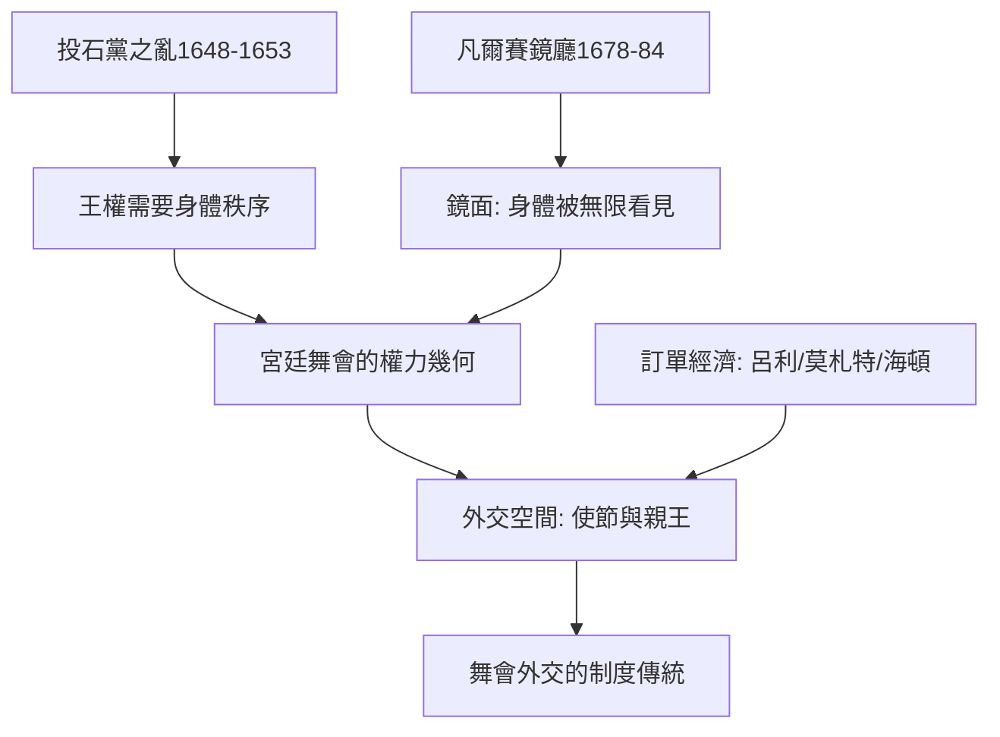

# 4.2 小步舞曲的權力密碼

時間：1650年代至1750年代

## 為什麼要請國王開舞

路易十四時代的宮廷舞會（grand bal）有一套現代難以想像的儀式細節。最重要的規範是：誰開舞。國王本人（或其指定者）必須最先下場，其舞伴通常是宮廷中最顯貴的女士；第二對通常由王儲或大國臣及其夫人；一路按階級往下排——這套順序的程序，與宴會座次與彌撒中的站位共同構成「宮廷的身體等級」。但是這裡有一個看不見的反轉：法王以「開舞」作為至高的榮譽，其他人只是「跟著國王」——開舞的人，也承擔了全場的注意力。路易十四在其親政的二十多年中親自主演二十幾部宮廷芭蕾與舞會（見本書舞蹈的故事第三章），他對「開舞」的政治價值心知肚明。小步舞（minuet）在此時的宮廷禮儀中位置獨特：它是每場舞會的第一支舞，也是唯一要求「先向國王與王后行禮、再向對舞者行禮」的舞——一場小步舞的三分鐘，其實是一次階級的自我申報。

## 幾何即階級

宮廷舞的隊形（formation）本身是權力的地圖。小步舞的S形行進（the S-shape figure）不是審美，而是社交次序：兩位舞者的交錯路線讓他們在同一個舞台上「被看見」與「被排序」；圓舞（round dance）則是「群體的平等儀式」（所有人共享同一圓心）。凡爾賽的鏡廳（1678–1684由勒布朗與孟薩建）在鏡面牆之間的舞會，是「幾何舞步」與「幾何空間」的同構：你旋轉於自己的鏡像與他人之間——身體的位置被無限放大，任何人（包括國王本人）都時刻被看見。這與當時的法國王權理論（國王的「自然身體」與「政治身體」的雙重性——中世紀英法法學傳統的「國王兩身」理論，在17世紀絕對王權論述中被發揮到極致）完美匹配：國王在鏡宮中的轉身，是政治身體的顯形。

## 宮廷舞會作為「外交空間」

1670至1700年代，凡爾賽的舞會成為歐洲外交的實質場所：與外國使節、親王與諸侯的身體接觸、舞伴的選擇、距離的差異，都是「訊息」。碑刻與記載中的例子：1671年，路易十四以凡爾賽盛大舞會接待英國使節（當時英法關係緊張），舞會的規模與次序本身就是一場「演給使節看的政治秀」。這種以舞會為外交的傳統，18世紀在歐洲各宮廷持續（維也納、柏林、聖彼得堡、馬德里都是），一直到1815年維也納會議的同時大量舞會——「舞會外交」是前現代歐洲的實質制度。它後來的經濟土壤是：宮廷音樂與舞蹈的「訂單經濟」（作曲家與舞蹈教師由王庭發薪，作品為特定慶典而作——呂利、莫札特、海頓都在這個體系內）。

## 舞池規則的身體政治學

宮廷舞會的規則列表（1686–1700年間的宮廷禮儀紀錄）可以歸納為數條。其一，進入與退出必須行禮（向君主、向對舞者、向旁觀者）；其二，手不得強拉對手（必須行禮後讓對方伸手）；其三，男性不可以直視舞伴的臉超過正常時間（轉身時目光應望向遠方）——這個「目視距離」是17世紀身體禮儀的核心（面部接近是家族性的、不是社交性的）；其四，跳舞中不交談過多（小步舞的口述「不超過二句」是常規的建議）。這些規則在數百年後的英式舞廳與圓廳舞會中仍留有餘響（今日 ballroom 的「frame」與「行禮」仍是芭蕾與國標共有的禮儀殘片）。宮廷舞會因此提供了一個完整而可複製的「社交舞禮儀模版」，它的核心直覺可以一句話說完：身體是一份你無法回去修改的公開名片。

