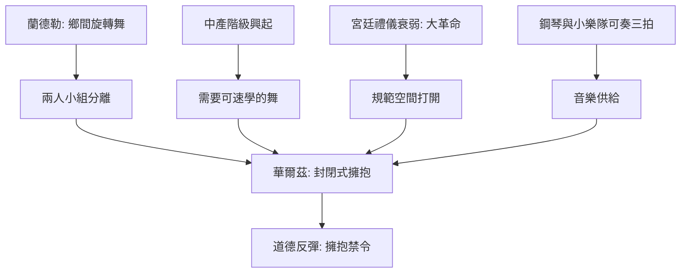

# 5.1 從鄉間蘭德勒到封閉式擁抱

時間：1780年代

## 蘭德勒：巴伐利亞鄉間的旋轉

華爾茲的祖源清楚地可見：南德意志與奧地利的鄉間舞蹈蘭德勒（Ländler，名來自蘭德爾Ben地區）。這是一種三拍子、以快速旋轉與跳躍為主的群體舞：男人以手臂甩出女人使其旋轉，女性持續「順時針」轉動——旋轉是其核心。莫札特與貝多芬都留下過蘭德勒與德意志舞曲（Teutsche）的創作（貝多芬1775年前後的十二首德意志舞曲，是維也納上層階級舞會音樂的邊界）。蘭德勒是「開放式」的：男女之間以手相牽，身體不緊靠，距離大約今日民俗舞的距離。

華爾茲（Waltz，德語Walzer，源自walzen「旋轉」）的關鍵變革是把蘭德勒的「兩人小組」從群體中分離出來：一對一、封閉式擁抱（closed hold）——男士的右手在女士腰後（時人描述有「放在腰上或臀部」的多種記載），女士左手搭男士肩。兩人在旋轉中身體緊貼，幾乎從不分離。這個「封閉式」的舞姿在1780年代的維也納成形：歌德《浮士德》（1808年出版本的酒窖段落）與同期刊物、1780至90年代的舞會描述（以及早前的Sperates等文獻）都記錄了貼身的旋轉舞姿。它同時打破了兩個歐洲最高級的禁忌：其一，男女在公共空間的長時間身體接觸；其二，兩人的「不對稱」與「性暗示」（男士的腰後手、女士的貼靠，都是前代小步舞所不敢提的）。

## 為什麼是此時此地：三個條件

華爾茲的誕生不是意外，而是三重條件的合流。其一，中產階級的興起：18世紀後期的維也納、柏林與巴黎，富商與官僚階層需要一種「不依賴深厚的宮廷傳統」的舞（小步舞要從童年學，華爾茲簡單、三拍子、旋轉即可）。其二，宮廷的衰弱（約瑟夫二世的改革、1789年法國大革命）使「宮廷舞的禮儀」失去政治壟斷——大革命後（1793年立法禁止宮廷禮儀）貴族規範的空間被打開。其三，鋼琴與樂隊技術的擴散：鋼琴（18世紀後期的fortepiano）使家庭與私宅可以伴奏三拍舞曲；城市舞廳的小樂隊也能演奏三拍的圓舞曲——音樂的供給跟上了舞步的需求。這三個條件，使華爾茲成為「資產階級社交舞」的第一盞燈。

## 首批反彈：身體的「不體面」

1790年代，華爾茲在歐洲（英國、德意志各邦、法國）的中產與貴族圈流行，但同時也遭到激烈的道德反彈。德國文學圈（如歌德、Claudius同期文章）記錄了「以擁抱與腰貼」的驚訝；英國的報刊（The Times 1800年代初期批評華爾茲為「野」、「羞恥」）；1816年，倫敦皇家崇敬舞會（Almack's——當時英國上層社會最中心的舞會俱樂部）一度禁止華爾茲入場（這一禁令在史上有明文記錄與當代報導證據）。這些反彈有一個共同點：它們攻擊的不是「旋轉」，而是「擁抱」。
華爾茲的道德危機因此是身體政治學的危機：兩人身體的中心距離（腹部貼腹部）是一個「不該在公共空間存在的距離」。反彈之強，恰好證明了其革命之深。

