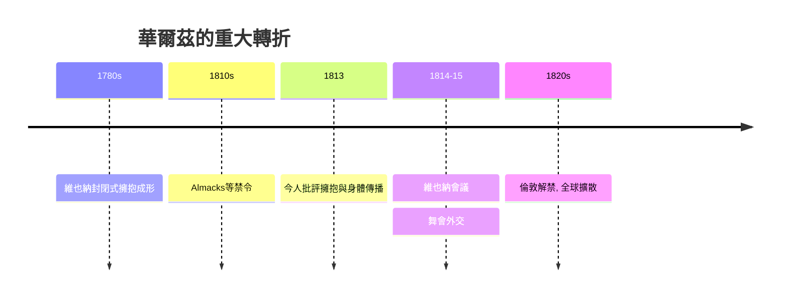

# 5.2 禁令、維也納會議與全球狂熱

時間：1780年代至1815年及之後

## 禁令的羅列

華爾茲的道德反彈是有檔案的。英國：倫敦的Almack's（上層社會的入場制舞會俱樂部）1810年代對華爾茲設限（1816年有明文報導其「不准上場」的規則，雖然上層貴族與年輕王族也在偷偷跳——這種「禁而不止」正是社交舞史的常態結構）。德意志：部分邦國的教會與市政對華爾茲公開譴責（路德會的神職者批評其「傷風敗俗」；市政的舞會規則一度限制「身體接觸的舞蹈」）。美國：1790年代已有報社批評華爾茲為「不雅」，但紐約與費城的舞會並未停歇。俄羅斯：宮廷引進華爾茲較晚凱瑟琳時代的宮廷以quadrille等隊形舞為主，1800年代後華爾茲才通行。這些禁令的共性是：它們承認了「擁抱就是問題」，卻無法阻止人們想要擁抱。

## 一群「女人抓住男人」的政治恐慌

華爾茲還觸動了另一層神經：舞伴的性別權力。在傳統的quadrille與小步舞中，舞步的次序由「男性引導的幾何」決定（男性帶位、女性跟隨，但兩人幾乎不接觸）。華爾茲則相反：封閉式擁抱中，女性的身體被「帶入」旋轉的中心，她的重量被承接、被旋轉、幾乎「對男性不可見」。1810至20年代的文獻（部分是女性舞者與教師的筆記）顯示：一些女性開始在舞會上「主動提出華爾茲」（主動要求這支舞），而這正是道德批評最恐懼的時刻——「女人自己選擇被擁抱」是19世紀初性別規範的一次赤裸破口。社交舞第一次不只是階級舞台，也是性別的邊界測試場。

## 維也納會議：政治的舞會

1814年10月至1815年6月，維也納會議（重構拿破崙戰後歐洲秩序的外交大會）在與會各國代表的大量舞會中進行——同期的諷刺短文（如The Congress dances but does not advance」「Congress dances」是同一時期的字句）披露了「舞會多於文書」的奇觀。梅特涅的宮廷舞會（其中一場1800人參與的紅色舞會）以華爾茲為主軸， tüm奢华與各國代表的旋轉是外交的「身體語言」。會議的結果（「華爾茲外交」）有兩個直接的歷史後果：其一，歐洲各國的上層階級在大會上「練習」了華爾茲（各國的使節向本國引回了「維也納方式」）；其二，會議把維也納的華爾茲投射成歐洲普遍的「官場語言」——數年後，華爾茲在倫敦的Almack's上正式解禁（約1820年代，倫敦的報導已常見華爾茲在舞會中如常出現），並迅速傳到美國。華爾茲的「勝利」是在外交舞池中完成的，其次是報紙與鋼琴樂譜（1810至20年代，歐洲的圓舞曲出版物數十上百種——全球鋼琴的量產為其傳播鋪路）。

## 一個新的一般性：從「教養」到「情緒」

維也納會議後的華爾茲帶來的改變不只是「身體接近」，更是一個價值觀的轉變：以「教育與禮儀」為階級尺度的社交舞（小步舞的傳統），逐漸被「情感表達」與「私密情緒」的社交舞（華爾茲的傳統）取代。19世紀中後期的文學（托爾斯泰的《安娜卡列尼娜》、莫泊桑的小說）中，華爾茲的旋轉是愛情的開始、慾望的啟動與道德的滑坡——社交舞第一次成為敘事中的「情緒機器」。這一轉變的源頭是浪漫主義（情感與私密在歐洲文化中的政治性崛起，見藝術的故事第七章），華爾茲是浪漫主義的身體：旋轉 ближай的兩人，在一個快速的圈內，把自己交付給情緒——比例為華爾茲的全歐「狂熱」提供了一個主導敘事，也不再需要任何人解釋它為什麼「道德上有問題」：它自己就是情緒。

