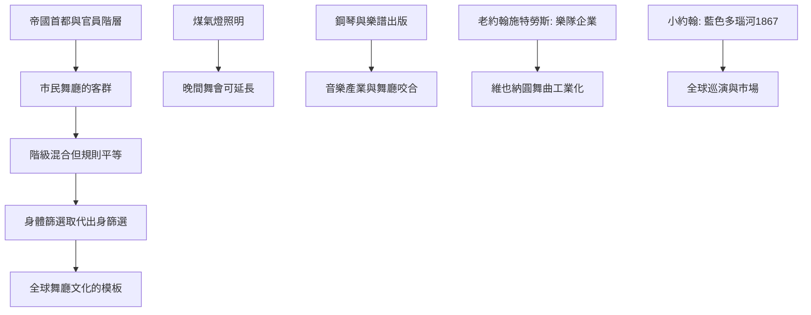

# 6.1 維也納大眾舞廳：市民階級的狂歡

時間：1830年代至1890年代

## 從宮廷舞會到售票入場

1815年維也納會議讓全歐洲看到了「舞會外交」，但真正的結構性變化發生在維也納市民的舞廳。1830至1890年代的維也納（帝國首都與德意志地區最大的音樂消費市場之一）有一套完整的商業舞廳體系：城市經營的遊樂園與花園舞廳、咖啡館附設舞場、以及大型舞會場所——最大的索波龍（Sperl，來自1808年開業的Sperl Brauhaus，1830年代成為市民舞廳的代表）可容納數千舞客同場。維也納的舞廳與倫敦、巴黎的一個本質差異是：它以「市民」（bourgeoisie與工匠、官員、小商人）為主力客群，票價低、入場門檻低、人數多——這使維也納舞廳成為「大眾社交舞」的第一個產業現場。

支持的基礎是一套經濟與技術條件的合流。其一，帝國首都的行政與軍官階層（大量有能力的年輕公僕）成為舞廳的核心客群——拿破崙戰爭後的維也納人口快速增長（1830年代約三十三萬人，至1890年代已逼近兩百萬）。其二，煤氣燈（1820年代的維也納正在普及煤氣街燈與室內照明）使晚間舞會可以持續到深夜——照明技術史幾乎每一個跳躍（煤氣、電燈、霓虹）都對應著社交舞的一次擴容。其三，工業化的印刷與鋼琴：維也納是歐洲鋼琴與樂譜出版的重鎮（Diabelli、Haslinger與Artaria等出版社），樂譜的廉價印行使「今天舞廳的圓舞曲」可以在明天的家庭聚會重現——音樂產業與舞廳產業第一次咬合。

## 施特勞斯家族：舞曲的工業化

老約翰·施特勞斯（Johann Strauss I，1804至1849年）與其子小約翰·施特勞斯（Johann Strauss II，1825至1899年）將圓舞曲「工業化」。老約翰早年與約瑟夫·蘭納（Joseph Lanner）共組樂隊起家，把維也納三拍子舞曲從鄉間蘭德勒提升為精緻的演奏形式（加入序奏、反覆、轉調與大型編制——「維也納圓舞曲」的五段式結構：序奏、數個圓舞主題、結尾）。他的音樂管理是「樂隊企業」——他旗下的樂團在1840年代已擴至多個小隊同晚演出於不同舞廳（這種多分隊同步營運是當時的新穎模式）。小約翰更進一步：1844年十九歲組團，此後六十年產出近五百首圓舞曲與波卡（《藍色多瑙河》1867年——在1866年普奧戰爭奧地利戰敗的低迷之後，以一次「維也納男子合唱團」的委約歌曲重新凝聚城市的士氣，首演於1867年的Dianabad-saal，後來成為奧地利事實上的「第二國歌」）。施特勞斯一家是「舞曲的股份有限公司」：巡演（1800年代的歐洲、美洲巡演——小約翰晚期在美國指揮的大型音樂會）把維也納圓舞曲推向全球的音樂市場。

## 舞廳作為社會空間

維也納舞廳有一個社會學上的重要特徵：它是「階級混合但規則平等」的空間。在同一張票價下，官員、工匠、學生、侍者與軍官可能與同一位女士起舞——社交舞的「邀請商談」以節奏與身手為準，不再以家世為第一準則（這不是平等的理想，而是一種由身體篩選取代出身篩選的換軌）。女性在舞廳有明確的規範（陪同者、可接受或拒絕邀請、受邀後的晚餐邀請）。同時，舞廳的「過夜文化」引發了醫師與道德家的再次批評（鞭策的「舞場熱」與「過度疲勞」是19世紀中葉德語醫學文獻的常見題目——上一章華爾茲的道德恐慌，在本章以「健康的恐慌」延續）。回望1830至1890年代：維也納大眾舞廳證明了「社交舞可以是一個產業」——票價、照明、印刷與演出管理合起來，創造了往後百年全球舞廳文化的模板（巴黎、布宜諾斯艾利斯、紐約、倫敦與上海都將各自複製這個模板）。

