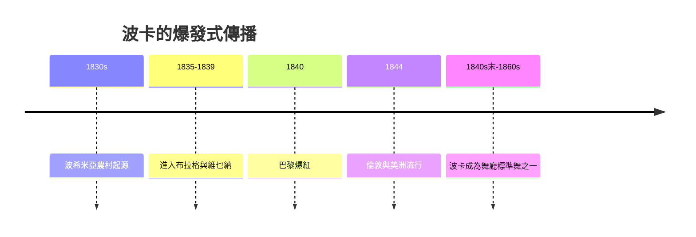

# 6.2 波卡狂潮：一夕征服巴黎與倫敦

時間：1830年代至1850年代

## 一個農村步型的「工業化」

波卡（polka）起源於波希米亞（捷克）的鄉間兩拍舞（plka「half-step」的民間二拍快舞），按常見記載以1830年代布拉格附近的女農 安娜·斯勒扎科娃為起點的傳說廣受流傳（這個起源故事存有不同版本，學界對具體人物存疑——但「1830年代波希米亞農村雙拍快舞」是大體確定的史實）。波卡的舞步簡潔：兩拍一組（hop、step、step、close的變形步型），輕快、跳躍、旋轉。它在1835年前後被帶進布拉格與維也納的舞廳，1839年前後小約翰·施特勞斯與樂師們大量創作波卡舞曲，1840年巴黎的舞廳裡已一票難求——「一夕征服」的速度，是19世紀社交舞流行的第一個現代化案例。

速度快的傳播不是偶然，它需要傳播介質。其一，舞蹈教師：1830至40年代巴黎的專業舞蹈教師學會了波卡並開課（巴黎的舞廳教師們把波卡納入「課程」，如當時巴黎的多位舞師——他們以「新舞」的包裝吸引學生）；其二，樂譜印刷（波卡舞曲的出版物激增）；其三，報紙的笑話與社會新聞（「全巴黎都在跳波卡」的狂熱本身成為可傳播的故事）。倫敦：1844年的一個耐人尋味的事件——倫敦的舞廳（如Almack's）在1844年前後已常見波卡，與華爾茲並列；同年報導亦提及維多利亞女王參與了波卡舞會的記錄。而美國的波卡狂熱在1840年代中後期全面展開。三年的速度，從布拉格農村到紐約——這比前代任何舞的傳播都快。

## 為什麼是「兩拍」

波卡的社會學語義值得注意：它是「兩拍」（duple meter）與「跳」——完全相反於華爾茲的「三拍滑」。跳與兩拍意味著：其一，男女之間的距離可以再遠一點（跳躍式的姿態使身體不易在所有拍點上緊貼——與華爾茲的封閉擁抱相對）；其二，大笑與笨拙被接受（跳的舞允許難看與錯誤——社交舞的第一種「自嘲的舞」）；其三，節奏更簡單，青少年與新手可以直接進場（學舞的門檻大幅下降）。波卡因此是「舞廳大眾化」的第一位功臣：它把「會不會跳」從「有沒有教養」鬆綁為「敢不敢跳」——後來的20世紀大眾舞（從查爾斯頓到迪斯可）都延用這個「波卡邏輯」。

## 遺留的技術遺產

波卡留下的技術也進入了今日的社交舞語庫。其一，「彈跳的膝蓋」的彈性技術——今日捷舞jive與搖滾舞的彈跳膝、以及薩爾薩等舞的彈性步，都可追溯此脈；其二，「hop-步」的步伐結構（加跳的移動）：這在世界各地的舞步語彙裡仍然常見；其三，波卡與華爾茲、瑪祖卡一起被列入19世紀的「舞廳標準舞」（ballroom suite），其佈局至今在美國鄉村舞廳仍能見到。波卡的流行期不長（約二十至三十年），但它是「以傳播速度與入門門檻，而非以優雅取勝」的舞——這個特徵後來成為20世紀每一次「舞潮」的共同基因。本章之後，我們將跨越美洲：切分音的節奏即將從非裔美洲的鼓聲中崛起，那正是20世紀社交舞的第一個真正革命。

