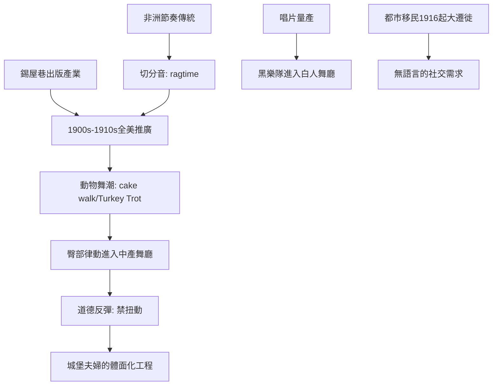

# 7.1 雷格泰姆與切分音的入侵

時間：1900年代至1910年代

## 切分音：節奏的「非洲DNA」

19世紀末的美國，密西西比河流域的黑人音樂家（主要推手是非裔美國人與克里奧爾音樂家）發展出雷格泰姆（ragtime）——把「切分音」（syncopation，重音拍點落在弱拍上）成為主要的節語。這個節奏資源有明確的非洲譜系：西非與中非的節奏傳統（透過奴隸貿易進入美洲）在加勒比與北美重新組合，生成多種節奏形態（班卓琴的切分節奏、古巴的habanera與conga的低音型）。1890年代，斯科特·喬普林Scott Joplin的《楓葉拉格》（Maple Leaf Rag，1899年出版）開啟雷格泰姆的出版產業；1900至1910年代紐約的錫盤巷（Tin Pan Alley，紐約的流行音樂出版產業群）以雷格泰姆與歌曲的印刷與推廣，把切分音推向全美。

社交舞收到的果實不是「聽」，而是「動」。切分音的物理效果顯而易見：兩拍內的重音位移，迫使舞者把重心從「滑」轉到「彈」與「晃」——臀部與膝蓋的彈性動作被帶進了白人中產的舞廳。1900至1910年代的美國，舞池迎來一場「動作的大爆發」：cake walk（1890年代黑人社區的競技舞，嘲弄上層姿態，後被白人社交場吸收）、Turkey Trot、Grizzly Bear、Bunny Hug與Texas Tommy——動物命名的「動物舞」潮（1909至1912年前後）成為第一波「黑人律動的白人社會接收」。這個過程的社會邏輯值得強調：黑人社交場（哈林的沙龍舞廳、南方諸城的黑人舞廳、紐奧良的Second Line遊行文化）孕育動作，白人中產舞廳接收後以「新舞」之名引爆流行——這個「節奏搬運」正是20世紀每一次社交舞潮的基本結構（查爾斯頓、林迪、搖滾、迪斯可、嘻哈都同構）。

## 為什麼是「此時」：三重引擎

1910年代的動作解放需要的三重引擎。其一，錄音與唱片：1900年代中期，Victor與Columbia的唱片量產（唱片首先在去除「現場的階級屏障」上有效——同一張唱片可以在黑人沙龍與白人舞廳被播放，白人終於可以「跟著黑人樂隊」練習）。其二，都市化與移民：1900至1914年，紐約與芝加哥的移民人口劇增（南歐、東歐與非裔人口的大遷徙Great Migration自1916年起）。移民的城市需要「不需述說家族史的社交」——跳舞正好是一種「無語的社交」。其三，女性的身體規範衝突（緊身衣的鬆綁：1908至1914年間，緊身胸衣開始被年輕女性捨棄——這是舞蹈的身體革命所需的服裝條件）。三重引擎同時啟動，登場的正是探戈的全球化（下一章），與第一波「美國街頭舞」的白人接待。

## 動物舞潮的道德反彈（舊劇本的重演）

1912年，美國與英國的道德評論者再次發出「舞廳不道德」的警報（這次反彈的形式是：報紙評論、教會的「舞廳問題」報導，以及幾座城市的市政舞廳規範——包括紐約的公立舞廳（public dance halls）的「行為守則」）。與1790年代華爾茲禁令的比較顯示規範的演變：反彈的重點已不是「身體接觸」（華爾茲已被合法化），而是「動作」（臀部與彈跳——「不要扭動」是1912年前後美國舞廳守則的常見條款）。這個「動作的規範化」戰線，將在與城堡夫婦（下一章）的「體面化」工程中出現轉折：社交舞的上層社會接受，將以「把動作收斂為優雅」為代價。

