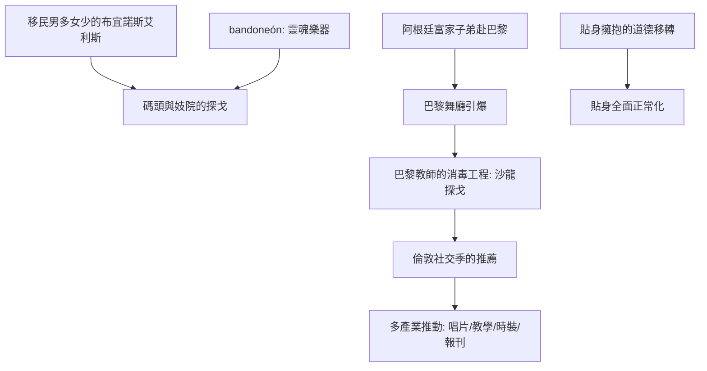

# 7.2 探戈逆襲：從布宜諾斯艾利斯碼頭到巴黎

時間：1900年代至1913年

## 碼頭與妓院：探戈的第一個世界

阿根廷探戈誕生於布宜諾斯艾利斯與蒙得維的亞的底層社交場：碼頭區、郊區（arrabal，城市邊緣的貧民區）的咖啡館與妓院（academias de baile）。十九世紀末，布宜諾斯艾利斯的人口因移民而爆增（1880至1914年，義大利與西班牙移民使阿根廷首都成為南美最歐化的都市——男性移民數量遠超女性）。這個「過量男性、貧窮移民」的社會結構，直接塑形了探戈：其一，探戈的「雙人擁抱」（abrazo，比華爾茲更近、更貼身）正配合這種社會結構下的求偶場景；其二，舞步的「即興、對節的停頓與轉頭」是在擁擠小舞池中與其他男性共處的身體協議（常見的「眼神與停頓」是舞池內的權力訊號）；其三，樂隊（班多紐手風琴bandoneón自德國傳入並成為探戈的靈魂樂器——1900年代這種無法被軍隊攜帶的小規模樂器，恰好配合妓院與咖啡館的空間規模）。此時的探戈曲風（早期常見的是milonga的節奏）可追溯自哈巴尼埃拉與克里奧爾節奏的結合。

## 巴黎的「消毒」與王公的推薦

1910年前後，阿根廷的富家子弟（學會了探戈的年輕上流男子）赴巴黎受教育與消費——他們把探戈帶進巴黎的夜世界。1912至1913年，探戈在巴黎爆紅（多家巴黎舞廳與餐廳增設「探戈之夜」；在時裝界的響應：時裝品牌為探戈設計了專門的窄裙與開衩裙，是時尚產業第一次為一支舞設計衣櫃）。巴黎的接受有明確的「消毒工程」：巴黎的舞教師把碼頭探戈的貼身與粗野改編為「優雅的沙龍探戈」（法式探戈的站距放寬、動作雅化），並由上流社會的男士在社交場合展演。1913年前後，英王喬治五世與愛德華親王的宮廷圈子、以及倫敦社交季的舞會紛紛出現探戈（倫敦的探戈之熱在1913年初達到高潮——(The Times)等報刊有當年報導記錄），「探戈課程」在各大飯店成為時流，教師們以「很容易學、馬上可上場」的廣告吸引學生。

## 城市資本與「舞的逆襲」

探戈的逆襲是「舞的全球化」第一次完整案例：非歐洲（阿根廷）的社交舞，透過移民資本與巴黎的尖端時尚場，反過來成為歐洲上層階級的「新教養」。它揭示了三個結構性趨勢：(1)「舞源地的社會學逆轉」：優雅不再是舞的源頭，反而是「底層的野性」成為稀缺的品味——巴黎的資本不是創造了一支舞，而是「認證」了一支舞（這個「巴黎認證」機制之後將由紐約接管，再由其他城市接替）；(2)「性別與規範的反彈」：巴黎與倫敦的反彈此起彼伏（多位神職與報刊批判探戈的貼身；1913年某些城市的禁令仍存），但因上流的人口已經「親舞探戈」，反彈在兩三年内消散——這顯示：上流的身體實踐比道德批評更有制度力量；(3)「產業的分工」：探戈的全球流行由四個產業同時推動（唱片/音樂出版、舞蹈教學、時裝與報刊八卦——四個產業第一次共同運作一支舞）。這種「多產業的合作推動」將成為往後所有美片舞潮（查爾斯頓、迪斯可、麥克舞、漢丹舞）的標準結構。

## 探戈的身體遺產

探戈留給社交舞的技術遺產有三。其一，「身體的重心分離」（一個舞者的「軸心在對方」，以提示步與重心接觸來「聽對方」——lead的效率與follow的身體敏感在探戈身上成為顯學）；其二，「音樂的重音不在步點而在呼吸」（探戈的斷奏與情感上的停頓——社交舞第一次把「停」作為動作）；其三，「對舞伴的相依」（兩人的貼身不再是道德問題，而成為技術的基礎——從此之後，貼身擁抱在西方社交舞全面正常化）。若沒有1913年的探戈，「貼身」的解放將仍要等待數十年——探戈是第一次由「上流社會自己」完成貼身擁抱的道德移轉的舞種。

