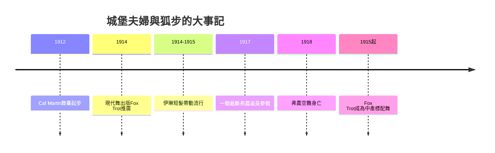

# 8.1 弗農與伊琳·城堡：現代社交舞的規範

時間：1912年至1920年代

## 一對夫妻的「體面化工程」

弗農與伊琳·城堡夫婦（Vernon and Irene Castle）是社交舞史上第一對「超級明星教師」。1912年起，他們在紐約的餐廳舞場（如Café Martin）與舞會上展演一種「乾淨的動物舞」：把動物舞潮裡的彈跳與扭動收斂成流暢而優雅的版本——他們普及的舞（Turkey Trot的收斂版、快速單步One Step、狐狸步Fox Trot的推廣、以及他們自創的Castle Walk）全部共享一個理念：舞可以簡單、可以輕快，但必須「體面」。城堡夫婦的形象工程極成功：伊琳的短髮與直筒裙（她剪掉長髮的消息在1914年成為美國報紙的頭條級討論，「伊琳·城堡式」短髮成為1915年前後一大流行）、兩人的儀態與簡潔衣着，成為「新式年輕女性」的視覺標準。他們在1914年出版《現代舞》（Modern Dancing，以文字與照片講解規範的社交舞）——這是第一本以「照片教學」為主的大眾舞蹈書。

城堡工程的社會學意涵值得點明：動物舞潮（上一章）的白人上層焦慮，需要一個「可以放心跳的美國舞」，城堡夫婦剛好補上了這個位置（他們實際上把黑人社群孕育的節奏動作「洗白化」——包括Fox Trot的步法，其源頭與黑人舞場的One-Step與Fox-Trot原型接近）。同時，兩人的演出方法有一個重要創新：他們在Tea dances（下午茶舞）與百老匯舞台上的示範，並以「電影」為推廣媒介（1910年代中葉，他們的多支示範影片在戲院放映——舞蹈教學影片的先聲）。

## Fox Trot：中產的舞

Fox Trot（狐步）的定名與推廣與城堡夫婦密不可分（其步法原型可上溯至黑人舞場的One-Step與W. C. Handy作曲的《聖路易斯藍調》節奏素材；城市舞廳的表演者如Harry Fox在1914年的紐約劇場把快速One-Step帶上舞台）。狐狸步的關鍵技術是「慢快快」的節奏組合（slow-slow-quick-quick），可以極慢或極快地消化音樂——這種節奏彈性讓「任何速度的美國歌」都可以被舞掉。Fox Trot因此成為20世紀美國中產階級的「標配舞」：從1915年起，它一直是美國與歐洲舞廳的最普及雙人舞之一，並成為「國標舞」體系摩登舞的核心之一。

## 1917年的斷裂：戰爭與雙人舞的重生

城堡夫婦的黃金期在1917年被第一次世界大戰截斷：弗農返英（加拿大飛行員部隊）參戰，1918年在德州受訓空難身亡；伊琳轉入慈善與時尚。一戰（1914–1918）對社交舞的衝擊是結構性的：其一，歐洲舞廳的人才與資金斷層（戰時倫敦與巴黎的舞會銳減，戰後以美國為尊）；其二，戰後一代的「活在今天」心理（1918–1929年的「查爾斯頓年代」有自己的解釋：一代人看過死亡，所以要跳舞）——戰後的「解放一代」將把城堡式的優雅再丟掉一部分；其三，美國的文化主權上升（爵士樂從新奧爾良、芝加哥、哈林北上——「美國舞」第一次成為全球舞廳的主流）。城堡夫婦規範的是「優雅的底層」，而下一章的查爾斯頓與林迪舞將在規範之上再爆一次：「亂」的全球化。

