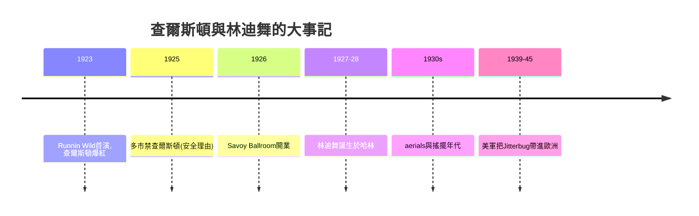

# 8.2 查爾斯頓與林迪舞：身體解放

時間：1920年代至1930年代

## 查爾斯頓：膝蓋與爆炸的節奏

查爾斯頓（Charleston）的名字來自南卡羅萊納州的查爾斯頓，其步法的源頭可上溯自非裔美國人的幾種腳部動作（包括19世紀的patting juba踏腳拍身的節奏傳統）。1923年，百老匯音樂劇《Runnin' Wild》（作曲家James P. Johnson）中的〈查爾斯頓〉一曲與其表演，把查爾斯頓推上全美（在百老匯與全國巡演的推動下，1923至1927年查爾斯頓是全球舞廳的最大熱潮，日本與中國沿海城市的舞廳也跳查爾斯頓，是當年報導常提及的現象）。查爾斯頓的動作語彙極為特定：膝蓋向內的外旋、腳掌的橫向擦地、上半身的自由搖擺——女性第一次以「不顧優雅」的方式在公共舞廳大動作。與約會千金Flappers的短髮、短裙與香菸一起，查爾斯頓成為1920年代「身體解放」的典型案例：舞與時尚與女性印象一起重寫了何謂「可以移動的身體」。

道德的反彈依舊（美國多個市政禁查爾斯頓於公共舞廳——常以安全為由：1925年報導過舞廳跳查爾斯頓致傷的例子），但這次反彈的效力顯然有限——因為「跳查爾斯頓的年輕女性」本身就是新的消費主體（汽車、咖啡館、舞票與服裝的消費者）。消費資本的效力，第一次大於道德資本——這是社交舞史的一個制度性轉折。

## 哈林的Savoy：林迪舞的誕生

林迪舞（Lindy Hop）是本章的重心：1927年前後誕生於哈林的Savoy Ballroom（1926年開業，可容納數千人的「搖擺舞之家」，非裔美國人主要客群——Savoy的特色是黑人與白人可以同場跳舞，這在當時的紐約相當罕見）。林迪舞流行的命名傳說（把「Lucky Lindy」——1927年林德伯格橫越大西洋的飛行員暱稱——接上舞步，見於1928年前後的紐約報刊）存有爭議的細節，但「1927至1928年前後的哈林Savoy」是林迪舞的主要誕生地，這個史實有教師與舞者的長期見證。林迪舞的技術突破是開放式擺盪步（swing out）與「空中動作」（aerials：舞者被拋起、翻轉——Frankie Manning在1930年代以aerials聞名），它從breakaway（離開擁抱的分離即興）演化而成，技術的核心是「引導與跟隨的彈性協商」：兩人在擁抱與分離之間即興。

## 搖擺的全球化

1930年代，搖擺（swing，音樂與舞的名字）經由三條路全球化：其一，樂隊巡演（Count Basie、Benny Goodman、Duke Ellington的全國廣播與巡演——1935年至1945年的「搖擺年代」）；其二，好萊塢與舞蹈片（1930年代後期的音樂片與舞蹈短片把林迪舞帶給全球觀眾）；其三，舞教師的商業化（紐約與歐洲的舞教師學校把Lindy Hop規範為「可以教」的課程）。二戰（1939–1945）時美國軍隊駐英與歐洲，把「吉特巴Jitterbug」直接帶進歐洲的舞廳（倫敦與巴黎的舞客學的是美國的搖擺舞北非與義大利戰場的休整期，美軍與當地青年的Jitterbug競賽曾被戰地記者報導）。戰後（1945年起，舞的國際流動是雙向的：美國帶走了英國的ballroom標準，英國則把國際競技化推向全球——見下一章）。

本章的結尾點題：查爾斯頓與林迪舞完成了「身體的解放」與「黑美社區的技術進入全球主流」兩件事。若無這一層，拉丁舞的全球熱（下一章）與搖滾舞（更晚）都缺乏身體的「即興語法」。社交舞的最後一個千年主題「誰在帶動作」，在本章有了新的答案：不是巴黎，不是倫敦，而是哈林。

