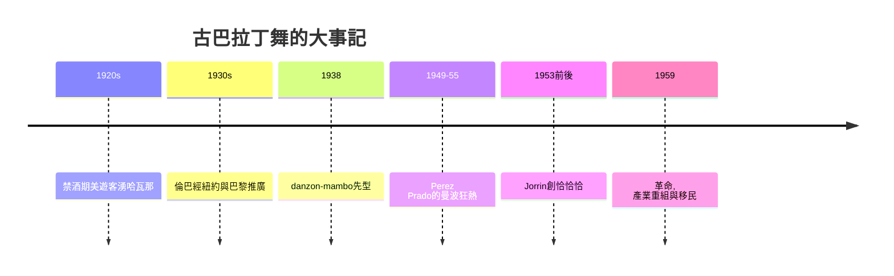

# 9.1 倫巴、恰恰恰與曼波的古巴舞台

時間：1930年代至1950年代

## 古巴：節奏的三層堆疊

古巴的社交舞傳統建立在一個非洲—西班牙的雙源節奏系統上（民間的rumba性感舞、son的雙人節奏舞、danzón的宮廷式搖擺）。20世紀頭三十年，美國資本對古巴（糖業、煙草與後來的旅遊業）的大舉投資，把哈瓦那造出一個「美國人可達的熱帶夜世界」（禁酒年代的1920年代，美國的「熱帶度假」把哈瓦那夜總會推向美國主流旅遊——哈瓦那夜生活的場景被美國遊記與專欄寫入美國文獻）。而1930年代起，古巴音樂的「美國化出口」（RCA與其他美國唱片公司錄製古巴樂隊；1930年代起紐約的拉丁樂隊在哈林與紐約市中心演出——公認的先驅之一是墨西哥裔樂隊領班Xavier Cugat——他在華爾道夫飯店的常駐演出與電台聲量）讓拉丁舞第一次成為「電台與電影」可傳播的商品。

## 倫巴的「上層引進」（1930年代）

倫巴（rumba，古巴的son與民間rumba在美國的重組版本）的推手是樂隊領班與舞師（Xavier Cugat 的紐約常駐樂隊與舞師如Aida Vera與Pierre Zurcher教授的推動；英國則由舞師Pierre Lavelle在1930年代自巴黎引進）。倫巴的身體語法核心是「臀部的8字」（重心的一次橫向移動在每拍產生臀部位移——「Cuban motion」，源自膝蓋的彎直交替而非刻意扭腰），它與爵士律動的最大差異是「節拍與重心的分離」（甚至是「不動聲色的性感」——倫巴與探戈一樣，是把「濃厚的情感」放在「最少的動作」上的舞）。1930年代的倫巴在美國是「飯店舞廳的宮廷化拉丁舞」（中產與上層的入場舞），英國的教師會議（球廳教師的協會）則在1940年代末與50年代把倫巴納入拉丁組舞的「教學標準」（見下一章的ISTD體系）。

## 曼波與恰恰恰：古巴的黃金五〇年代

曼波（mambo）與恰恰恰（cha-cha-chá）的爆發都在1950年代，經濟背景是古巴旅遊業的黃金年代（美國遊客與資本流入，哈瓦那夜總會的產業化——Tropicana與Sans Souci等大型夜總會的規模與投資達到頂點）。曼波的樂源是Danzon加非洲鼓的快節奏變體（構成於1940年代末，Orestes López與其弟Cachao在1938年創的danzón-mambo是關鍵檔案），它的推手是Pérez Prado（曼波之王——他的墨西哥與美國唱片在1949至1955年把曼波推向全球排行榜，1950年代中期「曼波狂熱Mambo Mania」在美國與歐洲的舞廳同時爆發）。恰恰恰則在1950年代初由Enrique Jorrín所創（在danzón的基礎上加入輕快的「cha-cha-chá」重複腳音——跳舞的剪影與音樂同步）：它是一支「自解釋」的舞（步法即唱名——「一二恰恰恰」的邏輯使其成為拉丁舞中最容易教的之一，此後的教師產業大量利用這一點）。

這些舞種的古巴黃金期在1959年的古巴革命戛然轉向：革命政府的文化政策重組夜總會產業、美國的古巴移民大量移居邁阿密——古巴音樂的中心外移到紐約與邁阿密（下一章的Salsa正是這個移民網絡的産物）。1950年代的古巴舞台留給社交舞的是三種至今仍在全球被跳的舞種（倫巴、恰恰恰在英國體系成為國標拉丁的固定組成，曼波成為紐約Palladium的靈魂）與「節奏的拉丁技術庫」。

