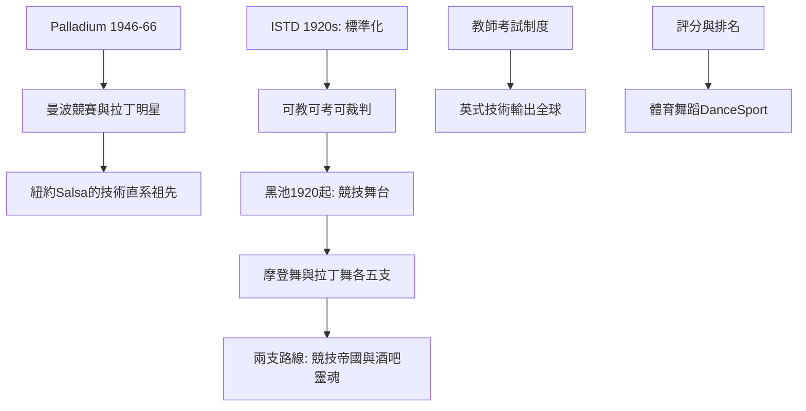

# 9.2 紐約Palladium、黑池與ISTD

時間：1940年代至1990年代

## Palladium：曼波之家的跨種族舞廳

紐約的Palladium Ballroom（1946至1966年，位於53街與百老匯口）是拉丁舞在美國的聖地。客群結構罕見：波多黎各移民、義裔、猶裔與非裔美國人同場共舞（紐約戰後的種族行政規範在Palladium依然有張力，但它的實際政策是「人人可進」——這是紐約戰後種種舞廳中最開放的一處）。Palladium的「舞王競賽」（週末的mambo競賽）創造了第一批拉丁舞明星（Millie Donay與Cuban Pete、Augie與Margo等名對），他們的技術語彙（快腳、旋轉、兩人身體的分離動作）就是日後紐約Salsa的技術直系祖先。Palladium在1960年代中期因場地易手而落幕，北美的拉丁舞中心隨後移向邁阿密等城市，但「拉丁舞是都市混血的社交」這個定義是它留下的。

## 黑池：舞廳帝國的競技化

英國的社交舞技術在兩次大戰之間走上另一條路：制度化與競技化。1920年，英國帝國舞蹈教師學會（Imperial Society of Teachers of Dancing，ISTD）在倫敦成立舞廳分會（Ballroom Branch，由北方與倫敦的舞師如G. W. Lyons、Phillip Richardson推動），開始把英倫流行的舞（華爾茲、Fox Trot、Quickstep與後來加入的Tango）標準化為「可教、可考、可裁判」的教材；1920年代末完成技術大綱，統一英式舞廳的語言。英國在這裡的角色是「技術譜系的管理者」：美國孕育動作，英國把它寫成教學大綱。

黑池舞蹈節（Blackpool Dance Festival）自1920年起舉辦（英國北岸度假勝地黑池的Winter Gardens），1920年代的Blackpool以「英國舞廳之王」的競賽即成為舞師與舞者朝聖地1950年代起其他國家的舞者開始參賽，國際級陣容逐漸成形，黑池遂成為全球國標舞的最高舞台（今日被稱為「國標舞的溫布頓」）。黑池與ISTD共同確立了現代國標舞的架構：摩登舞（Modern/Standard：華爾茲、維也納華爾茲、Fox Trot、Quickstep、Tango）與拉丁舞（Latin：倫巴、恰恰恰、Samba、Paso Doble、Jive）各五支，並建立等級與評分制度。

## 國際競技的產業結構

國標舞產業化有三個經濟支點。其一，「教師考試制度」：ISTD及其後續機構設立的舞蹈教師資格考試，使「舞蹈教師」成為一種持證職業（1930年代起英國舞師向美國、日本與澳洲輸出教學體系）；其二，「評分與排名」：成立於1950年代的國際組織（今天的WDC與WDSF等——舊的體系在1990年因國際承認權的競爭而分化敵對），把國標舞變成「有分數的體育」（2000年代的WDSF曾致力推動其納入奧運體系未果，但「體育舞蹈DanceSport」的名與制度仍在發展中）；其三，「黑池這個『商品』」：黑池在電視與網路的年代成為國標舞的影視平台（英國1960年代起即有舞廳競技的電視節目）。本章的結尾點出了往後50年的主要路線：社交舞分成兩支（「走下去的舞」與「回到酒吧的舞」）——競技的帝國在黑池與ISTD的章程裡，社會的靈魂在街頭與酒吧裡。兩支都活躍到今天。

