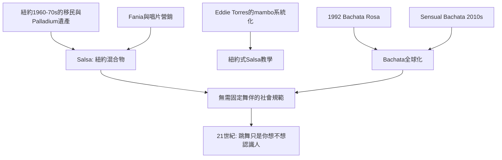

# 10.1 薩爾薩與巴恰塔：無門檻的社交

時間：1960年代至今

## Salsa：紐約混合物的名字

「Salsa」不是古巴的舞種，而是紐約的名字。1960至1970年代的紐約（古巴革命後的拉丁移民、波多黎各裔的南哈林社區、以及Palladium遺產的舞者與樂手）創造出一種混合風格（son、mambo、pachanga與爵士的節奏混合），需要一個行銷的名字——「salsa」（醬汁）在1970年代被唱片產業採用（Fania Records的唱片營銷，是salsa這個名字工業化的常見敘事）。舞的方面，紐約salsa的骨架是mambo（on 2的踏點與快腳——Eddie Torres在1970與80年代把紐約式salsa系統化的教學是關鍵），並吸入了加勒比與中南美的舞步資源。1980年代起，salsa經由三條路全球擴散：其一，移民網絡（紐約與邁阿密的龐帝移民把salsa帶回哥倫比亞、委內瑞拉與歐洲）；其二，度假與音樂產業（哥倫比亞Cali的salsa舞與樂隊的聲譽——Cali被譽為「世界salsa之都」，其salsa節是當代拉丁舞最大的社群節）；其三，教師產業的全球化（倫敦、東京、雪梨、台北的salsa學校在1990年代起爆發——salsa成為都市中產的「社交健體」產品）。

## Bachata：被歧視者的舞種

巴恰塔（bachata）的歷史與salsa截然不同：它曾長期是「被歧視的音樂」。1961年，獨裁者特魯希略（Trujillo的統治到1961年）死後，多明尼加的鄉村音樂（bolero與merengue的混合，初名 bolero campesino，1960年代被投以「bachata」的歧視性標籤）在城市低收入區的酒吧與妓院流行——其歌詞多講失戀與酒，其舞較慢、親密、以臀部與身體的動作作為表達。Bachata在多明尼加上層與主流媒體眼中是「低層音樂」（1970與80年多政府在媒體上幾乎不播bachata），它直到1990年代初才被主流接受（Juan Luis Guerra的1992年《Bachata Rosa》的全球成功是轉折點）。21世紀的bachata已經全球化（多明尼加傳統式、馬德里改良的sensual bachata在2010年代成為全球舞蹈教學的熱門——這支「在夜店界復活」的社交舞，是本章最後一個大眾化的案例）。

## 「無門檻」的社會結構

Salsa與bachata今天的流行有共同結構，值得指出它們與前代舞潮的差異。其一，「無需婚約」：這是最重要的變化。宮廷舞會與黑池競技都以「固定舞伴或正式引介」為前提；salsa社交（social）的規則是把「與陌生人共舞」標準化——「你跳舞不等於約會」已成為全球salsa社群的共享規範（如此使得女性可以獨自進場、已婚者可以另一半不同行）。其二，「公開的教學產品」：每家salsa學校的產品都包含「社交之夜」（skill的使用把教學與社交場景直接綁定：你在課堂見過的陌生人在週末的social可以再見——學校因此是一種「社交俱樂部」的變形）。其三，年齡與職業的多層擴散：salsa社群的年齡帶從20代到60代（中老年健康與公共衛生政策——「舞是健康的社交」成為公共衛生的語言）。換言之：21世紀的salsa酒吧完成的，是把本書第一章的遠古圓圈重新搬回現代都市：跳舞不再是身份的入場券，而只是「你今晚想不想認識人」。

