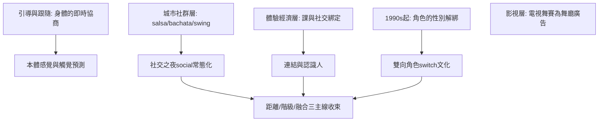

# 10.2 引導與跟隨：回歸身體溝通

時間：1990年代至今

## 「引導與跟隨」是什麼

社交舞與表演舞的分界，最終落在「引導與跟隨」（lead & follow）的語法上。表演舞（編舞、競技套舞、動作捕捉）的每一拍事先被規定；社交舞的每一拍由兩人「即時協商」：引導者（通常但不必是男性）以身體的重心、軸、框架的微調給出「下一步」的訊號，跟隨者以敏感與重量的即時反應完成——這個「身體的對話」本質上是本書自第一章以來長期主題（天然的社交技術）的技術化完成。它是一種「無口語、毫秒級」的溝通：研究成果（包括舞蹈科學與動作科學近二十年的實驗研究）顯示，雙人接觸的社交舞大量倚賴本體感覺與觸覺的預測——兩人的身體實質上構成一個「預測編碼系統」（以腦科學的話說：舞者的身體先「預測」對方的動作，再在毫秒內修正）。

## 疑似「性別解綁的換位」

1990年代起，全球社交舞社群有一個重要的規範演變：角色的性別解綁。傳統的「男引女跟」在中產新世代面前正被「雙向角色」（依活動或練習而switch roles）衝擊——倫敦、紐約與柏林的salsa與swing社群在2010年代有明顯的switch/ambidancian（雙能舞者）文化，常見於LGBTQ友善的社交舞活動；「雙向角色」已成為當代社交舞世界的重要文化板塊。這個變化的歷史位置值得回望：本書第3章的華爾茲，在1810年代的道德批評裡一個焦點是「女人的主動」——兩百年後「女人的主動」也包含了「引導」，而社交舞的身體權力終於不再由性別默認配置。

## 社交舞的當代結構

21世紀的社交舞場景有三層結構。其一，「城市社群層」：salsa、bachata、kizomba、zouk、swing（lindy hop）、blues等在各自城市的俱樂部與social（社交之夜）——紐約、倫敦、東京、巴黎、聖保羅的salsa、kizomba與swing活動的常態化使「都市社交舞」有固定的晚間議程；其二，「體驗經濟層」：舞蹈課與社交之夜（推銷「連結與認識人」的體驗商品）是21世紀社交舞的主要商品形態；其三，「影視層」：電視綜藝與影視作品（如《與星共舞》《舞力全開》）的社交舞熱，與社群層互動——電視上的華爾茲是舞廳的廣告。

## 縱貫全局的三條主線

寫到本章，本書的三條主線可以收束。距離：從遠古圓圈與手牽手，到宮廷指尖、華爾茲的封閉擁抱、探戈的貼身、搖擺的分離即興，到今日「連結與接觸即音」，距離的演變幾乎是「社交技術」的演變；階級：宮廷的教養篩選，被舞廳的身體篩選取代，再被酒吧的意願篩選取代——每一次的「破壁」都由一場逼人「動起來」的節奏革命催生；融合：歐洲的形式容器裡，先載入了非洲的節奏（切分音），再載入了拉丁的鼓聲（son與rumba），最後由全球的社群與產業共同翻新——社交舞是全球化最成功的一種身體產品。至此，本書的敘事收束於一個當代問題：影視綜藝與演算法短影音的年代，社交舞的身體語言能否跨越螢幕——而答案正在舞池裡繼續書寫。

