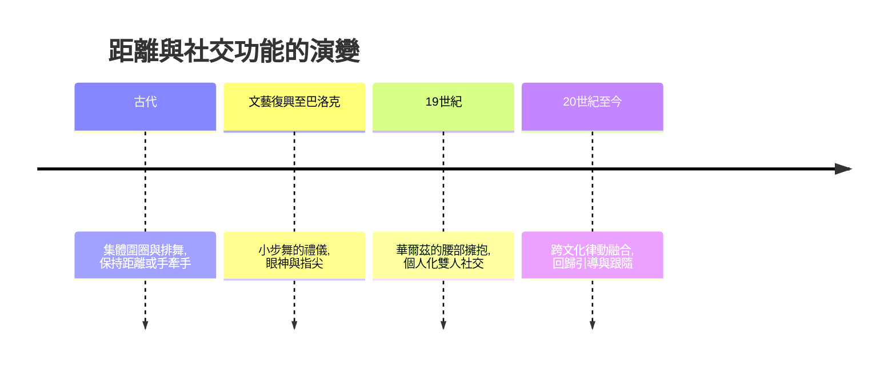

# 社交舞的故事：從篝火圍圈到酒吧連結的身體社交史

社交舞是唯一一種「出發點不是表演」的舞蹈：它存在的理由是你邀請了另一個人。本書從遠古篝火的集體律動寫起，經古希臘羅馬、中世紀鏈舞與宮廷低舞、路易十四的幾何宮廷、華爾茲的道德風暴、施特勞斯的大眾舞廳，到新大陸的鼓聲、探戈的逆襲、查爾斯頓的解放、拉丁舞與黑池競技，最後回到今日酒吧裡無門檻的引導與跟隨。三條主線貫穿全書：身體距離的演變（圍圈、手牽手、指尖、擁抱、離合連結）、階級的破壁（部落、宮廷、市民、街頭）、文化的融合（歐洲形式承載非洲律動與拉丁鼓聲）。

## 第一篇：集體律動與古文明的社交雛形

* 第1章-篝火圍圈與部落社交
    * [1.1-從祭祀巫術到擇偶與結盟](01.1-從祭祀巫術到擇偶與結盟.md)
    * [1.2-手牽手：人類最早的集體接觸](01.2-手牽手：人類最早的集體接觸.md)
* 第2章-古希臘的狂歡與古羅馬的宴會舞
    * [2.1-酒神節與雅典公民的社交舞禮儀](02.1-酒神節與雅典公民的社交舞禮儀.md)
    * [2.2-羅馬宴會舞與Carole的雛形](02.2-羅馬宴會舞與Carole的雛形.md)

## 第二篇：中世紀鄉村與宮廷禮儀的萌芽

* 第3章-鏈狀舞與鎖手舞：中世紀的等級與觸碰
    * [3.1-卡羅爾舞與布雷舞：圍圈與跳躍](03.1-卡羅爾舞與布雷舞：圍圈與跳躍.md)
    * [3.2-低舞Basse Dance：貴族的優雅滑步](03.2-低舞Basse Dance：貴族的優雅滑步.md)
* 第4章-太陽王與幾何宮廷舞的巔峰
    * [4.1-1661皇家舞蹈學院：社交舞的標準化](04.1-1661皇家舞蹈學院：社交舞的標準化.md)
    * [4.2-小步舞曲的權力密碼](04.2-小步舞曲的權力密碼.md)

## 第三篇：衝擊與革命——華爾茲與大眾舞廳

* 第5章-華爾茲：擁抱與旋轉的道德風暴
    * [5.1-從鄉間蘭德勒到封閉式擁抱](05.1-從鄉間蘭德勒到封閉式擁抱.md)
    * [5.2-禁令、維也納會議與全球狂熱](05.2-禁令、維也納會議與全球狂熱.md)
* 第6章-施特勞斯帝國與波卡舞狂潮
    * [6.1-維也納大眾舞廳：市民階級的狂歡](06.1-維也納大眾舞廳：市民階級的狂歡.md)
    * [6.2-波卡狂潮：一夕征服巴黎與倫敦](06.2-波卡狂潮：一夕征服巴黎與倫敦.md)

## 第四篇：新大陸的鼓聲與社交舞現代化

* 第7章-黑人律動注入與阿根廷探戈
    * [7.1-雷格泰姆與切分音的入侵](07.1-雷格泰姆與切分音的入侵.md)
    * [7.2-探戈逆襲：從布宜諾斯艾利斯碼頭到巴黎](07.2-探戈逆襲：從布宜諾斯艾利斯碼頭到巴黎.md)
* 第8章-城堡夫婦與咆哮二〇年代
    * [8.1-弗農與伊琳·城堡：現代社交舞的規範](08.1-弗農與伊琳·城堡：現代社交舞的規範.md)
    * [8.2-查爾斯頓與林迪舞：身體解放](08.2-查爾斯頓與林迪舞：身體解放.md)

## 第五篇：拉丁熱情、國標競技與現代社交圈

* 第9章-古巴夜總會與拉丁舞風暴
    * [9.1-倫巴、恰恰恰與曼波的古巴舞台](09.1-倫巴、恰恰恰與曼波的古巴舞台.md)
    * [9.2-紐約Palladium、黑池與ISTD](09.2-紐約Palladium、黑池與ISTD.md)
* 第10章-Salsa、Bachata與現代酒吧社交文化
    * [10.1-薩爾薩與巴恰塔：無門檻的社交](10.1-薩爾薩與巴恰塔：無門檻的社交.md)
    * [10.2-引導與跟隨：回歸身體溝通](10.2-引導與跟隨：回歸身體溝通.md)

## 核心亮點

