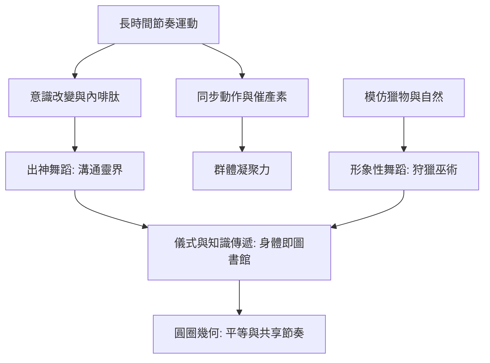

# 1.1 岩畫上的跳躍人影：舞蹈作為最早的語言

時間：約西元前30,000年至前3,000年

## 畫在石頭上的舞蹈

舞蹈是無法被儲存的藝術——但在文字出現之前，人們留下了少數珍貴的物證。印度中部的比姆貝特卡岩畫群（Bhimbetka，部分畫作可追溯至數千甚至上萬年前）中有明顯的舞蹈場景：成排的人物排成隊形、雙臂高舉或屈膝，另有明顯的舞者群像。阿爾及利亞塔西利納傑爾（Tassili n'Ajjer）的岩畫（約前6000年至前4000年的「圓頭時期」作品）中，有一幅著名的「行進的舞者」：人物排成縱隊、雙手高舉，姿態統一而富有節奏感，學者普遍解讀為儀式性舞蹈。西班牙東部的萊瓦岩畫、阿根廷巴塔哥尼亞的「手洞」遺址周邊，也都出現過被解讀為舞蹈的群像。

這些圖像的解讀當然有推測成分——一幅舉起雙手的人像，可能是舞蹈，也可能是祈禱、勞動或遊戲。但有幾個線索支持舞蹈解讀：人物成組排列、動作高度一致、場景常與動物（獵物）圖像相鄰、且與後世已知舞蹈民族的岩畫形態相似。舞蹈研究者柯蒂斯（Curt Sachs）1937年的經典研究《世界舞蹈史》就以此類圖像為起點，將史前舞蹈分為形象性（模仿動物與自然）與非形象性（純粹的律動迷狂）兩大類。

## 為什麼要跳：模仿、共感與巫術

史前舞蹈的功能，人類學家從現代狩獵採集社會（非洲桑人、澳洲原住民、美洲原住民）的田野調查中獲得強烈的旁證。桑人的治病之舞（trance dance）中，全族圍火而舞、擊掌吟唱，舞者進入出神狀態為病人「抽走」疾病；澳洲原住民的圖騰舞蹈重演創世神話，是口述傳統的「身體文本」；北美平原印第安人的野牛舞模仿獵物的動作，是狩獵前儀式的一部分。這些活的證據支持一個合理的推論：史前舞蹈的核心功能是宗教儀式、社群凝聚與知識傳遞——在沒有文字的世界裡，身體就是圖書館。

「狩獵巫術」說（模仿獵物就能捕獲獵物）與「出神說」（群舞引發集體恍惚，溝通靈界）並不衝突：兩者都指向同一個生理機制——長時間的節奏運動引發內啡肽分泌與意識改變，這是後世一切「舞蹈狂歡」現象（從酒神節到銳舞派對）的生理基礎。值得注意的是，集體節奏運動還有一個社會功能：同步動作促進催產素分泌、增強群體凝聚力（現代運動科學與社會心理學的研究結論）——對靠狩獵與戰爭生存的小型群體而言，這種「身體上的合群」可能事關生死。

## 圍火的圓圈：舞蹈的基本幾何

人類學紀錄中的狩獵採集舞蹈，最常見的隊形是圓圈（圍繞火堆或鼓手）與直線。這不是偶然：圓圈讓所有人同時看見彼此、共享同一個節奏中心，是最原始的「平等」幾何。這個幾何將以驚人的持久力貫穿舞蹈史：希臘的圓舞（choros）、中世紀的卡洛爾、文藝復興宮廷舞的圓形隊形、直到今天婚禮上的圓圈舞與繞圈的霍拉舞——篝火旁的幾何，延續了幾萬年。而當舞蹈離開圓圈、進入宮廷的鏡面與劇院的鏡框式舞台時，它的社會意義也將徹底改變：從「大家一起跳」變成「少數人跳、多數人看」，從平等變成表演。

## 舞蹈與繪畫：同源的兩種巫術

回到第一章藝術的故事的線索：拉斯科與夏維的洞穴壁畫描繪動物，岩畫描繪舞者——兩者可能屬於同一套儀式體系。畫出獵物、跳出獵物、唱出獵物，是同一場儀式的不同環節。這提醒我們：在藝術分科（繪畫、音樂、舞蹈、戲劇）的現代觀念出現之前，藝術是整體的儀式行為。舞蹈之於人類，可能不是「藝術的一種」，而是「藝術的原型」：它是第一種把時間、空間、身體、聲音與信仰融為一體的活動。接下來的數千年，我們將看見這個原型的每一次變形。

