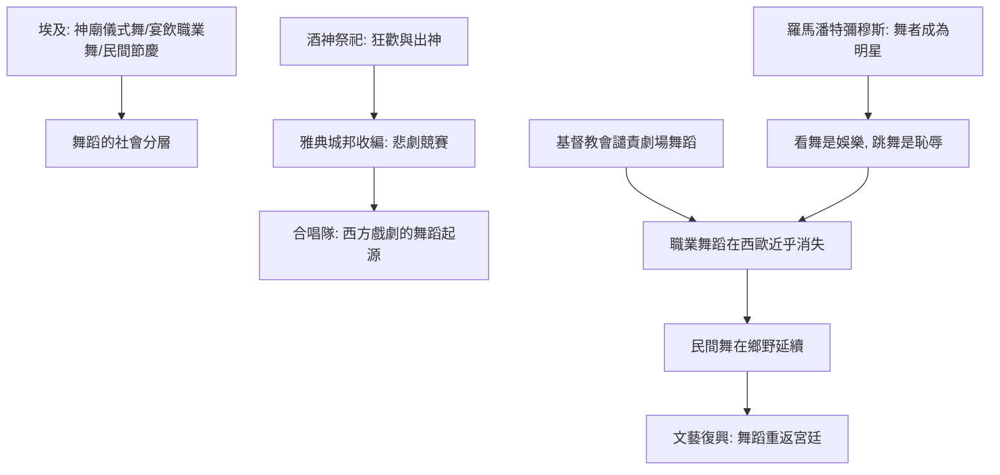

# 1.2 埃及祭祀舞與酒神節：神聖與狂歡的兩極

時間：約西元前3000年至西元前4世紀

## 尼羅河畔的聖舞

古埃及是舞蹈史料相對豐富的古代文明：墓室壁畫與浮雕留下了大量舞蹈圖像。第十八王朝（約前1350年前後）的貴族墓（如納赫特墓、門納墓）描繪宴飲場景中的女舞者：有的雙手交疊舉過頭頂、有的後仰下腰、有的以響板與拍手伴奏。樂師、歌手與舞者常同時出現，構成完整的表演隊伍。

埃及舞蹈的功能分層清晰。最高層是神廟儀式舞蹈：太陽神的晨祭舞、奧西里斯的葬儀舞、哈托爾女神（音樂與歡樂之神）的慶典舞。祭司與專職舞者（部分來自神廟附屬的女子學校）在特定節日表演，動作有嚴格的宗教含義。第二層是宴飲娛樂：貴族陵墓描繪的舞者屬於娛樂職業（多為女性，部分研究者認為涉及情色表演），她們是宮廷與貴族雇用的專業人員。第三層是民間節慶：尼羅河氾濫季與豐收節的村社舞蹈，全民參與。

這個分層透露了一個經典的舞蹈社會學結構：舞蹈的「神聖性」與「職業性」同時存在，且分屬不同的社會階層。當希臘人與羅馬人接觸埃及文化時，他們注意到埃及舞者的職業化與技藝（托勒密時代的遊方舞者已有國際市場）。

## 酒神節：身體的合法狂歡

古希臘的舞蹈傳統根植於兩種土壤：一是荷馬時代的戰舞與圓舞（choros），二是酒神狄俄尼索斯的祭祀。酒神節（Dionysia）是希臘最狂放的節日：信徒（大量是女性，稱為邁納德Maenads，「瘋狂的女人」）身披獸皮、手持茴香杖，在山林中通宵狂舞，伴隨酒、音樂（雙管aulos與手鼓）與出神狀態，傳說中她們曾撕裂野獸。柏拉圖與歐里庇得斯的《酒神的伴侶》（前405年首演）都記錄了這種狂歡的震撼與恐懼。

從制度上看，酒神節被雅典城邦「收編」為公共節慶（約前534年僭主庇西特拉圖確立城市酒神節），並在其中設置悲劇競賽——這就是西方戲劇的誕生現場。合唱隊（chorus）載歌載舞的表演形式，正是從酒神祭祀的舞蹈轉化而來：「悲劇」（tragedy）一詞的字源即「山羊之歌」（tragos＋ode），與酒神祭祀的犧牲儀式相關。換句話說，西方戲劇的祖先是舞蹈。

## 羅馬人的矛盾：喜歡看、鄙視跳

羅馬人承襲了希臘與埃及的舞蹈文化，卻發展出一種獨特的態度分裂。一方面，羅馬是舞蹈的消費大國：潘特彌穆斯（pantomimus，啞劇舞者）是帝國的超級明星——一位舞者、一張面具、一位樂隊，以純粹的身體表演複雜的神話敘事，觀眾為之瘋狂，頂級舞者（如瓦倫提努斯與帕里斯）收入驚人、社會名聲顯赫（帕里斯甚至因表演觸怒尼祿皇帝而引發宮廷風波，見塔西佗《編年史》）。另一方面，羅馬的道德精英鄙視「自己跳舞」的行為：西塞羅說過「除了瘋人院，無人獨自跳舞」（in salebris saltare nemo nisi insanit），貴族若公開舞蹈則名譽掃地（小西庇阿曾譴責跳舞的貴族青年）。看舞是娛樂，跳舞是恥辱——這種「表演者低賤」的態度，將以不同形式貫穿此後兩千年的西方階級史。

## 教會的長夜與身體的收縮

帝國晚期的另一股力量正在集結：基督教會。教父們（如聖奧古斯丁）譴責劇場舞蹈為異教淫穢之風；325年的埃爾維拉會議明文禁止基督徒參與此類表演。西羅馬帝國滅亡後（476年），職業舞蹈表演在拉丁西方幾近消失——但注意，舞蹈本身並未消失：民間節慶舞、婚禮舞、農村的圓舞在鄉野間繼續存在，教會只是把它從「劇場與神廟」驅趕回「村莊與節日」。同時，拜占庭的宮廷保留了啞劇舞者的傳統（史料顯示君士坦丁堡的宮廷娛樂延續至帝國晚期），而表演者「低賤」的社會標籤也一併延續。要到文藝復興的宮廷，舞蹈才會以「貴族的技藝」之名重新登堂入室——那是第三章的故事。

