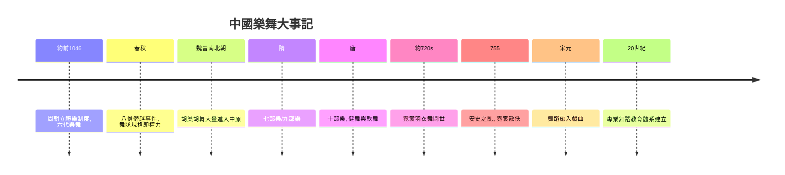

# 2.1 周朝六代樂舞與唐朝霓裳羽衣

時間：約西元前1046年至西元10世紀

## 制度化的舞蹈：周朝的禮樂體系

公元前1046年周武王滅商後，周朝建立了一套影響中國三千年的制度：禮樂。舞蹈在其中不是娛樂，而是政治與宗教的核心制度。周朝整理了六部傳說中的古樂舞，合稱六代樂舞：黃帝的《雲門》、堯的《大咸》、舜的《大韶》、禹的《大夏》、商湯的《大濩》、周武王的《大武》，分別用於祭祀天、地、四望、山川、先妣與先祖。春秋時期《左傳》記載，魯國季氏「八佾舞於庭」——用天子規格的八八六十四人舞隊在家廟演出——孔子聞之怒曰「是可忍，孰不可忍」（《論語·八佾》）。這段記載透露了關鍵事實：舞蹈的隊形規模（佾數）是嚴格的等級制度，天子八佾、諸侯六佾、大夫四佾、士二佾。舞蹈隊形就是權力組織圖，越權即是政治僭逆。

周朝還設有專職機構：大司樂掌管樂舞教育，貴族子弟十三歲起學樂、誦詩、舞勺、舞象（見《禮記·內則》），樂舞是貴族教育的必修課——「禮、樂、射、御、書、數」六藝中樂居第二。這是人類史上最早把舞蹈納入國家教育體系的記載之一。值得注意的是「樂」的概念包含詩、歌、舞三位一體（《樂記》：「詩，言其志也；歌，詠其聲也；舞，動其容也，三者本於心」），舞蹈是樂的完成形式。

## 雅樂與俗樂：制度與身體的張力

周朝的雅樂舞莊重、緩慢、程式化，服務於祭祀與朝儀；與之相對的是各地民間的俗樂舞（「鄭衛之音」），活潑、嫵媚、感官化。儒家士大夫對俗樂的態度分裂：孔子聞《韶》「三月不知肉味」，卻主張「放鄭聲」；魏文侯坦言聽雅樂就犯睏、聽鄭衛之音卻不知疲倦（《禮記·樂記》）。這場「雅俗之爭」是中國舞蹈史反覆出現的主題：制度需要莊嚴，身體渴望快樂。此後每個朝代都重演一次：宮廷雅樂持續被複製為禮儀道具（越來越僵化），民間與異域的俗樂舞不斷從外部注入活水。

## 唐朝：舞蹈的黃金帝國

西晉永嘉之亂後，胡樂胡舞隨民族遷徙大量進入中原（龜茲、康國、天竺的樂舞）；北魏與隋朝設「七部樂」「九部樂」收編四方樂舞；至唐朝（618–907），集大成而有十部樂。唐朝的舞蹈分為健舞（剛勁：胡旋、胡騰、劍器）與軟舞（婉約：綠腰、春鶯囀），規模上有大型的立部伎與坐部伎。長安的宮廷與市井到處是舞蹈：教坊與梨園（唐玄宗設立的宮廷音樂機構）培養數以千計的樂舞人員，杜甫筆下的公孫大娘以劍器舞名動天下（杜甫七歲時觀其舞，數十年後仍寫詩追憶，並載「自此草書長進」——詩人張旭觀公孫大娘舞劍器而悟草書筆法，是中國藝術史上舞與書互相啟發的名案）。

巔峰之作是《霓裳羽衣舞》。據《碧雞漫志》等文獻記載，此曲與唐玄宗夢遊月宮的傳說相關（更可信的源流是河西節度使楊敬述進獻的印度《婆羅門曲》，玄宗加以改編潤色），白居易《霓裳羽衣歌》描繪其演出：舞者著虹裳霞帔，舞姿「飄然轉旋迴雪輕」「小垂手後柳無力，斜曳裾時雲欲生」，以「散序」（散板器樂）、「中序」（抒情慢板）、「曲破」（快板急舞）三段結構呈現。這是中國宮廷樂舞的極致：胡樂的旋律骨架、道教的神話想像、大唐盛世的物質輝煌，熔於一體。安史之亂（755年）後此曲散佚，五代南唐後主李煜與大周后曾據殘譜修復，至宋代徹底失傳——舞蹈消逝的速度，再次證明它是「看不見的藝術」。

## 為什麼唐朝之後是衰落

宋朝以降，宮廷雅樂舞進一步儀式化、僵化，而舞蹈的活力轉移到了兩個地方：其一，戲曲——宋元雜劇與南戲把歌舞吸收進敘事表演，「舞」從獨立藝術變成戲曲演員的基本功（水袖、圓場、起霸都是舞蹈語彙的戲曲化）；其二，民間節慶與少數民族傳統（秧歌、獅舞、龍舞、藏戲、西域各民族的歌舞）在基層社會持續繁衍。這個轉移與科舉制度有關：文人階層通過文字晉身，舞蹈被士大夫視為「倡優之技」，職業舞人的社會地位持續下沉。中國舞蹈作為獨立藝術的復興，要等到20世紀（吳曉邦、戴愛蓮引進現代舞與芭蕾，1950年代起建立專業舞蹈教育體系）——那將是本書第九章與雲門舞集故事的遠因。

