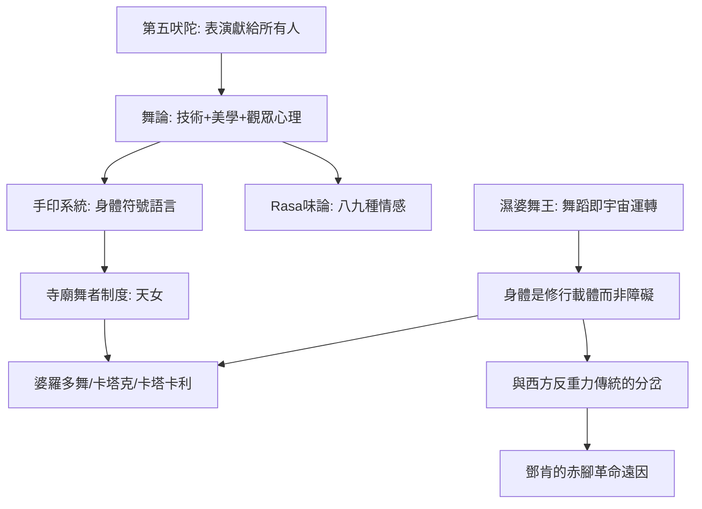

# 2.2 濕婆舞王與《舞論》：宇宙哲學的身體化

時間：約西元前200年至西元200年（文本成形期）

## 一部兩千年前的舞蹈百科全書

《舞論》（Natyasastra）相傳為聖者婆羅多牟尼（Bharata Muni）所作，成書年代學界爭議很大（約西元前200年至公元200年之間），共約六千頌（詩節）。它不只是舞蹈手冊，而是一部完整的表演藝術理論：涵蓋劇場建築、音樂（音階、節拍）、戲劇、化妝、舞蹈、表演美學與觀眾心理。它將表演界定為第五吠陀——獻給所有人的吠陀（前四吠陀僅限特定種姓），使表演藝術獲得宗教正當性。

《舞論》建立的技術體系至今仍是印度古典舞的基礎。其一，Nritta（純舞蹈，講究節奏與形式）與 Nritya（表意舞蹈，配合詩句傳達情意）的區分。其二，手印（mudra）系統：單手印24個、雙手印13個，每個手印有多重意義（如Patākā掌可以表示旗、雲、夜、河流、祝福……），這是一套完整的身體符號語言。其三，眼、眉、頸、胸、腰的細部動作規範。其四，Rasa（味）理論：表演的目標是在觀眾心中喚起八種（後增至九種，navarasa）情感之「味」——愛（śṛṅgāra）、笑、悲、怒、勇、懼、厭、奇、平靜。這是人類最早的觀眾情感心理學之一，比亞里斯多德《詩學》的淨化說更系統。

《舞論》催生了一個持久的文化結構：寺廟舞蹈的專業化。南印度的天女（devadasi，廟舞者）制度延續至19世紀末（英國殖民當局與印度改革運動於1947年前後立法廢止），她們在寺廟儀式中表演婆羅多舞（Bharatanatyam）的前身薩迪爾舞（sadir）；今天婆羅多舞的復興（20世紀初拉庫瑪等人推動，從廟舞改造為舞台藝術）與卡塔克舞（北印度，蒙兀兒宮廷與寺廟雙重源流，以腳鈴與旋轉著稱）、卡塔卡利舞劇（南印度喀拉拉，以宏大的臉譜與戲劇性著稱）共同構成印度古典舞的傳統系譜。

## 濕婆舞王：以舞蹈維繫宇宙的神

南印度朱羅王朝（9至13世紀）鑄造的「舞王濕婆」（Nataraja）青銅像是世界藝術史的名作：濕婆在一圈火焰曼荼羅中獨足起舞，右腳踏著名為Apasmāra（無知/遺忘）的侏儒，四臂各執法器——手鼓（創造）、火焰（毀滅）、施無畏印（保護）、指向下足（恩典）。火焰圈是宇宙循環的邊界，舞蹈本身就是宇宙的運轉：創造、保存、毀滅、遮蔽、恩典五種神格活動在同一具身體上同時進行。

這尊神像的哲學含義極深：宇宙不是靜態的秩序，而是持續的節奏運動；神不是王座上的統治者，而是舞者。物理學家薛丁格與後來的卡普拉（《物理學之道》）都曾以此像喻指宇宙的動態本質；日內瓦附近的CERN（歐洲核子研究組織）門口陳列了一尊兩公尺高的舞王濕婆像（印度政府1966年所贈），作為「宇宙動態」的象徵——一座公元11世紀的宗教雕像，成為21世紀物理學的精神圖騰，這是舞蹈哲學跨越千年的迴響。

## 為什麼印度舞蹈保留了哲學的深度

印度舞蹈與西方舞蹈的根本分歧，在於身體的形上學地位。西方（希臘—基督教傳統）長期把身體視為靈魂的容器或對手（柏拉圖貶低身體、保羅說「肉體與聖靈相爭」），舞蹈因此容易滑向「感官」與「墮落」的指控；印度傳統則把身體視為修行與顯現的載體：瑜伽（yoga）本義是「結合」，體位法（asana）是冥想的身體技術；舞蹈的手印與瑜伽的印契同源，跳舞即是瑜伽。神以舞維繫宇宙，人以舞參與神的活動——身體不是障礙，而是道路。

這個差異解釋了舞蹈史的一個大分岔：當西方舞蹈在19世紀走向「反重力」（足尖、懸浮、擺脫肉體重量，追求天國的輕盈）時，印度古典舞走向「向重力紮根」（重心低、腳踏大地、上半身自由，追求地與天的貫通）。伊斯多拉·鄧肯20世紀初的赤腳革命，某種意義上是把印度與希臘的身體哲學帶回了西方——她自述的靈感正是古希臘與自然，而她對身體的哲學態度（身體是靈魂的顯現）與濕婆舞王的宇宙論遙相呼應。

