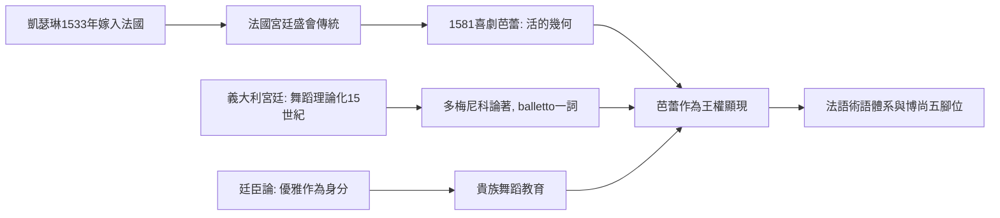

# 3.1 從義大利宮廷到法蘭西：凱瑟琳的引進

時間：15世紀至16世紀末

## 舞蹈成為貴族的必修課

文藝復興的義大利城市（佛羅倫斯、米蘭、費拉拉、威尼斯）是舞蹈重新「升級」的場所。中世紀的村莊舞蹈（圓舞、鏈舞）在15世紀被宮廷改造為一種新的藝術：巴薩丹莎（bassadance，低舞——足不離地的莊重舞步）與其後的Saltarello等高舞。此時出現了音樂史與舞蹈史的雙重突破：約15世紀中葉，多梅尼科·達·皮亞琴察（Domenico da Piacenza，又稱Domenico da Ferrara）寫下《論舞蹈與編舞的藝術》（De arte saltandi et choreas ducendi，約1455年）——這是歐洲現存最早的舞蹈論著，多梅尼科並首次使用ballo/balletto（芭蕾）一詞。他的學生安東尼奧·科納薩諾（Antonio Cornazzano）與古列爾莫·埃布雷奧（Guglielmo Ebreo da Pesaro，猶太裔舞蹈大師）繼續著書立說，描述了舞步術語、舞曲節奏與編舞隊形。

這場「舞蹈理論化」背後的社會動力是：義大利宮廷的社交競爭。舞蹈成為貴族教育的必修（騎士、武器、舞蹈並列），舞會是政治聯姻與外交的舞台；掌握「優雅」就是掌握身分。這與當時的人文主義（恢復古典的身體理想）、繪畫的透視法（空間的幾何化）、以及宮廷禮儀學（卡斯蒂利昂《廷臣論》1528年，把「從容的優雅」sprezzatura列為廷臣素養）共同構成一套新的身體美學：控制、對稱、幾何。舞蹈從村莊的狂歡，變成了宮廷的幾何學。

## 舞會與遊行：凱瑟琳·德·麥地奇的引進

1533年，佛羅倫斯美第奇家族的凱瑟琳（Caterina de' Medici，1519年至1589年）嫁給法王亨利二世。她把義大利宮廷的整套文化——烹飪、香水、禮儀與舞蹈——帶到了法蘭西。法國宮廷原本的舞蹈傳統相對樸素；凱瑟琳作為王后與攝政太后，以大規模的宮廷盛會（fête）建立權威：她的慶典融合了遊行、馬上競技、音樂與舞蹈，規模空前。

舞蹈史上的里程碑是1581年的《喜劇芭蕾》（Ballet Comique de la Reine）：由小提琴家與編舞巴爾薩薩·德·博若瓦（Balthasar de Beaujoyeulx）策劃，在盧浮宮演出，耗資驚人（據記載逾35萬法郎，堪比戰爭開銷），歷時五個多小時，融合歌、舞、戲劇、機械佈景與詩歌，敘述女巫瑟西被音樂與舞蹈馴服的寓言。這是「芭蕾」（ballet）一詞首次正式用於一種綜合宮廷藝術，並明確宣稱「以幾何與和諧制服身體」——舞蹈被定位為王權的顯現：混亂（女巫）被秩序（幾何隊形）馴服，正如法蘭西應被王室馴服（此時正值宗教戰爭，秩序的寓言有明確的政治所指）。博若瓦在獻詞中直言：編舞的幾何之美，勝過繪畫與雕塑，因為它是「活的幾何」。

## 舞步語彙的語言學基礎

16世紀的法國宮廷還留下了一項看不見的遺產：舞蹈術語的法語化。plié（彎）、relevé（升）、jeté（拋）、arabesque（阿拉伯式）——今天全世界芭蕾課堂使用的術語，絕大多數是17世紀法語，這是法國成為芭蕾母國的語言化石。培養術語的教育機構是宮廷的舞蹈教師階層：他們撰寫教本、定義舞步、建立師徒傳承——舞蹈第一次擁有了可以跨國傳播的「文法」。皮埃爾·博尚（Pierre Beauchamp，路易十四的個人舞蹈教師）在17世紀後期確立的五個基本腳位，將在下節登場，成為芭蕾技術體系的基石。

## 一條從義大利到法國、再回到義大利的迴路

有趣的歷史迴路是：芭蕾由義大利貴婦引進法國，由法國王室制度化，數百年後再由義大利舞蹈教師（切凱蒂恩里科·切凱蒂Enrico Cecchetti等）反哺世界芭蕾教育。文化傳播很少是單行道：藝術形式總是在「強勢制度」中獲得標準化，再以標準化形式反向傳播。法國宮廷之所以能完成標準化，靠的是兩個條件：絕對王權的集中資源，以及一位真正熱愛且擅長跳舞的國王——下一節的主角，太陽王路易十四。

