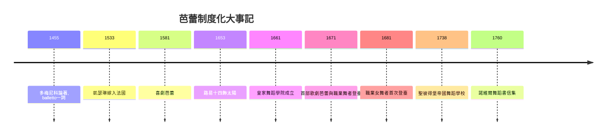

# 3.2 路易十四與皇家舞蹈學院：芭蕾的制度化

時間：1653年至1671年

## 國王親自跳芭蕾

路易十四（1638年至1715年）是一位貨真價實的舞者。他少年時在宮廷舞蹈教師皮埃爾·博尚（Pierre Beauchamp）指導下學舞，1653年15歲時在呂利的《夜之芭蕾》（Ballet Royal de la Nuit）中飾演「太陽」（升起的太陽）——「太陽王」（le Roi Soleil）的稱號由此而來。此後二十年，他在二十多部宮廷芭蕾中擔綱主演，包括1654年《時間之芭蕾》、1660年與弟弟共演的《兵器之芭蕾》。宮廷芭蕾（ballet de cour）不是「演出」，而是「王權的身體展示」：國王親自跳舞，向貴族證明君主在身體、意志與優雅上的絕對優越。

這背後有嚴肅的政治邏輯。法國經歷投石黨之亂（1648–1653，貴族叛亂幾乎推翻王權），路易十四親政後的核心課題是馴服貴族。宮廷芭蕾是手段之一：貴族被邀請（或要求）參與編制繁複的芭蕾，在幾何隊形中扮演指定角色，服從編舞的權威——編舞者就是王權的代理人。同時，凡爾賽宮（1682年朝廷正式遷入）以精密的禮儀（起床儀式、用餐儀式）把貴族困在宮廷，生活即表演，身體即臣服。舞蹈在這個體系中的功能，與「八佾舞」之於周天子遙相呼應：身體的幾何即政治的幾何。

## 1661年：皇家舞蹈學院

1661年，路易十四頒布敕令成立皇家舞蹈學院（Académie Royale de Danse），由宮廷舞蹈教師（以博尚為首的十三人）組成，職責是「恢復舞蹈藝術的本真與完美」——即制定標準、糾正濫用、教學與考核。這是史上第一個由國家設立的舞蹈機構，其意義可與1661年同年的皇家音樂學院（後成為巴黎歌劇院）並列：藝術從此有了「官方標準」。博尚確立的五個基本腳位（feet positions）成為芭蕾技術的公理系統——全世界芭蕾課堂的第一節課，學的就是這五個位置。1671年，第一部正式「歌劇芭蕾」《波莫納》在皇家音樂學院劇院上演；同年皇家舞蹈學院的專業舞者（貴族漸退出，職業舞者取代）首次登臺，芭蕾從「貴族的業餘技藝」轉型為「職業的舞台藝術」。

制度化的深層後果有三。其一，職業化：舞蹈教師與舞者有了國家認可的身分（儘管社會地位仍屬工匠階層——「明星」的崇拜要到19世紀浪漫芭蕾才出現）。其二，技術標準的可傳播性：法語術語＋腳位系統＋學院教材，使芭蕾可以跨國、跨代傳授——這是芭蕾能成為全球技術體系的前提。其三，女舞者的邊緣化（初期）：宮廷芭蕾中女性角色長期由男性反串（路易十四本人也演女角），女性正式登臺要等到1681年《愛情的勝利》（首位職業女舞者瑪德萊娜與拉封丹等登臺），此後女性才逐漸成為芭蕾的核心。

## 從凡爾賽到聖彼得堡的技術遷徙

路易十四時代確立的技術與制度，經由兩條路徑傳播。其一是劇院：巴黎歌劇院（1669年特許成立，學院派系統）培養職業舞者，技術規範經劇場制度化。其二是移民教師：18世紀法國舞蹈教師（如讓-喬治·諾維爾）與俄羅斯的相遇。1738年，法國舞者讓-巴蒂斯特·朗代（Jean-Baptiste Landé）在聖彼得堡創立帝國舞蹈學校（瓦加諾娃學院的前身，首批學生是宮廷侍童）——法國技術＋俄羅斯國家資源的結合，將在19世紀結出巨大的果實：佩蒂帕、柴可夫斯基與古典芭蕾的黃金時代（第四章）。同時，諾維爾1760年的《舞蹈與舞劇書信集》提出「動作啞劇」（ballet d'action）：舞劇應敘事、應有情感邏輯，純裝飾性的舞蹈是「會動的屍體」——這是芭蕾從裝飾走向戲劇的理論轉折，為19世紀的敘事芭蕾（吉賽爾、天鵝湖）鋪路。

## 幾何的身體，制度的身體

回望本章：芭蕾的誕生不是美學事件，而是制度事件。沒有絕對王權的資源、沒有國家學院的標準、沒有宮廷的政治需求，就不會有「五個腳位」與「活的幾何」。這解釋了為什麼芭蕾的技術體系如此「幾何」：對稱、直線、精確的角度——它是宮廷理性主義的身體化，正如凡爾賽花園是數學化的自然。當19世紀的浪漫主義者受不了這種「理性的身體」時，他們的反叛方式將是：讓身體變輕（足尖）、變幽靈（白色紗裙）、變得不可測——下一章的故事。

